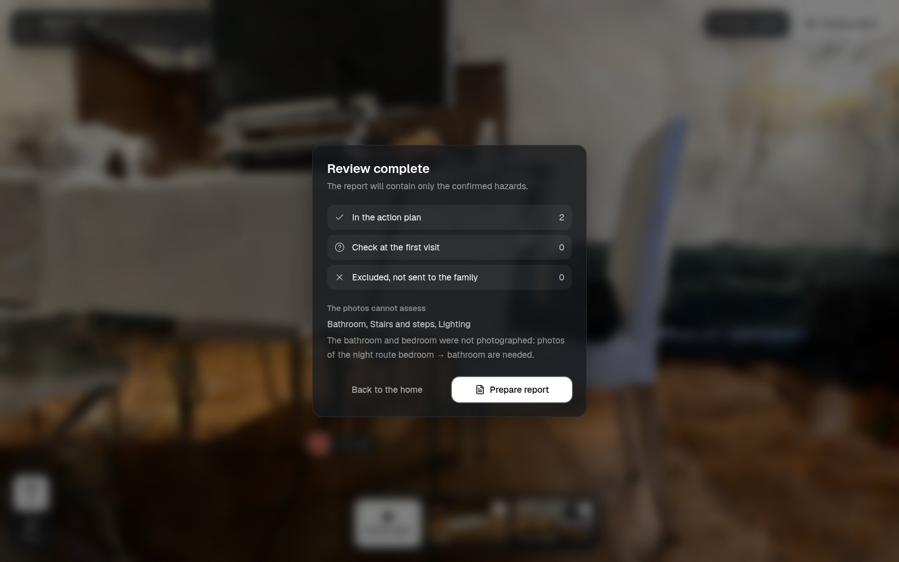
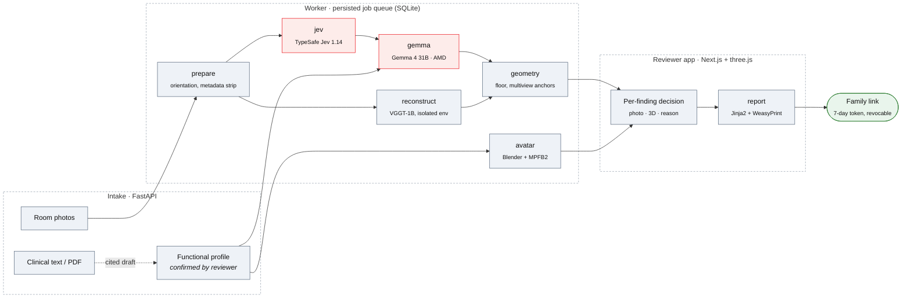
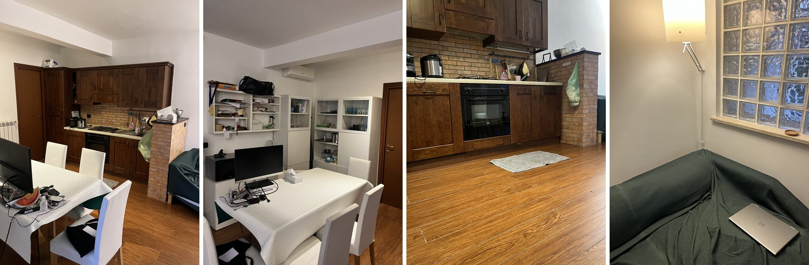
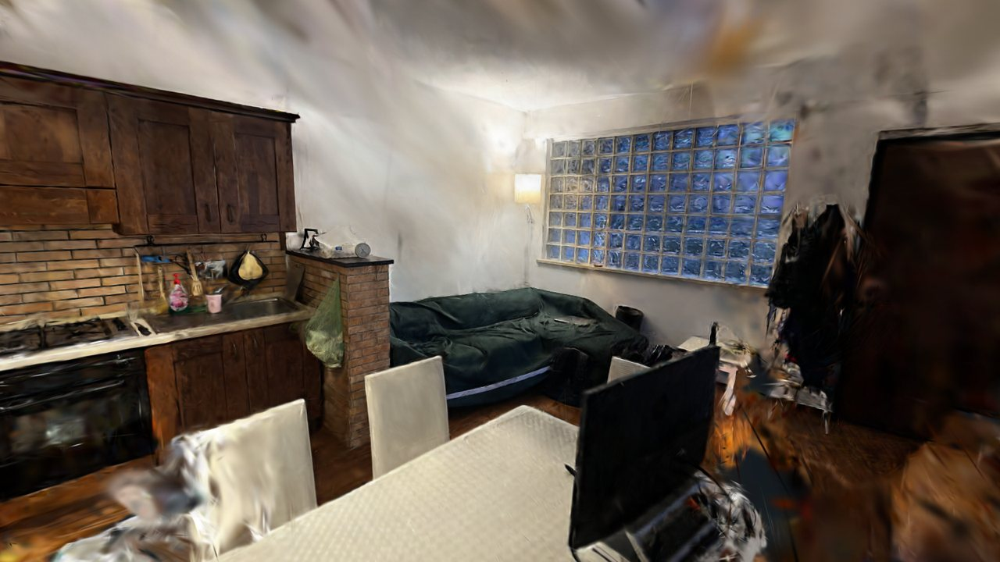
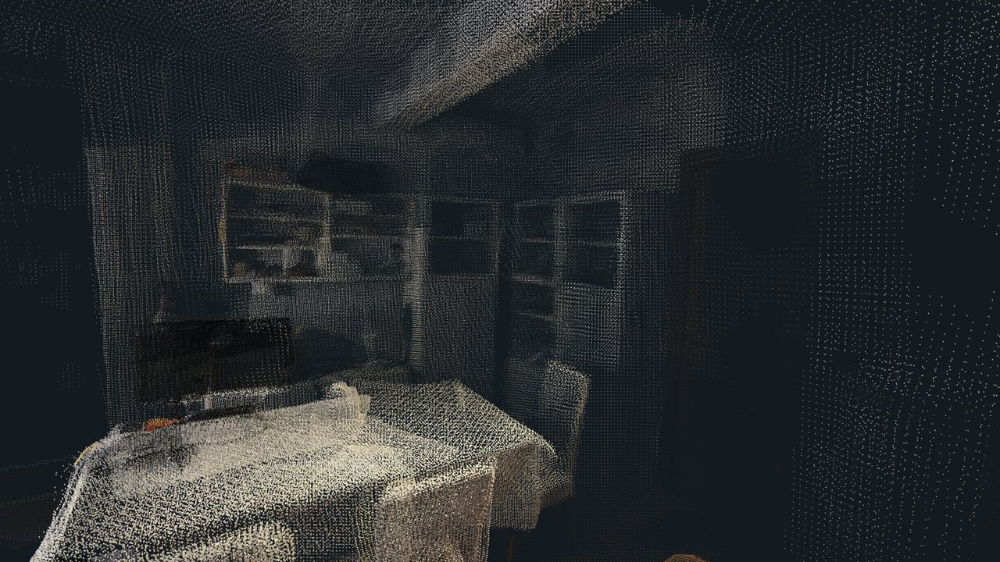

# Step Wise

Remote home fall-hazard assessment from phone photos, reviewed by a healthcare professional before the plan reaches the family.

[](LICENSE)


<sub>The reviewer app on a real room: Gaussian splats reconstructed from 39 phone photos, a hazard pin on the rug and its evidence card. The two hazards in this demo case were marked by hand; see <a href="#try-it">Try it</a>.</sub>

A family member photographs the home room by room. The pipeline proposes candidate hazards, reconstructs the room in 3D and drafts an explanation tailored to the patient's confirmed functional profile (walker, night-time bathroom trips, low vision). A discharge nurse or occupational therapist confirms, edits or excludes each finding against the photo that supports it. Only reviewed findings go into the report, which is shared with the family through a private, expiring link.

Built for the [AMD Developer Hackathon: ACT III](https://lablab.ai/ai-hackathons/amd-developer-hackathon-act-iii), Track 2 (Health & Wellbeing).

**Contents** · [Workflow](#workflow) · [Architecture](#architecture) · [Try it](#try-it) · [AMD deployment](#amd-deployment) · [Model outputs](#model-outputs) · [Evidence and limits](#evidence-and-limits) · [Development](#development) · [Hackathon deck (PDF)](pitch/step-wise-deck.pdf)

### Background

In Italy 54% of falls among people over 65 happen at home, and only 11% of older adults report having been advised by a doctor on how to prevent them ([ISS, PASSI d'Argento 2023–2024](https://www.iss.it/en/-/almeno-una-caduta-nell-ultimo-anno-per-un-anziano-su-cinque-la-casa-e-il-luogo-dove-si-verificano-di-piu)). Expert home-hazard assessment with hazard removal reduces falls by 38% in high-risk older adults ([Cochrane CD013258, 2023](https://www.cochrane.org/evidence/CD013258_reducing-fall-hazards-within-environment)), but Italy has about 3,000 occupational therapists for 14.8 million people over 65 ([FNO TSRM e PSTRP, 2024](https://www.tsrm-pstrp.org/index.php/la-giornata-nazionale-del-terapista-occupazionale-2024/)). Step Wise targets the gap at hospital discharge: the professional reviews the home remotely, from photos, instead of not at all.

---

## Workflow

<table>
<tr>
<td width="50%" valign="top">

<b>1 · Capture.</b> Overlapping phone photos, grouped by room. Uploads are re-oriented, stripped of EXIF/GPS metadata and re-encoded. The reviewer adds or confirms the patient's functional profile, optionally drafted from a clinical document with citations.
</td>
<td width="50%" valign="top">

<b>2 · Analysis.</b> TypeSafe Jev answers fixed object questions (rug, floor cable, bathtub, grab bar…). VGGT-1B recovers cameras, depth and points; Gaussian splats are trained on top. Gemma 4 31B ranks hazards for the confirmed profile. A 3D anchor is kept only when several views agree.
</td>
</tr>
<tr>
<td width="50%" valign="top">

<b>3 · Review.</b> Each finding opens with its photo, its position in the room, the reason and the proposed action. The reviewer chooses <i>Confirm</i>, <i>Edit</i>, <i>Exclude</i> or <i>Check in person</i>. Decisions are versioned.
</td>
<td width="50%" valign="top">

<b>4 · Summary.</b> Confirmed actions, items to verify at the first visit, excluded findings, and the areas the photos cannot assess (here: bathroom and bedroom were not photographed).
</td>
</tr>
<tr>
<td colspan="2">

<b>5 · Release.</b> An HTML/PDF plan built only from reviewed findings. The family link opens the report alone, expires after 7 days and can be revoked. Release is blocked if a review decision changes after the report was drafted.
</td>
</tr>
</table>

The photographs remain the evidence. The 3D view helps the reviewer navigate the room; its scale is not calibrated and it is not a measurement.

---

## Architecture



<sub>Red: external model APIs, called only with the matching consent. Grey: runs locally. Jev never receives the patient profile or clinical text.</sub>

- **Single worker, explicit stage graph.** Stages declare their dependencies; outputs are checksum-verified and reused when inputs have not changed. If one branch fails, independent stages keep their results (`failed_stages` on the job).
- **Isolated GPU runtime.** VGGT runs in a separate Python environment with secrets removed from its environment, so the API process never imports PyTorch.
- **Same-origin frontend.** The Next.js reviewer app is a static export served by FastAPI.
- **Consent-gated egress.** External image and profile processing requires consent; new photos or documents invalidate it.

| Stage | Purpose | Runs on | Recorded evidence |
| --- | --- | --- | --- |
| `prepare` | Upright orientation, metadata stripping, canonical re-encoding | CPU · Pillow | Bounded uploads; EXIF, padding and metadata tests |
| `jev` | Six object question pairs with presence and box gates | TypeSafe Jev 1.14 API | Both rugs and the bathtub localized on the test photos; repeat box IoU 0.94–1.00 |
| `reconstruct` | Poses, depth, point cloud and observed-surface mesh | VGGT-1B · NVIDIA RTX 5090 Laptop | 20 rendered views: 2.67 s forward pass, 9.68 GiB peak memory |
| `gemma` | Full-image hazard sweep, personalized to the confirmed profile | Gemma-4-31B-IT · AMD endpoint | 1 image in 6.29 s, 4 images in 11.00 s (synthetic smoke) |
| `geometry` | Floor and gravity estimate, multiview anchors or abstention | CPU · NumPy | Floor normal error 0.39–0.83° on rendered scenes |
| `avatar` | Illustrative older-adult figure; walker only when confirmed | Blender 4.5.14 · MPFB2 2.0.18 | Rigged GLB in 2.0 s, no clinical text inside |
| `report` | HTML/PDF from reviewed findings only | Jinja2 · WeasyPrint | 8-page long-text PDF inspected without clipping |

Figures come from dated development runs in [runtime evidence](docs/runtime.md); they are not accuracy or clinical claims.

| | |
| --- | --- |
| **Backend** | Python 3.12 · FastAPI · Pydantic 2 · SQLite · Pillow · NumPy · Jinja2 · WeasyPrint |
| **Frontend** | Next.js 16 (static export) · React 19 · TypeScript · Tailwind CSS 4 · three.js |
| **Models** | Gemma-4-31B-IT (AMD endpoint; Hugging Face optional) · TypeSafe Jev 1.14 · VGGT-1B (PyTorch 2.8, BF16) · gsplat 1.5.3 · MPFB2 |
| **Ops** | CPU Docker images with pinned base digests · single-container demo · ROCm Compose override (configuration-validated only) |

---

## Try it

### Judge demo · one command, no keys

```bash
docker compose -f compose.demo.yaml up --build
```

Open <http://localhost:8000>. You open the demo case (Maria R., a fictional 84-year-old patient) and walk the professional's part of the flow: **review each hazard → prepare the report → release it to the family**. Every visitor gets a private copy of the same frozen, pre-analysed case, so nothing calls an external model. The same image deploys to Render through [`render.yaml`](render.yaml).

> [!IMPORTANT]
> The bundled case is a **real room**: 8 of the 39 phone photos and the offline VGGT + Gaussian-splat reconstruction. Its two hazards were **marked by hand by the team**, not detected by a model, and every finding says so. It demonstrates the review workflow on a real 3D room, not detection or clinical accuracy.

<details>
<summary><b>Full local setup (fixture pipeline, API + worker)</b></summary>

<br>

| Tool | Version | Why |
| --- | --- | --- |
| Python | 3.12.3 | Backend runtime (pinned in `requirements.lock`) |
| Node.js | 22.22.3 | Builds the reviewer app |
| Pango, HarfBuzz, DejaVu fonts | see [`Dockerfile.worker`](Dockerfile.worker) | PDF rendering |
| Blender + MPFB2 | 4.5.14 / 2.0.18 | Optional: live avatar (`AVATAR_BACKEND`) |
| CUDA GPU + VGGT runtime | PyTorch 2.8, checksum-verified checkpoint | Optional: live reconstruction (`RECON_BACKEND=vggt`) |

**1. Install**

```bash
python3 -m venv .venv
.venv/bin/pip install -r requirements.lock
.venv/bin/pip install --no-deps -e .
npm --prefix frontend ci
npm --prefix frontend run build
```

**2. Configure the fixture backends** in both the API and the worker terminal. The separate data directory keeps the demo apart from existing assessments. Fixture findings and geometry are fixed controls, even when you upload arbitrary photos.

```bash
export STEP_WISE_DATA="$PWD/data/fixture-demo"
export STEP_WISE_DATABASE="$STEP_WISE_DATA/assessment.sqlite3"
export RECON_BACKEND=fixture GEMMA_BACKEND=fixture AVATAR_BACKEND=fixture JEV_ENABLED=false
```

**3. Initialize and generate the synthetic upload images**

```bash
.venv/bin/python -m step_wise.cli init
.venv/bin/python -m step_wise.cli seed-controls
```

**4. Start the API and the worker**

```bash
# terminal 1
.venv/bin/uvicorn step_wise.api:create_app --factory --host 127.0.0.1 --port 8000 --no-access-log

# terminal 2, same settings
.venv/bin/python -m step_wise.worker
```

**5. Walk the flow** at <http://localhost:8000>:

1. **New patient** → fill in a fictional profile under **Mobility and needs**.
2. Upload `data/demo/synthetic-1.png` and `synthetic-2.png` to one room as **Overview**.
3. **Start analysis** and follow the stage status.
4. Open the room; each pin and photo box opens its evidence card. Confirm, dismiss or flag, and edit the action if needed.
5. **Prepare report** → check the HTML/PDF → **Review and release** → **Release**. **Revoke link** disables it.

For hot reload and the `/api` proxy, see the [frontend README](frontend/README.md). The fixture demo needs no keys.

> [!WARNING]
> The reviewer API has no login. Keep it on loopback unless an external access-control layer is in place.

</details>

<details>
<summary><b>Live models: Gemma on AMD, Jev, VGGT</b></summary>

<br>

The Python app loads a local `.env`; already-exported variables take precedence. Set `RECON_BACKEND`, `GEMMA_BACKEND`, `JEV_ENABLED` and `AVATAR_BACKEND` explicitly, and restart the API and worker together after changing them. A worker with a different configuration refuses a queued attempt. All settings are documented in [`.env.example`](.env.example). Keys are read server-side and never sent to the browser.

| Variable | Used for |
| --- | --- |
| `GEMMA_API_KEY` | AMD hosted endpoint or another OpenAI-compatible Gemma endpoint |
| `JEV_API_KEY` | TypeSafe Jev, when `JEV_ENABLED=true` |
| `HF_TOKEN` | Only when `GEMMA_BASE_URL` is the Hugging Face router |

- **Gemma on AMD:** `GEMMA_BASE_URL=https://developer.amd.com.cn/radeon/api/v1`, `GEMMA_MODEL=Gemma-4-31B-IT`, `GEMMA_PROVIDER=amd`.
- **Gemma on Hugging Face (optional):** `GEMMA_BASE_URL=https://router.huggingface.co/v1`, `HF_TOKEN` and an explicit `GEMMA_PROVIDER`. Only this router appends `:provider` to the model name.
- **VGGT:** requires an explicitly installed runtime, the pinned source commit and a checksum-verified local checkpoint. Weights are never downloaded implicitly.
- **Consent:** external image and profile processing is consent-gated; new photos or documents invalidate the matching consent.

Send one generated, non-clinical test image to the configured Gemma endpoint:

```bash
.venv/bin/python scripts/smoke_gemma.py
```

</details>

---

## AMD deployment

Home photos and clinical data should not leave the hospital network. A single **AMD Instinct MI300X** (192 GB HBM3) has room for both the reconstruction model and the reasoning model, so the target is one on-premise GPU running the whole pipeline on ROCm.

| Status | |
| --- | --- |
| **Working today** | `Gemma-4-31B-IT` on AMD's OpenAI-compatible endpoint is the configured model for the hazard sweep and report drafting. Authenticated model discovery and image/strict-JSON smokes passed: 1 image in 6.29 s, 4 images in 11.00 s. |
| **Target** | One MI300X on-premise: VGGT on PyTorch-ROCm and Gemma on vLLM-ROCm, one job at a time. [`compose.rocm.yaml`](compose.rocm.yaml) and [`Dockerfile.worker.rocm`](Dockerfile.worker.rocm) describe that worker. |
| **Not yet established** | A complete room analysis through the AMD endpoint, any self-hosted ROCm run (the override has only passed configuration validation), and MI300X latency, memory and cost figures. VGGT currently runs on an NVIDIA RTX 5090 Laptop GPU. |

---

## Model outputs

### Reconstruction of a real room



<table>
<tr>
<td width="50%"></td>
<td width="50%"></td>
</tr>
</table>

Input: 39 phone photos of an open-plan kitchen and living room (four shown above), EXIF/GPS-free, processed locally. VGGT-1B recovered cameras, depth and points for all 39 views; [gsplat](https://github.com/nerfstudio-project/gsplat) 1.5.3 then trained 757,792 Gaussians in 9,000 steps (412 s, 2.2 GB peak GPU memory). Floor and ceiling Gaussians are flattened onto fitted planes (RMS distance to the plane down about 65%, in relative units); colours are untouched and no holes are filled. The scale is not calibrated. The demo streams a 20 MB compressed copy (`.ksplat`, 651,321 Gaussians). Details in [capture reconstruction](docs/capture-reconstruction.md).

### Object checks and avatar

<table>
<tr>
<td width="42%" valign="top">

<sub><b>Jev · corridor.</b> Live <code>jev-1.14.0</code> call, 17 Oct 2026. Nearest rug: presence 0.99, box 0.70. Farther rug: presence 0.95, box 0.91. The footstool stayed below the presence gate (0.42) and is withheld. Photo: Thomas Würth / Unsplash.</sub>
</td>
<td width="42%" valign="top">

<sub><b>Jev · bathroom.</b> Bathtub: presence 0.97, box 0.84. Locating it is separate from deciding it is a hazard; that belongs to Gemma and the reviewer. Nothing is boxed as a "missing grab bar". Photo: Point3D Commercial Imaging Ltd. / Unsplash.</sub>
</td>
<td width="16%" valign="top">

<sub><b>Avatar.</b> Generated headlessly with Blender + MPFB2. The walker appears only when the reviewer confirms one.</sub>
</td>
</tr>
</table>

A repeated run on the same photos matched closely (box IoU 0.94–1.00): a consistency check on two images, not accuracy validation. The [before/after comparison](pitch/jev-results/2026-10-17/optimization/index.html) keeps the original open-ended prompt, which boxed a wall painting instead of the rug. Gates (presence ≥ 0.75, box ≥ 0.50) are provisional and uncalibrated.

---

## Evidence and limits

**Verified.** The full intake → analysis → review → PDF → release → revocation lifecycle in fixture mode and in a headless browser · a live four-screenshot run (local VGGT, Jev, Gemma via Hugging Face, MPFB2 avatar, unreleased Gemma-drafted PDF) · a five-photo real-room analysis with four provisional findings · VGGT resource scaling to 20 views · AMD-hosted Gemma vision/strict-JSON smokes.

**Not yet established.** A guided, independently measured room capture · real-room centimetre accuracy · validated 3D hazard anchors on real scenes · a full analysis through the AMD endpoint · self-hosted ROCm · clinical accuracy, fall reduction or reviewer-time benefit.

Run IDs, dates and open gates are in [runtime evidence](docs/runtime.md).

---

## Development

<details>
<summary><b>Development and checks</b></summary>

<br>

```bash
.venv/bin/python -m unittest discover -s tests
.venv/bin/python eval/jev/evaluate.py self-check
npm --prefix frontend run typecheck
npm --prefix frontend run lint
npm --prefix frontend run build
```

With the fixture API and worker running, the HTTP smoke test exercises simulated review, report release, stale-release protection and family-link access on a separate synthetic assessment:

```bash
.venv/bin/python scripts/smoke_e2e.py --mode fixture --base-url http://localhost:8000
```

Optional headless UI check:

```bash
.venv/bin/pip install playwright
.venv/bin/python -m playwright install chromium
.venv/bin/python scripts/browser_smoke.py --base-url http://localhost:8000
```

Reproducible case runs and cleanup (cleanup is a dry run unless explicitly executed; stop the ordinary worker first, it holds a shared lock):

```bash
.venv/bin/python -m step_wise.cli case run demo/cases/room-001.json --mode fixture
.venv/bin/python -m step_wise.cli case check --run RUN_ID
.venv/bin/python -m step_wise.cli cleanup --older-than-days 30
```

Exit code `4` from `case check` means manual checks remain pending, not an execution failure.

</details>

<details>
<summary><b>Real photos: the Monolocale study</b></summary>

<br>

The **Monolocale WhatsApp** study starts from five real photos and VGGT geometry. Its optional `photo_completed` presentation keeps the photographic textures and adds manually fitted floor, walls, ceiling and selected furniture, window and door surfaces. **Completed reconstruction** and **Original surfaces** switch between the completion and the captured surfaces.

Missing surfaces are inferred: completion creates no validated hazard anchors or measurements, and the original photos and raw reconstruction stay available. To add photos, upload **12–20 overlapping overviews in total** to the exact existing room label (**Soggiorno**) as **Overview**, then re-run the analysis; `VGGT_FRAME_CAP` (default 20) is checked before queueing, and nothing is silently dropped. Adding photos invalidates the analysis, review, calibration and manual completion. The [completion script](scripts/complete_monolocale.py) is authored for the original five-image set; attach new output with [`attach_room_presentation.py`](scripts/attach_room_presentation.py), which checks it against the current revision and source hashes.

</details>

<details>
<summary><b>API surface</b></summary>

<br>

| Method | Path | Purpose |
| --- | --- | --- |
| `GET` | `/api/health` | Liveness probe |
| `POST` · `GET` | `/api/assessments` | Create or list assessments |
| `GET` · `PATCH` · `DELETE` | `/api/assessments/{id}` | Read, update or delete one assessment |
| `POST` | `/api/assessments/{id}/photos` | Upload a room photo (overview or detail) |
| `POST` | `/api/assessments/{id}/clinical-documents` | Upload a clinical text or PDF |
| `POST` · `PUT` | `/api/assessments/{id}/profile/draft` · `/profile/confirm` | Draft and confirm the cited functional profile |
| `POST` | `/api/assessments/{id}/analyze` | Queue the analysis |
| `GET` | `/api/jobs/{id}` | Job status, stages and `failed_stages` |
| `GET` | `/api/assessments/{id}/bundle` | Versioned bundle: findings, rooms, geometry, avatar |
| `PUT` | `/api/assessments/{id}/reviews/{hazard_id}` | Record a review decision |
| `PUT` · `DELETE` | `/api/assessments/{id}/scenes/{scene_id}/calibration` | Set or clear metric calibration |
| `PUT` · `DELETE` | `/api/assessments/{id}/scene-links/{from}/{to}` | Confirm or remove a room link |
| `POST` | `/api/assessments/{id}/reports` | Draft a report from reviewed findings |
| `POST` | `/api/reports/{id}/release` · `/revoke` | Release to the family or revoke the link |
| `GET` | `/api/family/{token}` | Family view of the released report |
| `GET` · `POST` | `/api/demo` · `/api/demo/session` | Judge demo: case summary and a private visitor copy |

</details>

<details>
<summary><b>Project structure</b></summary>

<br>

```
amd-hack/
├── backend/src/step_wise/
│   ├── api.py                   # FastAPI routes: intake, jobs, review, reports, family links, demo
│   ├── worker.py                # Persisted queue, seven-stage pipeline, checksum-verified reuse
│   ├── snapshot.py              # Judge demo: frozen case, private copy per visitor
│   ├── db.py · schema.sql       # SQLite storage and schema upgrades
│   ├── models.py                # Versioned AssessmentBundle and public DTOs
│   ├── validation.py            # Checks model findings against photos, scenes and profile
│   ├── cli.py · cases.py        # init, seed-controls, cleanup, reproducible case runs
│   ├── pipeline/
│   │   ├── photos.py            # Upright, metadata-free canonical photos and box transforms
│   │   ├── jev.py               # TypeSafe Jev object checks and evidence gates
│   │   ├── gemma.py · http.py   # OpenAI-compatible Gemma client, bounded streaming parser
│   │   ├── reconstruction.py    # VGGT dispatch, point cloud and observed-surface mesh
│   │   ├── vggt_worker.py       # Isolated GPU subprocess
│   │   ├── geometry.py          # Floor estimate, multiview anchors, photo-surface markers
│   │   ├── calibration.py       # Metric scale from tape measurements, with holdout check
│   │   ├── registration.py      # Reviewer-confirmed links between rooms
│   │   ├── clinical.py          # Clinical document intake and cited profile drafts
│   │   ├── avatar*.py           # Blender/MPFB2 avatar generation
│   │   └── reports.py           # Report drafting and release
│   ├── prompts/                 # Gemma and Jev prompts
│   └── templates/report.html    # HTML/PDF report template
├── frontend/src/
│   ├── app/                     # Patient list, intake, patient space
│   ├── components/              # PatientSpace, ReleaseDialog, space/ (3D viewers, cards)
│   └── lib/                     # API client, types, labels
├── frontend/public/capture-data/ # Compressed room splats and cameras for the 3D room view
├── scripts/                     # Smoke tests, capture reconstruction, Monolocale completion (archive/: one-offs)
├── tests/                       # Python unittest suite
├── eval/jev/                    # Jev evaluation harness and historical results
├── demo/                        # Fixture cases, judge-demo snapshot, capture photos, dated artifacts
├── docs/                        # Runtime evidence, capture reconstruction, product blueprint (archive/: old plans)
└── pitch/                       # Pitch site, source captures, Jev results
```

</details>

---

## Team

<table>
<tr>
<td align="center"><a href="https://github.com/jacopopper"><br><b>@jacopopper</b></a></td>
<td align="center"><a href="https://github.com/davideblesse"><br><b>@davideblesse</b></a></td>
</tr>
</table>

## License

Code is released under the [MIT License](LICENSE). Third-party material keeps its own terms: pitch and evaluation photos from Unsplash are credited where they appear, source captures under `pitch/assets/sources/` belong to their publishers, the avatar uses a CC0 MPFB2 asset pack, and the VGGT-1B research checkpoint (non-commercial, not distributed here) must be obtained separately.

> [!CAUTION]
> Step Wise is a hackathon prototype. It is not a medical device, has no clinical validation, and must not be used for real patient intake. Use staged homes and fictional profiles.
