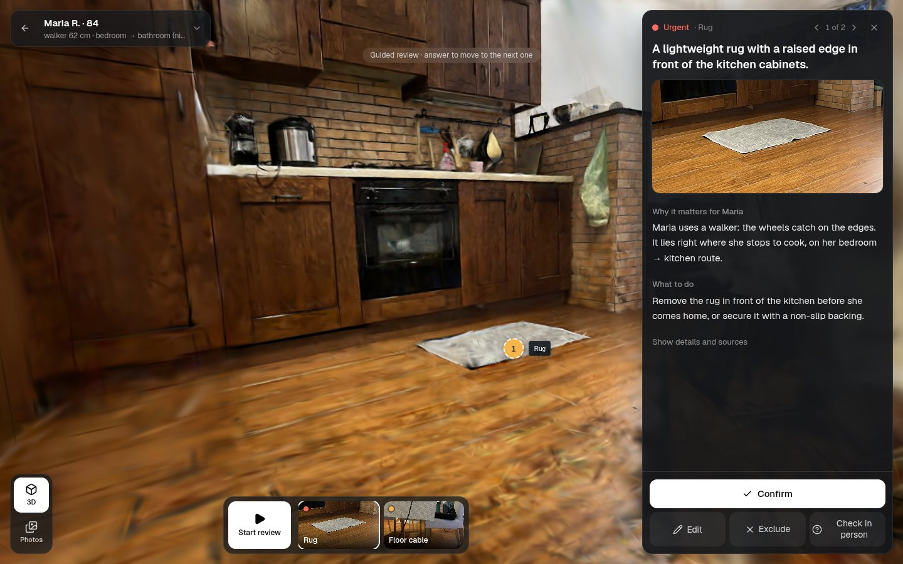
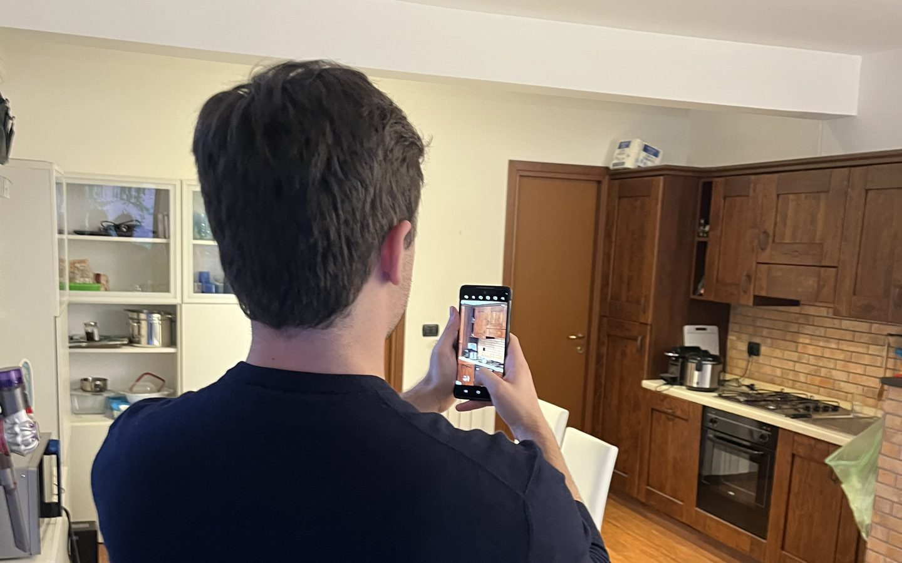
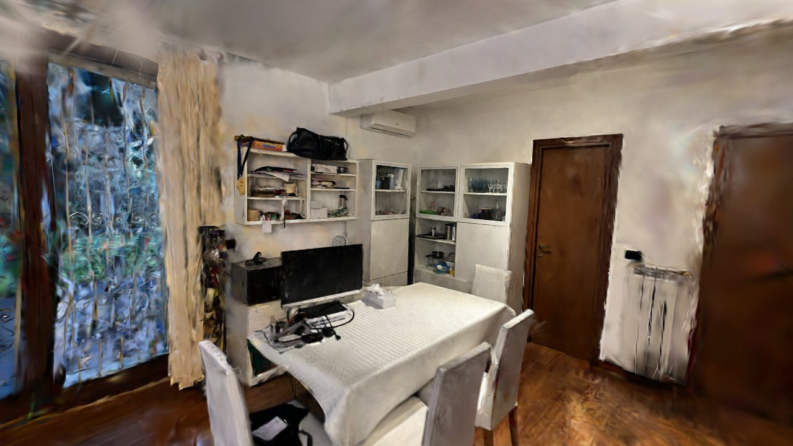
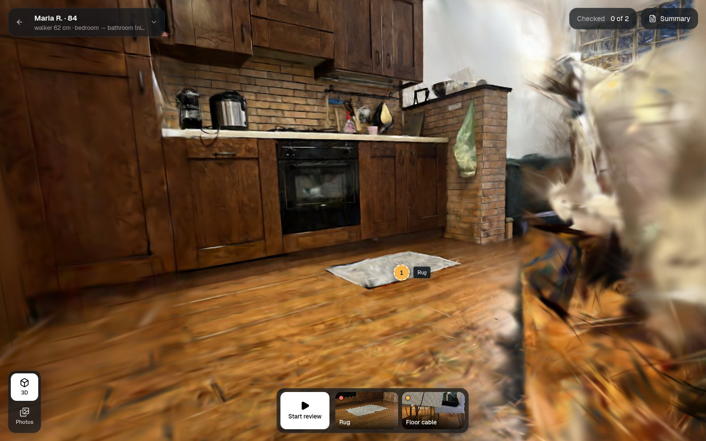
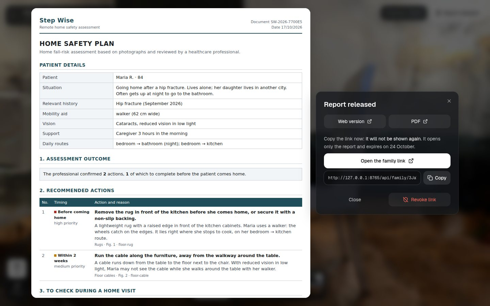
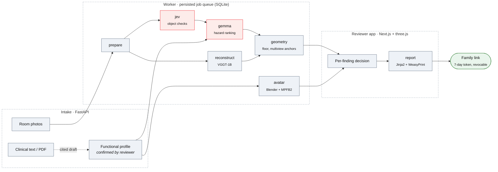

# Step Wise

Step Wise helps a discharge nurse or occupational therapist check a patient's home for fall hazards remotely, using phone photos taken by the family. A model pipeline proposes candidate hazards and rebuilds the room in 3D. The professional confirms, edits or rejects each one, and only reviewed findings reach the family's safety plan.



> [!CAUTION]
> Research prototype built in a hackathon. It is not a medical device and has no clinical validation. Use staged homes and fictional patients only.

## Why

Most falls among older adults happen at home. An expert home assessment, followed by removing the hazards it finds, reduces falls by 38% in high-risk patients ([Cochrane CD013258, 2023](https://www.cochrane.org/evidence/CD013258_reducing-fall-hazards-within-environment)). Few patients get one: Italy has roughly 3,000 occupational therapists for 14.8 million people over 65 ([FNO TSRM e PSTRP, 2024](https://www.tsrm-pstrp.org/index.php/la-giornata-nazionale-del-terapista-occupazionale-2024/)). Step Wise targets the moment of hospital discharge, when a remote review from photos is better than no review at all.

## How it works

<table>
<tr>
<td width="50%" valign="top">

<b>1 · Capture.</b> The family photographs each room with overlapping shots. Uploads are re-oriented, stripped of EXIF/GPS and re-encoded. The reviewer confirms the patient's functional profile (walker, night-time bathroom trips, low vision…), which can be drafted from a clinical document with citations.
</td>
<td width="50%" valign="top">

<b>2 · Analysis.</b> An object detector checks for known items (rugs, floor cables, bathtubs, grab bars). VGGT recovers cameras and depth, and Gaussian splats are trained on top. Gemma ranks the hazards against the confirmed profile. A 3D anchor is kept only when several views agree.
</td>
</tr>
<tr>
<td width="50%" valign="top">

<b>3 · Review.</b> Each finding shows its photo, its place in the room, the reason and a proposed action. The reviewer can <i>Confirm</i>, <i>Edit</i>, <i>Exclude</i> or mark it <i>Check in person</i>. Every decision is versioned.
</td>
<td width="50%" valign="top">

<b>4 · Release.</b> The HTML/PDF plan is built only from reviewed findings and lists the areas the photos could not cover. The family gets a link that opens only the report, expires after 7 days and can be revoked.
</td>
</tr>
</table>

The photos are the evidence. The 3D view is for orientation: its scale is not calibrated, so it cannot be used for measurements.

## Quick start

The demo needs no API keys and makes no external model calls:

```bash
docker compose -f compose.demo.yaml up --build
```

Open <http://localhost:8000> and follow the reviewer's part of the flow on a fictional patient, Maria R., 84: **review the hazards → prepare the report → release it to the family**. Each visitor gets a private copy of the same pre-analysed case. The same image deploys to Render through [`render.yaml`](render.yaml).

The demo room is real: 39 phone photos reconstructed offline with VGGT and Gaussian splats. Its two hazards were flagged by **live TypeSafe Jev 1.14 runs** on the case photos, with the raw responses committed under [`pitch/jev-results/2026-10-17/room-capture/`](pitch/jev-results/2026-10-17/room-capture/README.md): the rug cleared the automatic localization gate (presence 0.98, box 0.88), while the cable was flagged on presence (0.78) and kept as a reviewer-confirmed approximate pin because its box scored below the localization gate. Every finding carries its scores and points at its record. The demo shows the review workflow; it says nothing about detection accuracy.

## Architecture



<sub>Red: external model APIs, called only after the matching consent. Grey: local.</sub>

| Stage | What it does | Model / library |
| --- | --- | --- |
| `prepare` | Upright orientation, metadata stripping, canonical re-encoding | Pillow |
| `jev` | Asks fixed yes/no object questions per photo and returns boxes that pass presence and localization gates | TypeSafe Jev 1.14 (API) |
| `reconstruct` | Camera poses, depth, point cloud and observed-surface mesh | [VGGT-1B](https://github.com/facebookresearch/vggt), in an isolated PyTorch env |
| `gemma` | Full-image hazard sweep, written for the confirmed profile | Gemma-4-31B-IT, OpenAI-compatible endpoint |
| `geometry` | Floor and gravity estimate; places a 3D anchor only when several views agree, otherwise abstains | NumPy |
| `avatar` | Illustrative figure of the patient, with a walker only if one is confirmed | Blender 4.5 + MPFB2 |
| `report` | HTML/PDF plan from reviewed findings only | Jinja2 + WeasyPrint |

Design choices:

- **One worker with an explicit stage graph.** Stages declare their dependencies. Outputs are checksum-verified and reused when their inputs have not changed. If one branch fails, the independent stages keep their results (`failed_stages` on the job).
- **GPU code runs in its own process.** VGGT runs in a separate Python environment with secrets stripped from it, so the API never imports PyTorch.
- **Consent-gated egress.** Photos and the profile go to an external model only with consent, and new photos or documents invalidate that consent. Jev never receives the profile or the clinical text.
- **Stale releases are blocked.** If a review decision changes after the report was drafted, the report cannot be released.
- **Same origin.** The reviewer app is a static Next.js export served by FastAPI.

**Stack:** Python 3.12, FastAPI, Pydantic 2, SQLite · Next.js 16, React 19, TypeScript, Tailwind 4, three.js · PyTorch 2.8, gsplat 1.5.3 · Docker.

## Running on AMD

Home photos and clinical data should stay inside the hospital network. The deployment target is a single **AMD Instinct MI300X** (192 GB HBM3) on-premise. Its memory is large enough for both VGGT (PyTorch on ROCm) and Gemma 4 31B (vLLM on ROCm), processing one job at a time. [`compose.rocm.yaml`](compose.rocm.yaml) and [`Dockerfile.worker.rocm`](Dockerfile.worker.rocm) describe that worker.

Today Gemma is called through AMD's hosted OpenAI-compatible endpoint (`Gemma-4-31B-IT`), and VGGT runs on a local NVIDIA GPU. The ROCm override has passed configuration validation but has not been run on AMD hardware yet.

## Development

<details>
<summary><b>Local setup with fixture models</b></summary>

<br>

Requires Python 3.12 and Node.js 22. Rendering the PDF also needs Pango, HarfBuzz and DejaVu fonts (see [`Dockerfile.worker`](Dockerfile.worker)).

```bash
python3 -m venv .venv
.venv/bin/pip install -r requirements.lock
.venv/bin/pip install --no-deps -e .
npm --prefix frontend ci
npm --prefix frontend run build
```

Fixture backends return fixed findings and geometry, whatever photos you upload. Export these in both terminals:

```bash
export STEP_WISE_DATA="$PWD/data/fixture-demo"
export STEP_WISE_DATABASE="$STEP_WISE_DATA/assessment.sqlite3"
export RECON_BACKEND=fixture GEMMA_BACKEND=fixture AVATAR_BACKEND=fixture JEV_ENABLED=false

.venv/bin/python -m step_wise.cli init
.venv/bin/python -m step_wise.cli seed-controls   # writes data/demo/synthetic-*.png
```

```bash
# terminal 1
.venv/bin/uvicorn step_wise.api:create_app --factory --host 127.0.0.1 --port 8000 --no-access-log
# terminal 2
.venv/bin/python -m step_wise.worker
```

At <http://localhost:8000>, create a patient, upload `data/demo/synthetic-1.png` and `synthetic-2.png` to one room as **Overview**, then start the analysis, review, prepare the report and release it. For hot reload, see the [frontend README](frontend/README.md).

> [!WARNING]
> The reviewer API has no login. Keep it on loopback unless an external access-control layer is in place.

</details>

<details>
<summary><b>Live models</b></summary>

<br>

Settings are read from `.env` (exported variables take precedence); all of them are documented in [`.env.example`](.env.example). Set `RECON_BACKEND`, `GEMMA_BACKEND`, `JEV_ENABLED` and `AVATAR_BACKEND` explicitly, and restart the API and worker together after changing them. A worker with a different configuration refuses queued jobs. Keys stay server-side.

| Variable | Used for |
| --- | --- |
| `GEMMA_API_KEY` | AMD hosted endpoint or any OpenAI-compatible Gemma endpoint |
| `JEV_API_KEY` | TypeSafe Jev, when `JEV_ENABLED=true` |
| `HF_TOKEN` | Only when `GEMMA_BASE_URL` is the Hugging Face router |

- **Gemma on AMD:** `GEMMA_BASE_URL=https://developer.amd.com.cn/radeon/api/v1`, `GEMMA_MODEL=Gemma-4-31B-IT`, `GEMMA_PROVIDER=amd`.
- **Gemma on Hugging Face:** `GEMMA_BASE_URL=https://router.huggingface.co/v1`, `HF_TOKEN` and an explicit `GEMMA_PROVIDER`.
- **VGGT** (`RECON_BACKEND=vggt`): needs a separately installed runtime (`VGGT_PYTHON`), the pinned source commit and a checksum-verified local checkpoint. Weights are never downloaded automatically.
- **Avatar** (`AVATAR_BACKEND`): needs Blender 4.5 with MPFB2 2.0.

Send one generated, non-clinical test image to the configured Gemma endpoint:

```bash
.venv/bin/python scripts/smoke_gemma.py
```

</details>

<details>
<summary><b>Tests and checks</b></summary>

<br>

```bash
.venv/bin/python -m unittest discover -s tests
.venv/bin/python eval/jev/evaluate.py self-check
npm --prefix frontend run typecheck
npm --prefix frontend run lint
```

With the fixture API and worker running:

```bash
.venv/bin/python scripts/smoke_e2e.py --mode fixture --base-url http://localhost:8000
.venv/bin/python scripts/browser_smoke.py --base-url http://localhost:8000   # needs playwright + chromium
```

Reproducible case runs and data cleanup (stop the normal worker first; cleanup is a dry run without `--execute`):

```bash
.venv/bin/python -m step_wise.cli case run demo/cases/room-001.json --mode fixture
.venv/bin/python -m step_wise.cli case check --run RUN_ID   # exit 4 = manual checks pending
.venv/bin/python -m step_wise.cli cleanup --older-than-days 30
```

</details>

<details>
<summary><b>API</b></summary>

<br>

| Method | Path | Purpose |
| --- | --- | --- |
| `GET` | `/api/health` | Liveness probe |
| `POST` · `GET` | `/api/assessments` | Create or list assessments |
| `GET` · `PATCH` · `DELETE` | `/api/assessments/{id}` | Read, update or delete one assessment |
| `POST` | `/api/assessments/{id}/photos` | Upload a room photo (overview or detail) |
| `POST` | `/api/assessments/{id}/clinical-documents` | Upload a clinical text or PDF |
| `POST` · `PUT` | `/api/assessments/{id}/profile/draft` · `/profile/confirm` | Draft and confirm the cited functional profile |
| `POST` | `/api/assessments/{id}/analyze` | Queue the analysis |
| `GET` | `/api/jobs/{id}` | Job status, stages and `failed_stages` |
| `GET` | `/api/assessments/{id}/bundle` | Versioned bundle: findings, rooms, geometry, avatar |
| `PUT` | `/api/assessments/{id}/reviews/{hazard_id}` | Record a review decision |
| `PUT` · `DELETE` | `/api/assessments/{id}/scenes/{scene_id}/calibration` | Set or clear metric calibration |
| `PUT` · `DELETE` | `/api/assessments/{id}/scene-links/{from}/{to}` | Confirm or remove a link between rooms |
| `POST` | `/api/assessments/{id}/reports` | Draft a report from reviewed findings |
| `POST` | `/api/reports/{id}/release` · `/revoke` | Release to the family or revoke the link |
| `GET` | `/api/family/{token}` | Family view of the released report |
| `GET` · `POST` | `/api/demo` · `/api/demo/session` | Demo case summary and a private visitor copy |

</details>

<details>
<summary><b>Repository layout</b></summary>

<br>

```
backend/src/step_wise/
  api.py                 FastAPI routes
  worker.py              Persisted queue and stage graph
  snapshot.py            Frozen demo case, one private copy per visitor
  validation.py          Checks model findings against photos, scenes and profile
  pipeline/              photos, jev, gemma, reconstruction (+ vggt_worker), geometry,
                         calibration, registration, clinical, avatar, reports
  prompts/               Gemma and Jev prompts
  templates/report.html  Report template
frontend/                Next.js reviewer app
scripts/                 Smoke tests and capture reconstruction tools
tests/                   Python unittest suite
eval/jev/                Jev evaluation harness
demo/                    Fixture cases, demo snapshot, capture photos
docs/                    Runtime evidence, capture reconstruction, product notes
pitch/                   Hackathon slides and video
```

</details>

## Status

**Works end to end:** intake → analysis → review → PDF → release → revocation, in fixture mode and in a headless browser. It also ran with live models (local VGGT, Jev, Gemma, MPFB2 avatar) on a few real photo sets, and the AMD-hosted Gemma endpoint passed vision and strict-JSON smoke tests.

**Not established yet:** detection accuracy, metric accuracy of the 3D anchors on real rooms, a full analysis through the AMD endpoint, self-hosted ROCm, and any clinical benefit. Detection thresholds are provisional and uncalibrated.

Dated runs, timings and open gates are recorded in [docs/runtime.md](docs/runtime.md). The reconstruction of the demo room is described in [docs/capture-reconstruction.md](docs/capture-reconstruction.md).

## About

Built by [@jacopopper](https://github.com/jacopopper) and [@davideblesse](https://github.com/davideblesse) for the [AMD Developer Hackathon: ACT III](https://lablab.ai/ai-hackathons/amd-developer-hackathon-act-iii), Track 2 (Health & Wellbeing). The slides and video are in [`pitch/`](pitch/step-wise-deck.pdf).

Code is [MIT](LICENSE)-licensed. Third-party material keeps its own terms: Unsplash photos are credited where they appear, the source captures in `pitch/assets/sources/` belong to their publishers, and the avatar uses a CC0 MPFB2 asset pack. The VGGT-1B checkpoint is non-commercial, is not distributed here, and has to be obtained separately.
