<div align="center">

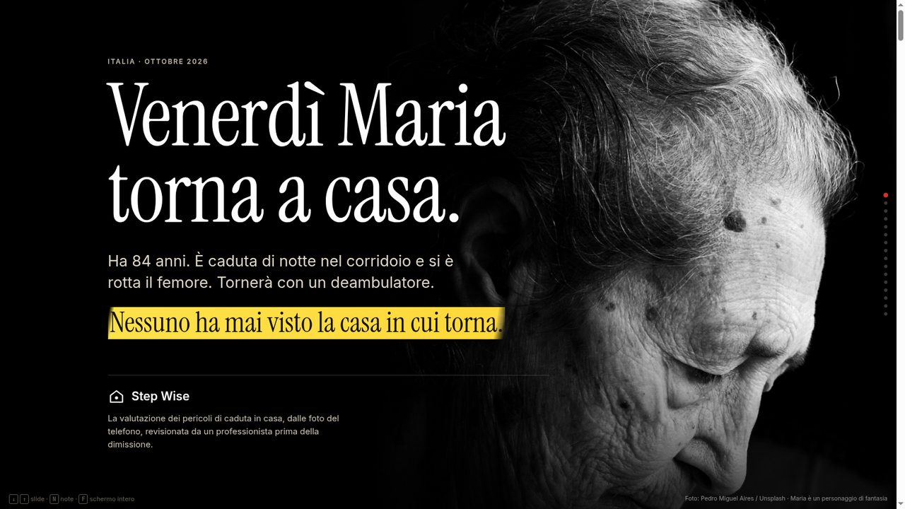

# Step Wise

### Home fall-hazard review from phone photos, checked by a professional before discharge.

[](https://lablab.ai/ai-hackathons/amd-developer-hackathon-act-iii)
[](https://lablab.ai/ai-hackathons/amd-developer-hackathon-act-iii)
[](#why-amd)
[](LICENSE)

**[Pitch](pitch/index.html)** · **[Try the demo](#try-it)** · **[How it works](#how-it-works)** · **[Why AMD](#why-amd)** · **[Runtime evidence](docs/runtime.md)**

</div>

---

## Venerdì Maria torna a casa.

Maria is 84. She fell in her hallway at night and broke her hip. On Friday she goes home with a walker.

**Nobody on her care team has ever seen that hallway.**

Step Wise changes that. Her grandson photographs the home with his phone. Three AI models turn those photos into hazards, a 3D room and a reason why each one matters *for Maria*. A discharge nurse reviews every finding next to the photo that proves it. Her family gets a plain-Italian plan before she comes home, not after the next fall.

> *Maria is a fictional patient. Every number below is real and sourced.*

---

## The problem

<table>
<tr>
<td width="50%">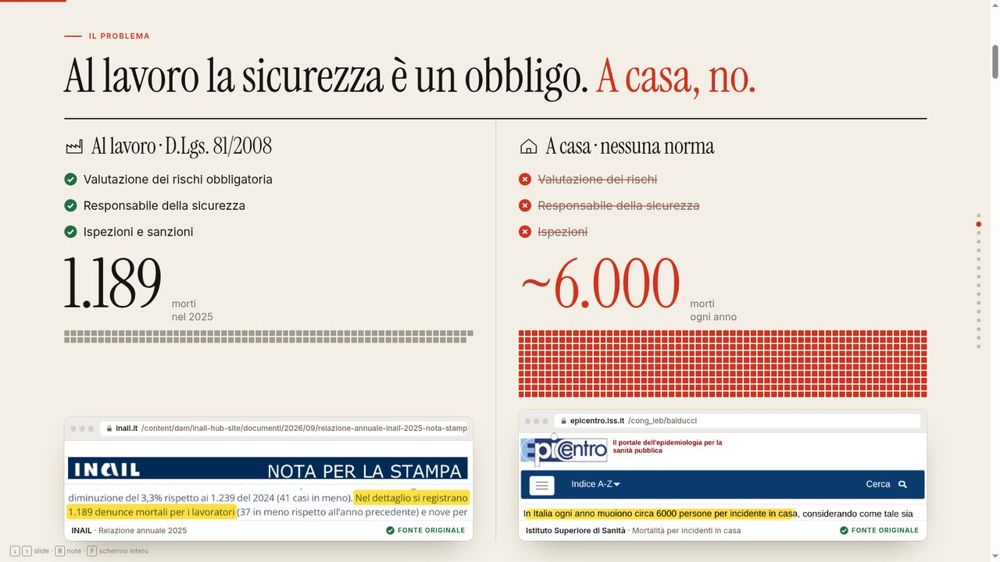</td>
<td width="50%">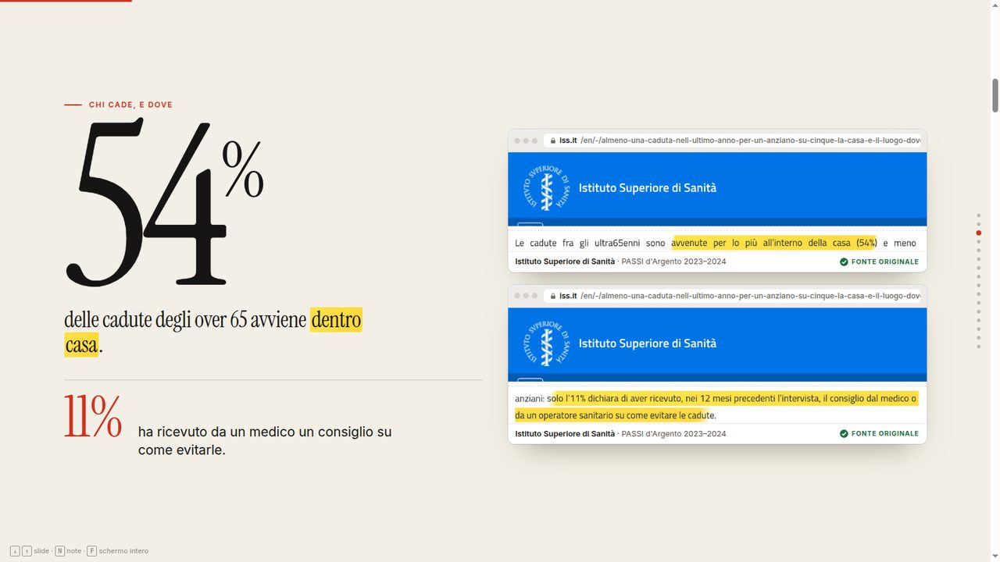</td>
</tr>
<tr>
<td width="50%">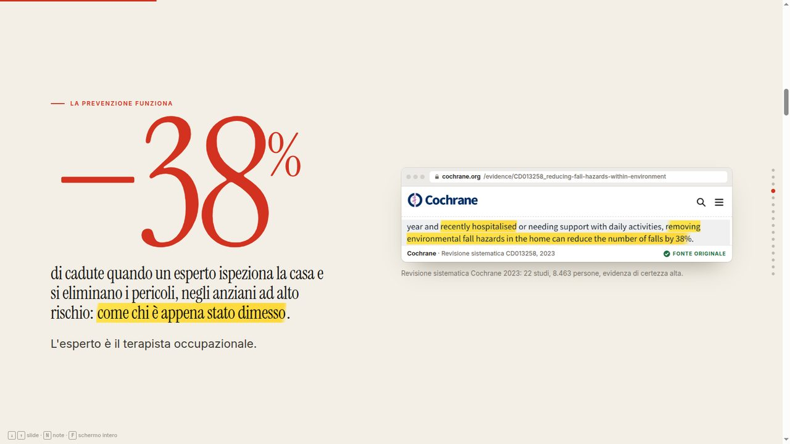</td>
<td width="50%">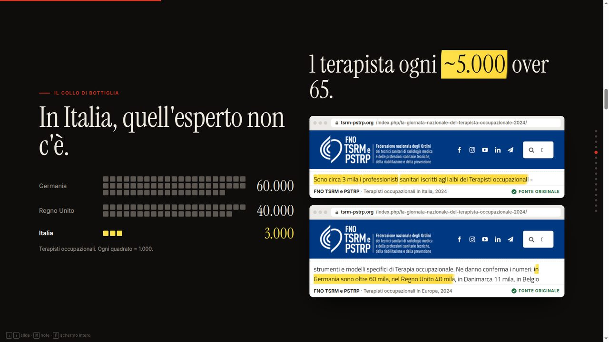</td>
</tr>
</table>

| | | |
| ---: | --- | --- |
| **~6,000** | deaths a year from home accidents in Italy, against 1,189 at work, where risk assessment is mandatory | [ISS](https://www.epicentro.iss.it/cong_leb/balducci) · [INAIL 2025](https://www.inail.it/content/dam/inail-hub-site/documenti/2026/09/relazione-annuale-inail-2025-nota-stampa-infortuni-mp.pdf) |
| **54%** | of falls among people over 65 happen at home; only **11%** were advised by a doctor on how to avoid them | [ISS, PASSI d'Argento 2023–2024](https://www.iss.it/en/-/almeno-una-caduta-nell-ultimo-anno-per-un-anziano-su-cinque-la-casa-e-il-luogo-dove-si-verificano-di-piu) |
| **−38%** | falls when an expert inspects the home and hazards are removed, in high-risk older adults | [Cochrane CD013258, 2023](https://www.cochrane.org/evidence/CD013258_reducing-fall-hazards-within-environment) |
| **3,000** | occupational therapists in Italy, about one for every 5,000 people over 65 | [FNO TSRM e PSTRP, 2024](https://www.tsrm-pstrp.org/index.php/la-giornata-nazionale-del-terapista-occupazionale-2024/) |

The CDC already recommends the fallback at every discharge: *if an occupational therapy assessment is not available, review home hazards with the patient and family.* **Step Wise makes that review possible, with an expert's eye on the evidence.**

---

## How it works

Six steps, from phone photos to a plan the family can act on. The professional has the last word.

<table>
<tr>
<td width="55%">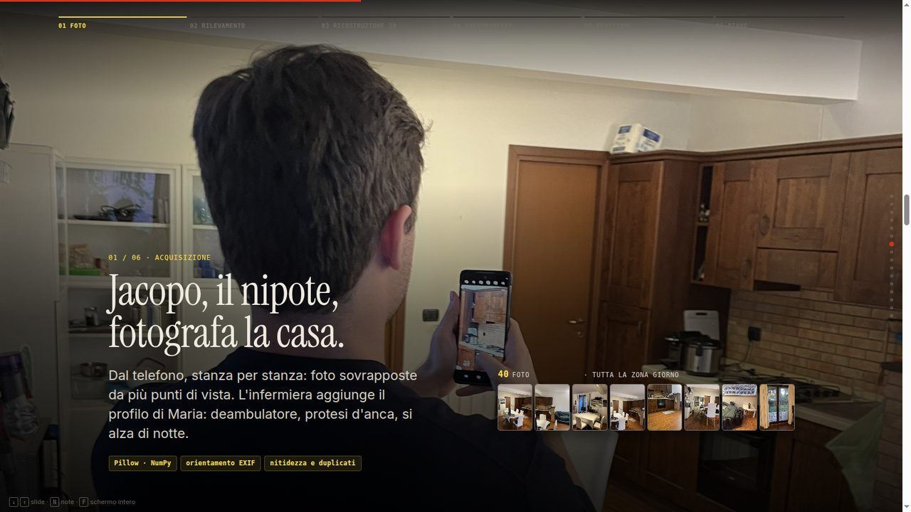</td>
<td>

### 01 · Capture
A family member photographs the home room by room, with overlapping shots. The nurse adds the patient's functional profile: walker, hip replacement, gets up at night.

<sub>FastAPI · Pillow · NumPy: upright orientation, metadata stripping, canonical re-encoding</sub>

</td>
</tr>
<tr>
<td width="55%">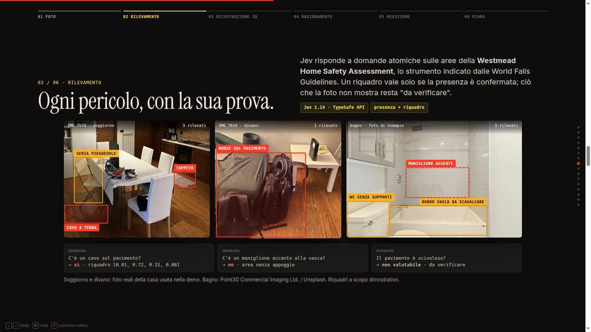</td>
<td>

### 02 · Detection
**TypeSafe Jev 1.14** answers atomic visual questions: is there a rug, a floor cable, a bathtub, a grab bar? A box is kept only when presence is confirmed. What a photo cannot show stays *"to verify"*.

<sub>Six fixed question pairs · presence and box gates</sub>

</td>
</tr>
<tr>
<td width="55%">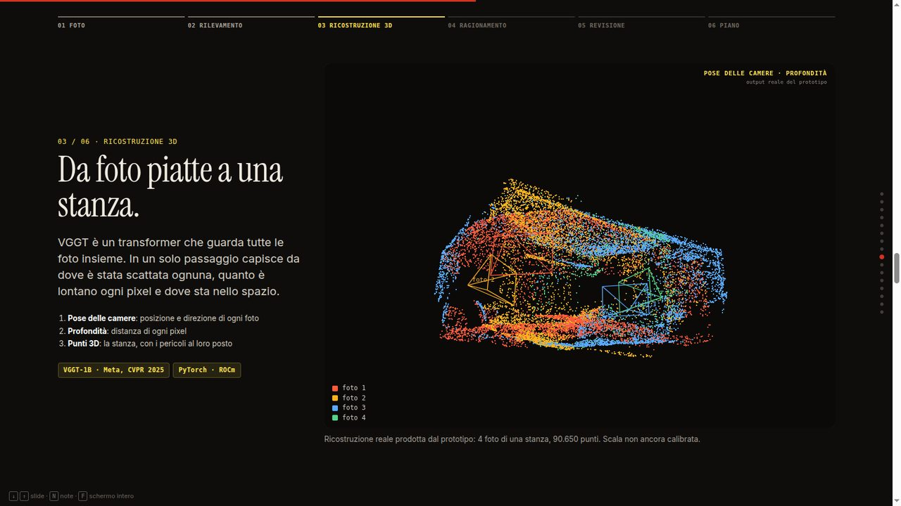</td>
<td>

### 03 · 3D reconstruction
**VGGT-1B** looks at all the photos at once and, in a single forward pass, recovers camera poses, per-pixel depth and 3D points. A hazard gets a 3D anchor only when several views agree.

<sub>The point cloud in the slide is real prototype output: 4 photos, 90,650 points</sub>

</td>
</tr>
<tr>
<td width="55%">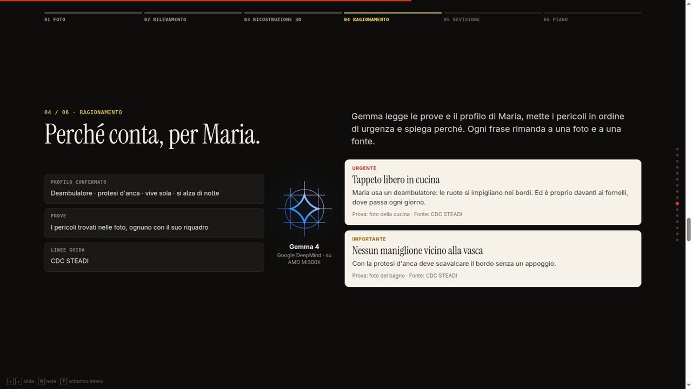</td>
<td>

### 04 · Reasoning
**Gemma 4 31B** reads the evidence and the confirmed profile, ranks hazards by urgency and explains *why they matter for this patient*. Every sentence points to a photo and a guideline.

<sub>Schema-validated JSON · CDC STEADI</sub>

</td>
</tr>
<tr>
<td width="55%">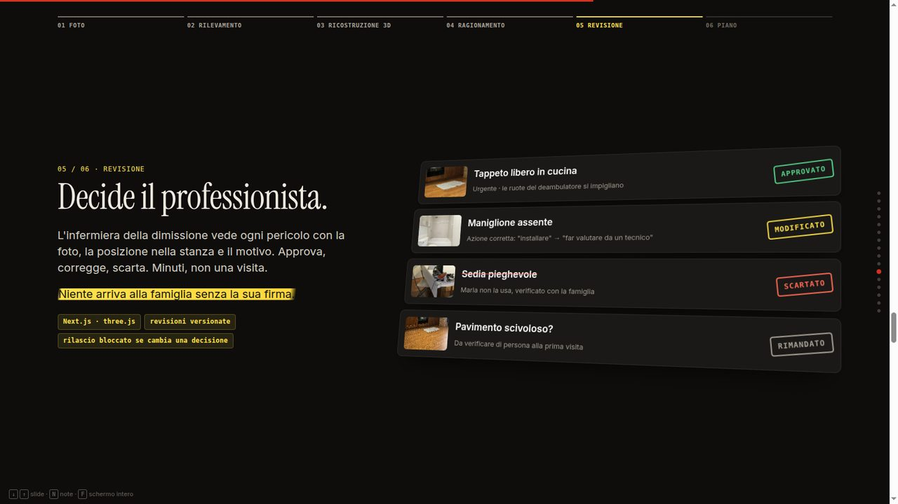</td>
<td>

### 05 · Review
The nurse sees each hazard with its photo, its place in the room and the reason. **Confermo**, **Non è un problema** or **Serve verificare**. Minutes, not a home visit.

**Nothing reaches the family without their sign-off.**

<sub>Next.js · three.js · versioned reviews, release blocked if a decision changes</sub>

</td>
</tr>
<tr>
<td width="55%">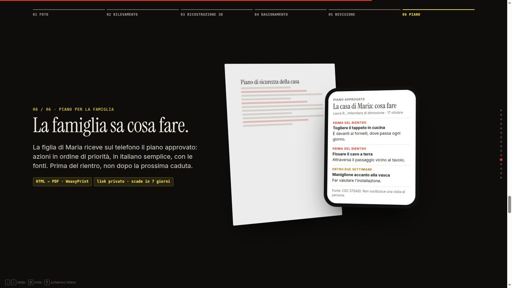</td>
<td>

### 06 · Family plan
The family receives the approved plan on their phone: actions by priority, in plain Italian, with sources. A private link that expires after 7 days and can be revoked.

<sub>Jinja2 · WeasyPrint HTML/PDF</sub>

</td>
</tr>
</table>

> [!NOTE]
> The photographs remain the evidence. The 3D view helps the reviewer navigate the room; it is not a measurement. Slides are illustrations from the [pitch](pitch/index.html); real model outputs are [below](#real-model-outputs).

---

## Why AMD

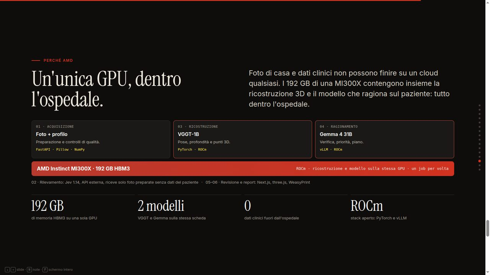

Home photos and clinical data cannot go to just any cloud. The **192 GB of HBM3** on a single **AMD Instinct MI300X** hold both the 3D reconstruction and the model that reasons about the patient, so the whole pipeline can run inside the hospital network on an open ROCm stack.

| | |
| --- | --- |
| **Live today** | `Gemma-4-31B-IT` on AMD's OpenAI-compatible endpoint is the configured model for the hazard sweep and report drafting. Authenticated model discovery and image/strict-JSON smokes passed: **1 image in 6.29 s, 4 images in 11.00 s**. |
| **Target** | One MI300X on-premise: VGGT on PyTorch-ROCm and Gemma on vLLM-ROCm, on the same GPU, one job at a time. [`compose.rocm.yaml`](compose.rocm.yaml) and [`Dockerfile.worker.rocm`](Dockerfile.worker.rocm) describe that worker. |
| **Not yet established** | A complete room analysis through the AMD endpoint, any self-hosted ROCm run (the override has only passed configuration validation), and MI300X latency, memory and cost figures. VGGT currently runs on an NVIDIA RTX 5090 Laptop GPU. |

---

## Try it

### Judge demo · one command, no keys

```bash
docker compose -f compose.demo.yaml up --build
```

Open <http://localhost:8000>. You land on Maria's case and walk the professional's part of the flow: **review each hazard → prepare the report → release it to the family**. Every visitor gets a private copy of the same frozen, pre-analysed case, so nothing calls an external model. The same image deploys to Render through [`render.yaml`](render.yaml).

> [!IMPORTANT]
> The bundled snapshot is a **control case**: its analysis is deterministic fixture output, not a model run, and the landing page states this. It demonstrates the review workflow, not image analysis or clinical accuracy.

<details>
<summary><b>Full local setup (fixture pipeline, API + worker)</b></summary>

<br>

| Tool | Version | Why |
| --- | --- | --- |
| Python | 3.12.3 | Backend runtime (pinned in `requirements.lock`) |
| Node.js | 22.22.3 | Builds the reviewer app |
| Pango, HarfBuzz, DejaVu fonts | see [`Dockerfile.worker`](Dockerfile.worker) | PDF rendering |
| Blender + MPFB2 | 4.5.14 / 2.0.18 | Optional: live avatar (`AVATAR_BACKEND`) |
| CUDA GPU + VGGT runtime | PyTorch 2.8, checksum-verified checkpoint | Optional: live reconstruction (`RECON_BACKEND=vggt`) |

**1. Install**

```bash
python3 -m venv .venv
.venv/bin/pip install -r requirements.lock
.venv/bin/pip install --no-deps -e .
npm --prefix frontend ci
npm --prefix frontend run build
```

**2. Configure the fixture backends** in both the API and the worker terminal. The separate data directory keeps the demo apart from existing assessments. Fixture findings and geometry are fixed controls, even when you upload arbitrary photos.

```bash
export STEP_WISE_DATA="$PWD/data/fixture-demo"
export STEP_WISE_DATABASE="$STEP_WISE_DATA/assessment.sqlite3"
export RECON_BACKEND=fixture GEMMA_BACKEND=fixture AVATAR_BACKEND=fixture JEV_ENABLED=false
```

**3. Initialize and generate the synthetic upload images**

```bash
.venv/bin/python -m step_wise.cli init
.venv/bin/python -m step_wise.cli seed-controls
```

**4. Start the API and the worker**

```bash
# terminal 1
.venv/bin/uvicorn step_wise.api:create_app --factory --host 127.0.0.1 --port 8000 --no-access-log

# terminal 2, same settings
.venv/bin/python -m step_wise.worker
```

**5. Walk the flow** at <http://localhost:8000>:

1. **Nuovo paziente** → fill in a fictional profile under **Mobilità e bisogni**.
2. Upload `data/demo/synthetic-1.png` and `synthetic-2.png` to one room as **Panoramiche**.
3. **Avvia l’analisi** and follow the stage status.
4. Open the room; each pin and photo box opens its evidence card. Confirm, dismiss or flag, and edit the action if needed.
5. **Prepara il report** → check the HTML/PDF → **Rilascia alla famiglia**. **Revoca il link** disables it.

For hot reload and the `/api` proxy, see the [frontend README](frontend/README.md). The fixture demo needs no keys.

> [!WARNING]
> The reviewer API has no login. Keep it on loopback unless an external access-control layer is in place.

</details>

<details>
<summary><b>Live models: Gemma on AMD, Jev, VGGT</b></summary>

<br>

The Python app loads a local `.env`; already-exported variables take precedence. Set `RECON_BACKEND`, `GEMMA_BACKEND`, `JEV_ENABLED` and `AVATAR_BACKEND` explicitly, and restart the API and worker together after changing them. A worker with a different configuration refuses a queued attempt. All settings are documented in [`.env.example`](.env.example). Keys are read server-side and never sent to the browser.

| Variable | Used for |
| --- | --- |
| `GEMMA_API_KEY` | AMD hosted endpoint or another OpenAI-compatible Gemma endpoint |
| `JEV_API_KEY` | TypeSafe Jev, when `JEV_ENABLED=true` |
| `HF_TOKEN` | Only when `GEMMA_BASE_URL` is the Hugging Face router |

- **Gemma on AMD:** `GEMMA_BASE_URL=https://developer.amd.com.cn/radeon/api/v1`, `GEMMA_MODEL=Gemma-4-31B-IT`, `GEMMA_PROVIDER=amd`.
- **Gemma on Hugging Face (optional):** `GEMMA_BASE_URL=https://router.huggingface.co/v1`, `HF_TOKEN` and an explicit `GEMMA_PROVIDER`. Only this router appends `:provider` to the model name.
- **VGGT:** requires an explicitly installed runtime, the pinned source commit and a checksum-verified local checkpoint. Weights are never downloaded implicitly.
- **Consent:** external image and profile processing is consent-gated; new photos or documents invalidate the matching consent.

Send one generated, non-clinical test image to the configured Gemma endpoint:

```bash
.venv/bin/python scripts/smoke_gemma.py
```

</details>

---

## Under the hood

Photos are uploaded room by room to a FastAPI backend, stored in SQLite and the local filesystem, and queued as a persisted job. One worker runs seven stages with explicit dependencies. Stage outputs are checksum-verified and reused when their inputs have not changed, and independent stages keep their results when another branch fails. VGGT runs in an isolated Python environment with secrets removed, so the API never imports PyTorch. The Next.js reviewer app is a static export served by FastAPI on the same origin.

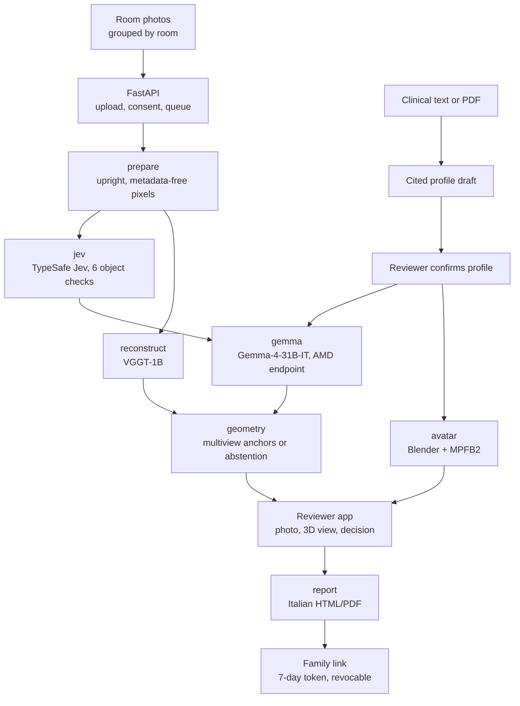

| Stage | What it does | Runs on | Recorded evidence |
| --- | --- | --- | --- |
| `prepare` | Upright orientation, metadata stripping, canonical re-encoding | CPU · Pillow | Bounded uploads; EXIF, padding and metadata tests |
| `jev` | Six object question pairs with presence and box gates | TypeSafe Jev 1.14 API | Pitch photos: both rugs and the bathtub localized; repeat box IoU 0.94–1.00 |
| `reconstruct` | Poses, depth, point cloud and observed-surface mesh | VGGT-1B · NVIDIA RTX 5090 Laptop | 20 rendered views: 2.67 s forward pass, 9.68 GiB peak memory |
| `gemma` | Full-image hazard sweep, personalized to the confirmed profile | Gemma-4-31B-IT · AMD endpoint | 1 image in 6.29 s, 4 images in 11.00 s (synthetic smoke) |
| `geometry` | Floor and gravity estimate, multiview anchors or abstention | CPU · NumPy | Floor normal error 0.39–0.83° on rendered scenes |
| `avatar` | Illustrative older-adult figure; walker only when confirmed | Blender 4.5.14 · MPFB2 2.0.18 | Rigged GLB in 2.0 s, no clinical text inside |
| `report` | Italian HTML/PDF from reviewed findings only | Jinja2 · WeasyPrint | 8-page long-text PDF inspected without clipping |

All figures come from dated runs in [runtime evidence](docs/runtime.md). They are development measurements, not accuracy or clinical claims.

**Backend** Python 3.12 · FastAPI · Pydantic 2 · SQLite · Pillow · NumPy · Jinja2 · WeasyPrint
**Frontend** Next.js 16 (static export) · React 19 · TypeScript · Tailwind CSS 4 · three.js
**AI** Gemma-4-31B-IT (AMD endpoint; Hugging Face optional) · TypeSafe Jev 1.14 · VGGT-1B (PyTorch 2.8, BF16, isolated worker) · MPFB2 on Blender
**Ops** CPU Docker images with pinned base digests · single-container judge demo · ROCm Compose override (configuration-validated only)

---

## Real model outputs

<table>
<tr>
<td width="42%" valign="top">
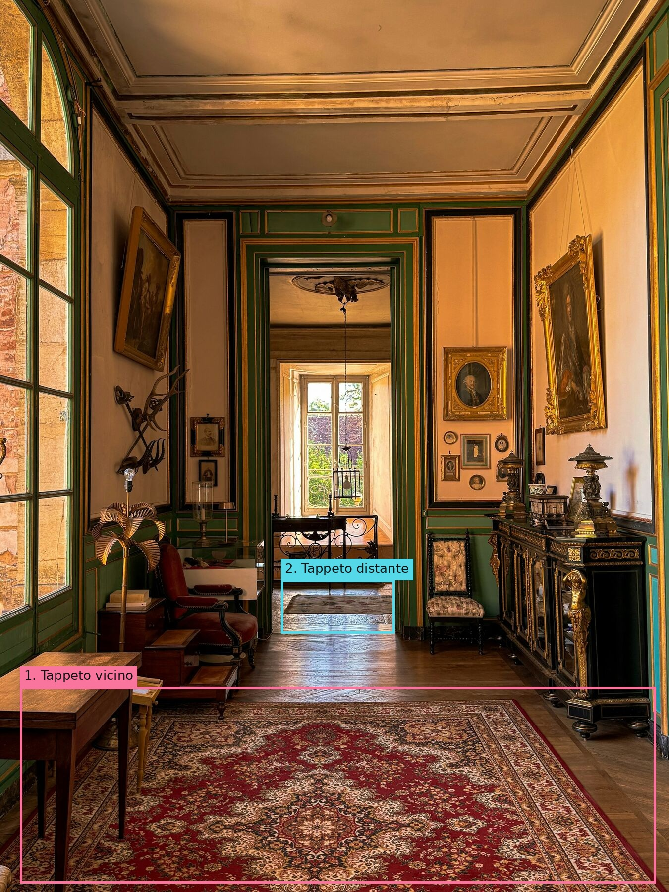
<sub><b>Jev · corridor.</b> Live <code>jev-1.14.0</code> call, 17 Oct 2026. Nearest rug: presence 0.99, box 0.70. Farther rug: presence 0.95, box 0.91. The footstool stayed below the presence gate (0.42) and is withheld. Photo: Thomas Würth / Unsplash.</sub>
</td>
<td width="42%" valign="top">
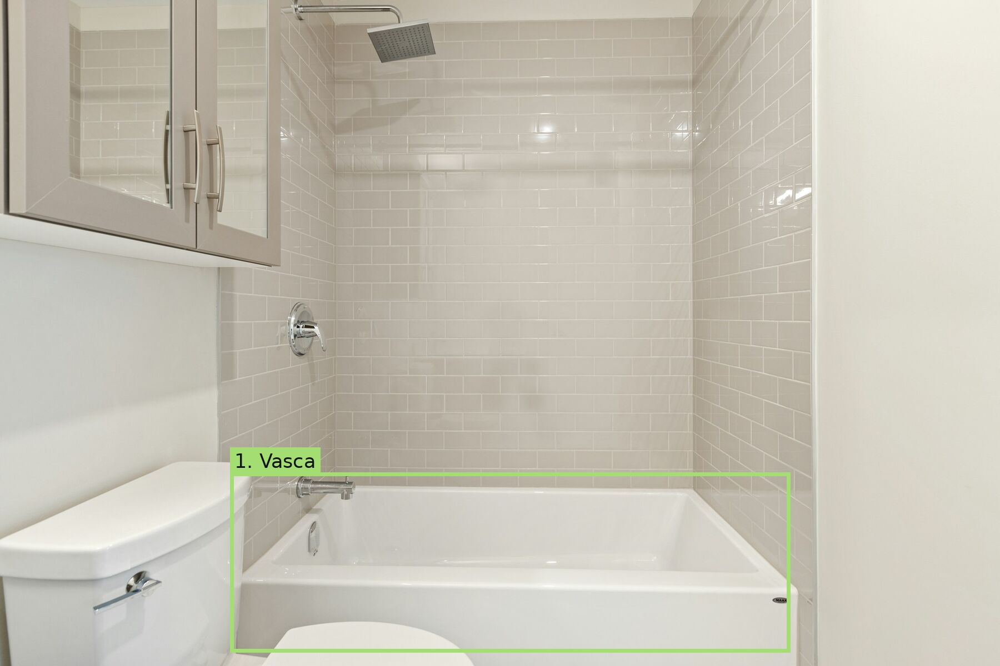
<sub><b>Jev · bathroom.</b> Bathtub: presence 0.97, box 0.84. Locating it is separate from deciding it is a hazard; that belongs to Gemma and the professional. Nothing is boxed as a "missing grab bar". Photo: Point3D Commercial Imaging Ltd. / Unsplash.</sub>
</td>
<td width="16%" valign="top">
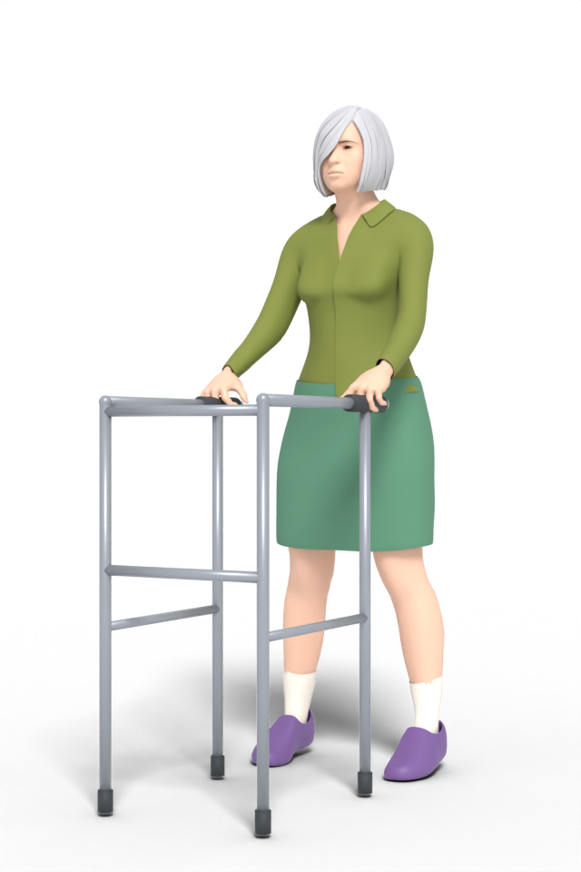
<sub><b>Avatar.</b> Generated headlessly with Blender + MPFB2. The walker appears only when the reviewer confirms one.</sub>
</td>
</tr>
</table>

A repeated run on the same photos matched closely (box IoU 0.94–1.00): a consistency check on two images, not accuracy validation. The [before/after comparison](pitch/jev-results/2026-10-17/optimization/index.html) keeps the original open-ended prompt, which boxed a wall painting instead of the rug. Gates (presence ≥ 0.75, box ≥ 0.50) are provisional and uncalibrated.

---

## Evidence and limits

**Verified so far.** The full intake → analysis → review → PDF → release → revocation lifecycle in fixture mode and in a headless browser · a live four-screenshot run (local VGGT, Jev, Gemma via Hugging Face, MPFB2 avatar, unreleased Gemma-drafted PDF) · a five-photo real-room analysis with four provisional findings · VGGT resource scaling to 20 views · AMD-hosted Gemma vision/strict-JSON smokes.

**Not yet established.** A guided, independently measured room capture · real-room centimetre accuracy · validated 3D hazard anchors on real scenes · a full analysis through the AMD endpoint · self-hosted ROCm · clinical accuracy, fall reduction or reviewer-time benefit.

Run IDs, dates and open gates are in [runtime evidence](docs/runtime.md).

---

<details>
<summary><b>Development and checks</b></summary>

<br>

```bash
.venv/bin/python -m unittest discover -s tests
.venv/bin/python eval/jev/evaluate.py self-check
npm --prefix frontend run typecheck
npm --prefix frontend run lint
npm --prefix frontend run build
```

With the fixture API and worker running, the HTTP smoke test exercises simulated review, report release, stale-release protection and family-link access on a separate synthetic assessment:

```bash
.venv/bin/python scripts/smoke_e2e.py --mode fixture --base-url http://localhost:8000
```

Optional headless UI check:

```bash
.venv/bin/pip install playwright
.venv/bin/python -m playwright install chromium
.venv/bin/python scripts/browser_smoke.py --base-url http://localhost:8000
```

Reproducible case runs and cleanup (cleanup is a dry run unless explicitly executed; stop the ordinary worker first, it holds a shared lock):

```bash
.venv/bin/python -m step_wise.cli case run demo/cases/room-001.json --mode fixture
.venv/bin/python -m step_wise.cli case check --run RUN_ID
.venv/bin/python -m step_wise.cli cleanup --older-than-days 30
```

Exit code `4` from `case check` means manual checks remain pending, not an execution failure.

</details>

<details>
<summary><b>Real photos: the Monolocale study</b></summary>

<br>

The **Monolocale WhatsApp** study starts from five real photos and VGGT geometry. Its optional `photo_completed` presentation keeps the photographic textures and adds manually fitted floor, walls, ceiling and selected furniture, window and door surfaces. **Ricostruzione completata** and **Superfici originali** switch between the completion and the captured surfaces.

Missing surfaces are inferred: completion creates no validated hazard anchors or measurements, and the original photos and raw reconstruction stay available. To add photos, upload **12–20 overlapping overviews in total** to the exact existing room label (**Soggiorno**) as **Panoramiche**, then re-run the analysis; `VGGT_FRAME_CAP` (default 20) is checked before queueing, and nothing is silently dropped. Adding photos invalidates the analysis, review, calibration and manual completion. The [completion script](scripts/complete_monolocale.py) is authored for the original five-image set; attach new output with [`attach_room_presentation.py`](scripts/attach_room_presentation.py), which checks it against the current revision and source hashes.

</details>

<details>
<summary><b>API surface</b></summary>

<br>

| Method | Path | Purpose |
| --- | --- | --- |
| `GET` | `/api/health` | Liveness probe |
| `POST` · `GET` | `/api/assessments` | Create or list assessments |
| `GET` · `PATCH` · `DELETE` | `/api/assessments/{id}` | Read, update or delete one assessment |
| `POST` | `/api/assessments/{id}/photos` | Upload a room photo (overview or detail) |
| `POST` | `/api/assessments/{id}/clinical-documents` | Upload a clinical text or PDF |
| `POST` · `PUT` | `/api/assessments/{id}/profile/draft` · `/profile/confirm` | Draft and confirm the cited functional profile |
| `POST` | `/api/assessments/{id}/analyze` | Queue the analysis |
| `GET` | `/api/jobs/{id}` | Job status, stages and `failed_stages` |
| `GET` | `/api/assessments/{id}/bundle` | Versioned bundle: findings, rooms, geometry, avatar |
| `PUT` | `/api/assessments/{id}/reviews/{hazard_id}` | Record a review decision |
| `PUT` · `DELETE` | `/api/assessments/{id}/scenes/{scene_id}/calibration` | Set or clear metric calibration |
| `PUT` · `DELETE` | `/api/assessments/{id}/scene-links/{from}/{to}` | Confirm or remove a room link |
| `POST` | `/api/assessments/{id}/reports` | Draft a report from reviewed findings |
| `POST` | `/api/reports/{id}/release` · `/revoke` | Release to the family or revoke the link |
| `GET` | `/api/family/{token}` | Family view of the released report |
| `GET` · `POST` | `/api/demo` · `/api/demo/session` | Judge demo: case summary and a private visitor copy |

</details>

<details>
<summary><b>Project structure</b></summary>

<br>

```
amd-hack/
├── backend/src/step_wise/
│   ├── api.py                   # FastAPI routes: intake, jobs, review, reports, family links, demo
│   ├── worker.py                # Persisted queue, seven-stage pipeline, checksum-verified reuse
│   ├── snapshot.py              # Judge demo: frozen case, private copy per visitor
│   ├── db.py · schema.sql       # SQLite storage and schema upgrades
│   ├── models.py                # Versioned AssessmentBundle and public DTOs
│   ├── validation.py            # Checks model findings against photos, scenes and profile
│   ├── cli.py · cases.py        # init, seed-controls, cleanup, reproducible case runs
│   ├── pipeline/
│   │   ├── photos.py            # Upright, metadata-free canonical photos and box transforms
│   │   ├── jev.py               # TypeSafe Jev object checks and evidence gates
│   │   ├── gemma.py · http.py   # OpenAI-compatible Gemma client, bounded streaming parser
│   │   ├── reconstruction.py    # VGGT dispatch, point cloud and observed-surface mesh
│   │   ├── vggt_worker.py       # Isolated GPU subprocess
│   │   ├── geometry.py          # Floor estimate, multiview anchors, photo-surface markers
│   │   ├── calibration.py       # Metric scale from tape measurements, with holdout check
│   │   ├── registration.py      # Reviewer-confirmed links between rooms
│   │   ├── clinical.py          # Clinical document intake and cited profile drafts
│   │   ├── avatar*.py           # Blender/MPFB2 avatar generation
│   │   └── reports.py           # Report drafting and release
│   ├── prompts/                 # Gemma and Jev prompts
│   └── templates/report.html    # Italian HTML/PDF template
├── frontend/src/
│   ├── app/                     # Patient list, intake, patient space
│   ├── components/              # PatientSpace, DemoLanding, ReleaseDialog, space/ (three.js viewer, cards)
│   └── lib/                     # API client, types, labels
├── scripts/                     # Smoke tests, benchmarks, Monolocale completion
├── tests/                       # Python unittest suite
├── eval/jev/                    # Jev evaluation harness and historical results
├── demo/                        # Fixture cases, judge-demo snapshot, dated artifacts
├── docs/                        # Runtime evidence, demo runbook, 3D plan, README images
└── pitch/                       # Pitch site, source captures, Jev results
```

</details>

---

## Team

<table>
<tr>
<td align="center"><a href="https://github.com/jacopopper"><br><b>@jacopopper</b></a></td>
<td align="center"><a href="https://github.com/davideblesse"><br><b>@davideblesse</b></a></td>
</tr>
</table>

## License

Code is released under the [MIT License](LICENSE). Third-party material keeps its own terms: pitch and evaluation photos from Unsplash are credited where they appear, source captures under `pitch/assets/sources/` belong to their publishers, the avatar uses a CC0 MPFB2 asset pack, and the VGGT-1B research checkpoint (non-commercial, not distributed here) must be obtained separately.

> [!CAUTION]
> Step Wise is a hackathon prototype. It is not a medical device, has no clinical validation, and must not be used for real patient intake. Use staged homes and fictional profiles.

<div align="center">
<br>

***Venerdì Maria torna a casa. Questa volta qualcuno ha guardato il corridoio.***

</div>
