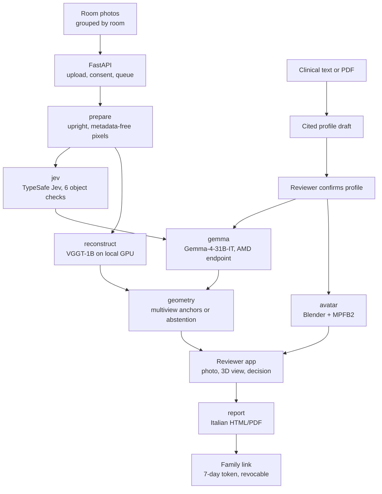

# Step Wise

**Home fall-hazard review from ordinary room photos, with every finding tied to the photo that shows it.**

Built for the [AMD Developer Hackathon: ACT III](https://lablab.ai/ai-hackathons/amd-developer-hackathon-act-iii) (Italy, October 2026) · **Track 2: Health and Wellbeing**.

[Pitch site](pitch/index.html) · [Runtime evidence](docs/runtime.md) · [Demo runbook](docs/demo-script.md) · [Jev results](pitch/jev-results/2026-10-17/optimization/README.md)

---

## What It Does

_"Venerdì Maria torna a casa."_ Maria, the fictional patient in our pitch, is 84. She fell in her hallway at night, broke her hip and is going home with a walker. Nobody on her care team has ever seen that hallway.

In Italy, **1 in 5** people over 65 fell in the past year and **54%** of those falls happened at home. Only **11%** were advised by a doctor on how to avoid them ([ISS, PASSI d'Argento 2023–2024](https://www.iss.it/en/-/almeno-una-caduta-nell-ultimo-anno-per-un-anziano-su-cinque-la-casa-e-il-luogo-dove-si-verificano-di-piu)). An expert home hazard assessment with hazard removal cuts falls by **38%** in high-risk older adults ([Cochrane CD013258, 2023](https://www.cochrane.org/evidence/CD013258_reducing-fall-hazards-within-environment)), yet Italy has about 3,000 occupational therapists to do it ([FNO TSRM e PSTRP, 2024](https://www.tsrm-pstrp.org/index.php/la-giornata-nazionale-del-terapista-occupazionale-2024/)).

Step Wise lets a family member photograph the home and a professional review it remotely. Three model signals run on the same prepared photos:

1. **Visual object checks** (TypeSafe Jev 1.14): six fixed question pairs (nearest rug, farther rug, footstool, floor cable, bathtub, grab bar). Each returns a presence score and a box; a box is kept only when both pass their gates.
2. **Hazard sweep** (Gemma 4 31B IT, served from AMD's hosted endpoint): a full-image review that returns schema-validated findings with boxes, personalized to the reviewer-confirmed functional profile.
3. **3D reconstruction** (VGGT-1B on a local GPU): camera poses, depth and a coloured surface of each room. A hazard gets a 3D anchor only when several views agree; otherwise it stays photographic evidence.

A professional then walks through every proposal next to its source photo and answers **Confermo**, **Non è un problema** or **Serve verificare**. Only confirmed or edited findings become actions in an Italian HTML/PDF plan. The family receives a link that expires after seven days and can be revoked.

The photographs remain the evidence. The 3D view helps the reviewer navigate the room; it is not a measurement.

---

## How It Works

Photos are uploaded room by room to a FastAPI backend, stored in SQLite and the local filesystem, and queued as a persisted job. A single worker runs seven stages with explicit dependencies. Stage outputs are checksum-verified and reused when their inputs have not changed, and independent stages keep their results when another branch fails. VGGT runs in an isolated Python environment with secrets removed, so the API never imports PyTorch. The Next.js reviewer app is a static export served by FastAPI on the same origin.



### Stage pipeline

| Stage | What it does | Runs on | Recorded evidence |
| --- | --- | --- | --- |
| `prepare` | Upright orientation, metadata stripping, canonical re-encoding | CPU · Pillow | Bounded uploads; EXIF, padding and metadata tests |
| `jev` | Six object question pairs with presence and box gates | TypeSafe Jev 1.14 API | Pitch photos: both rugs and the bathtub localized; repeat box IoU 0.94–1.00 |
| `reconstruct` | Poses, depth, point cloud and observed-surface mesh | VGGT-1B · NVIDIA RTX 5090 Laptop | 20 rendered views: 2.67 s forward pass, 9.68 GiB peak memory |
| `gemma` | Full-image hazard sweep, personalized to the confirmed profile | Gemma-4-31B-IT · AMD endpoint (Hugging Face optional) | AMD: synthetic strict-JSON vision smoke, 1 image in 6.29 s, 4 images in 11.00 s |
| `geometry` | Floor and gravity estimate, multiview anchors or abstention, photo-surface markers | CPU · NumPy | Floor normal error 0.39–0.83° on rendered scenes |
| `avatar` | Illustrative older-adult figure; walker only when confirmed | Blender 4.5.14 · MPFB2 2.0.18 | Rigged GLB in 2.0 s, no clinical text inside |
| `report` | Italian HTML/PDF from reviewed findings only | Jinja2 · WeasyPrint | 8-page long-text PDF inspected without clipping |

All figures come from dated runs in [runtime evidence](docs/runtime.md). They are development measurements, not accuracy or clinical claims.

---

## AMD in Step Wise

- **Live today:** `Gemma-4-31B-IT` on AMD's OpenAI-compatible endpoint (`https://developer.amd.com.cn/radeon/api/v1`) is the configured model for the hazard sweep and report drafting. Authenticated model discovery and synthetic image/strict-JSON smokes passed (1 image in 6.29 s, 4 images in 11.00 s).
- **Target deployment:** one AMD Instinct MI300X (192 GB HBM3) inside the hospital network, running VGGT on ROCm and Gemma on vLLM-ROCm on the same GPU, so home photos and clinical data stay on-premise. [`compose.rocm.yaml`](compose.rocm.yaml) and [`Dockerfile.worker.rocm`](Dockerfile.worker.rocm) describe that worker.
- **Not yet established:** a complete room analysis through the AMD endpoint, any self-hosted ROCm run (the ROCm override has only passed configuration validation), and MI300X latency, memory and cost figures. VGGT currently runs on an NVIDIA RTX 5090 Laptop GPU.

---

## Model Outputs

### Jev object localization: corridor

_Live `jev-1.14.0` call, 17 October 2026. Nearest rug: presence 0.99, box confidence 0.70. Farther rug: presence 0.95, box confidence 0.91. The footstool stayed below the presence gate (0.42), so it is withheld. Photo: Thomas Würth on Unsplash._


### Jev object localization: bathroom

_Bathtub: presence 0.97, box confidence 0.84. Locating the bathtub is separate from deciding whether it is a hazard; that belongs to the Gemma review and the professional. Nothing is boxed as a "missing grab bar". Photo: Point3D Commercial Imaging Ltd. on Unsplash._


A repeated run on the same photos matched closely (box IoU 0.94–1.00). That is a consistency check on two images, not accuracy validation. The [before/after comparison](pitch/jev-results/2026-10-17/optimization/index.html) keeps the original open-ended prompt, which boxed a wall painting instead of the rug. Gates of presence ≥ 0.75 and box confidence ≥ 0.50 are provisional and uncalibrated.

### Functional-profile avatar

_Generated headlessly with Blender 4.5.14 and MPFB2 2.0.18 from a pinned CC0 asset pack. The walker appears only when the reviewer confirms a current walker or rollator. The GLB carries no clinical text._


---

## Tech Stack

**Backend**: Python 3.12 · FastAPI · Pydantic 2 · SQLite · Pillow · NumPy · Jinja2 · WeasyPrint

**Frontend**: Next.js 16 (static export) · React 19 · TypeScript · Tailwind CSS 4 · three.js

**AI**: Gemma-4-31B-IT via an OpenAI-compatible endpoint (AMD hosted; Hugging Face router optional) · TypeSafe Jev 1.14 · VGGT-1B (PyTorch 2.8, CUDA 12.8, BF16, isolated worker) · MPFB2 2.0.18 on Blender 4.5.14

**Ops**: CPU Docker images with pinned base digests · ROCm Compose override (configuration-validated only)

---

## Getting Started

### Prerequisites

| Tool | Version | Why |
| --- | --- | --- |
| Python | 3.12.3 | Backend runtime (pinned in `requirements.lock`) |
| Node.js | 22.22.3 | Builds the reviewer app |
| Pango, HarfBuzz, DejaVu fonts | see [`Dockerfile.worker`](Dockerfile.worker) | PDF rendering |
| Blender + MPFB2 | 4.5.14 / 2.0.18 | Optional: live avatar (`AVATAR_BACKEND`) |
| CUDA GPU + VGGT runtime | PyTorch 2.8, checksum-verified checkpoint | Optional: live reconstruction (`RECON_BACKEND=vggt`) |

### API keys

The fixture demo needs **no keys**. Live runs read these server-side; they are never sent to the browser.

| Variable | Used for |
| --- | --- |
| `GEMMA_API_KEY` | AMD hosted endpoint or another OpenAI-compatible Gemma endpoint |
| `JEV_API_KEY` | TypeSafe Jev, when `JEV_ENABLED=true` |
| `HF_TOKEN` | Only when `GEMMA_BASE_URL` is the Hugging Face router |

All settings are documented in [`.env.example`](.env.example).

### 1. Install

```bash
python3 -m venv .venv
.venv/bin/pip install -r requirements.lock
.venv/bin/pip install --no-deps -e .
npm --prefix frontend ci
npm --prefix frontend run build
```

### 2. Configure the CPU fixture demo

> [!IMPORTANT]
> **The reproducible CPU demo uses synthetic fixtures.** Its findings and geometry are fixed controls, even when you upload arbitrary photos. It verifies the application workflow, not image analysis, clinical accuracy or hardware performance.

Use these settings in **both** the API and the worker terminal. The separate data directory keeps the demo apart from existing assessments.

```bash
export STEP_WISE_DATA="$PWD/data/fixture-demo"
export STEP_WISE_DATABASE="$STEP_WISE_DATA/assessment.sqlite3"
export RECON_BACKEND=fixture GEMMA_BACKEND=fixture AVATAR_BACKEND=fixture JEV_ENABLED=false
```

### 3. Initialize and generate the synthetic upload images

```bash
.venv/bin/python -m step_wise.cli init
.venv/bin/python -m step_wise.cli seed-controls
```

### 4. Start the API and the worker

```bash
# terminal 1
.venv/bin/uvicorn step_wise.api:create_app --factory --host 127.0.0.1 --port 8000 --no-access-log

# terminal 2, same settings
.venv/bin/python -m step_wise.worker
```

Open <http://localhost:8000>. FastAPI serves the export from `frontend/out/`; for hot reload and the `/api` proxy, see the [frontend README](frontend/README.md).

> [!WARNING]
> The reviewer API has no login. Keep it on loopback unless an external access-control layer is in place. This is a prototype for staged demonstrations, not real patient intake.

---

## Using Step Wise

1. Choose **Nuovo paziente**, fill in a fictional profile under **Mobilità e bisogni**, and continue to the photos.
2. Upload `data/demo/synthetic-1.png` and `synthetic-2.png` to one room as **Panoramiche**. These controls always live in `data/demo/`; `STEP_WISE_DATA` holds the assessment.
3. Click **Avvia l’analisi** and follow the stage status.
4. Open the room. Each pin and photo box opens its evidence card. Answer **Confermo**, **Non è un problema** or **Serve verificare**, and edit the suggested action if needed.
5. Click **Prepara il report**, check the HTML/PDF, then **Rilascia alla famiglia**. A released assessment can no longer be edited; **Revoca il link** disables the family link.

Review in this demo is simulated. Family links expose only the released HTML/PDF.

### Real photos: the Monolocale study

The **Monolocale WhatsApp** study starts from five real photos and VGGT geometry. Its optional `photo_completed` presentation keeps the photographic textures and adds manually fitted floor, walls, ceiling and selected furniture, window and door surfaces. **Ricostruzione completata** and **Superfici originali** switch between the completion and the captured surfaces. The Blender room illustration is a separate, historical experiment.

Missing surfaces are inferred. Repeated textures, approximate room extents and residual torn geometry do not establish unseen detail or metric accuracy, and completion creates no validated hazard anchors or measurements. The original photos and raw reconstruction stay available for inspection.

<details>
<summary><b>Adding photos to the same room</b></summary>

1. Capture overlapping overview photos while moving around the room, keeping shared furniture and corners visible in adjacent views. Include the doorway, wall/floor joins, both sides of the desk, and the gaps around the sofa and kitchen. Keep furniture and lighting stable and use original JPEG/PNG files when available. Aim for **12–20 overview photos in total**, including the existing five.
2. Open the **Monolocale WhatsApp** assessment and click the top-right **Foto** button. In **Stanza**, select or enter the exact existing label **Soggiorno**. Keep **Panoramiche** selected and choose **Aggiungi foto**. A different room label creates a separate scene; **Dettaglio** photos are not used by VGGT.
3. After uploading, renew the photo-processing consent if the configured external models require it, then click **Avvia l’analisi**. The API and worker must share the same live backend configuration. `VGGT_FRAME_CAP` defaults to 20 overview photos per room; the upload panel checks the whole selection first, and the backend blocks an over-limit analysis before queueing it. No images are silently dropped.
4. Inspect the new source surfaces and photo evidence, then review the new findings. Adding photos invalidates the current analysis and review, the room's calibration and links, and its manual completion. Existing reports no longer match the new inputs.

The [manual completion script](scripts/complete_monolocale.py) is authored for the original **five-image** set; its masks, image indices and fitted surfaces must be revised for new inputs. It is not an automatic hole-filling pipeline. Generate into a new `--output` directory, inspect the completion, then attach it with [`attach_room_presentation.py`](scripts/attach_room_presentation.py). Attachment checks `completion.json` against the GLB, reconstruction and source-photo hashes, and requires the current input revision and analysis job. Stale completion is hidden; previous assets remain stored.

</details>

---

## Live Configuration

The Python app loads a local `.env`; already-exported variables take precedence. Set `RECON_BACKEND`, `GEMMA_BACKEND`, `JEV_ENABLED` and `AVATAR_BACKEND` explicitly for each run, and restart the API and worker together after changing them. Queued attempts record their backend modes, and a worker with a different configuration refuses the attempt.

- **Gemma on AMD:** `GEMMA_BASE_URL=https://developer.amd.com.cn/radeon/api/v1`, `GEMMA_MODEL=Gemma-4-31B-IT`, `GEMMA_PROVIDER=amd` and a server-side `GEMMA_API_KEY`. The model identifier is sent exactly as configured.
- **Gemma on Hugging Face (optional):** `GEMMA_BASE_URL=https://router.huggingface.co/v1`, `HF_TOKEN`, the model identifier and an explicit `GEMMA_PROVIDER`. Only this router appends `:provider` to the model name.
- **VGGT:** requires an explicitly installed runtime, the pinned source commit and a checksum-verified local checkpoint. Weights are never downloaded implicitly.
- **Consent:** external image and profile processing is consent-gated, and new photos or documents invalidate the matching consent.

To send one generated, non-clinical test image to the configured Gemma endpoint:

```bash
.venv/bin/python scripts/smoke_gemma.py
```

<details>
<summary><b>Operations: worker lock, cleanup and reproducible case runs</b></summary>

The worker holds a shared execution lock. Stop the ordinary worker before running an isolated case or benchmark against the same lock. Back up the SQLite database and its assets together. Cleanup is a dry run unless explicitly executed:

```bash
.venv/bin/python -m step_wise.cli cleanup --older-than-days 30
```

The CLI supports `case run`, `inspect`, `check`, `compare` and revision-bound attestations:

```bash
.venv/bin/python -m step_wise.cli case run demo/cases/room-001.json --mode fixture
.venv/bin/python -m step_wise.cli case inspect --run RUN_ID
.venv/bin/python -m step_wise.cli case check --run RUN_ID
```

Runs live under `data/case-runs/`. Exit code `4` means manual checks remain pending; it is not an execution failure. The runner preserves input and artifact fingerprints and distinguishes live output from replay.

</details>

---

## Project Structure

```
amd-hack/
├── backend/src/step_wise/
│   ├── api.py                   # FastAPI routes: intake, jobs, review, reports, family links
│   ├── worker.py                # Persisted queue, seven-stage pipeline, checksum-verified reuse
│   ├── db.py · schema.sql       # SQLite storage and schema upgrades
│   ├── models.py                # Versioned AssessmentBundle and public DTOs
│   ├── validation.py            # Checks model findings against photos, scenes and profile
│   ├── cli.py · cases.py        # init, seed-controls, cleanup, reproducible case runs
│   ├── pipeline/
│   │   ├── photos.py            # Upright, metadata-free canonical photos and box transforms
│   │   ├── jev.py               # TypeSafe Jev object checks and evidence gates
│   │   ├── gemma.py · http.py   # OpenAI-compatible Gemma client, bounded streaming parser
│   │   ├── reconstruction.py    # VGGT dispatch, point cloud and observed-surface mesh
│   │   ├── vggt_worker.py       # Isolated GPU subprocess
│   │   ├── geometry.py          # Floor estimate, multiview anchors, photo-surface markers
│   │   ├── calibration.py       # Metric scale with holdout check
│   │   ├── registration.py      # Reviewer-confirmed links between rooms
│   │   ├── clinical.py          # Clinical document intake and cited profile drafts
│   │   ├── avatar*.py           # Blender/MPFB2 avatar generation
│   │   └── reports.py           # Report drafting and release
│   ├── prompts/                 # Gemma and Jev prompts
│   └── templates/report.html    # Italian HTML/PDF template
├── frontend/src/
│   ├── app/                     # Patient list, intake (pazienti/nuovo), patient space (pazienti)
│   ├── components/              # PatientSpace, PreparePanel, ReleaseDialog
│   │   └── space/               # SpaceViewer (three.js), HazardCard, PhotoView, AvatarViewer
│   └── lib/                     # API client, types, labels
├── scripts/                     # Smoke tests, benchmarks, Monolocale completion, presentation attach
├── tests/                       # Python unittest suite
├── eval/jev/                    # Jev evaluation harness and historical results
├── demo/                        # Fixture cases and dated artifacts
├── docs/                        # Runtime evidence, demo runbook, 3D plan
└── pitch/                       # Pitch site, source captures, Jev results
```

---

## API Surface

| Method | Path | Purpose |
| --- | --- | --- |
| `GET` | `/api/health` | Liveness probe |
| `POST` · `GET` | `/api/assessments` | Create or list assessments |
| `GET` · `PATCH` · `DELETE` | `/api/assessments/{id}` | Read, update or delete one assessment |
| `POST` | `/api/assessments/{id}/photos` | Upload a room photo (overview or detail) |
| `POST` | `/api/assessments/{id}/clinical-documents` | Upload a clinical text or PDF |
| `POST` · `PUT` | `/api/assessments/{id}/profile/draft` · `/profile/confirm` | Draft and confirm the cited functional profile |
| `POST` | `/api/assessments/{id}/analyze` | Queue the analysis |
| `GET` | `/api/jobs/{id}` | Job status, stages and `failed_stages` |
| `GET` | `/api/assessments/{id}/bundle` | Versioned assessment bundle: findings, rooms, geometry, avatar |
| `PUT` | `/api/assessments/{id}/reviews/{hazard_id}` | Record a review decision |
| `PUT` · `DELETE` | `/api/assessments/{id}/scenes/{scene_id}/calibration` | Set or clear metric calibration |
| `PUT` · `DELETE` | `/api/assessments/{id}/scene-links/{from}/{to}` | Confirm or remove a room link |
| `POST` | `/api/assessments/{id}/reports` | Draft a report from reviewed findings |
| `POST` | `/api/reports/{id}/release` · `/revoke` | Release to the family or revoke the link |
| `GET` | `/api/family/{token}` | Family view of the released report |

---

## Development

Run the offline checks from the repository root:

```bash
.venv/bin/python -m unittest discover -s tests
.venv/bin/python eval/jev/evaluate.py self-check
npm --prefix frontend run typecheck
npm --prefix frontend run lint
npm --prefix frontend run build
```

With the fixture API and worker running, the HTTP smoke test creates a separate synthetic assessment and exercises simulated review, report release, stale-release protection and family-link access:

```bash
.venv/bin/python scripts/smoke_e2e.py --mode fixture --base-url http://localhost:8000
```

Optional UI verification uses a fresh headless browser and also creates a synthetic assessment:

```bash
.venv/bin/pip install playwright
.venv/bin/python -m playwright install chromium
.venv/bin/python scripts/browser_smoke.py --base-url http://localhost:8000
```

Browser screenshots and local runs stay in the gitignored `data/` directory. Test counts and timings belong in the dated [runtime evidence](docs/runtime.md), not here.

---

## Evidence and Limits

**Verified so far:** the full intake → analysis → review → PDF → release → revocation lifecycle in fixture mode and in a headless browser; a live four-screenshot run (local VGGT, Jev, Gemma via Hugging Face, MPFB2 avatar, unreleased Gemma-drafted PDF); a five-photo Monolocale analysis with four provisional findings; VGGT resource scaling to 20 views; and AMD-hosted Gemma vision/strict-JSON smokes.

**Not yet established:** a guided, independently measured room capture; real-room centimetre accuracy; validated 3D hazard anchors on real scenes; a full analysis through the AMD endpoint; self-hosted ROCm; clinical accuracy, fall reduction or reviewer-time benefit. Details, run IDs and open gates are in [runtime evidence](docs/runtime.md).

---

## Repository and Submission Material

| Location | Purpose |
| --- | --- |
| [`backend/src/step_wise/`](backend/src/step_wise/) | API, queue, model adapters, review and report lifecycle |
| [`frontend/`](frontend/) | Reviewer interface and interactive 3D viewer |
| [`demo/cases/`](demo/cases/) | Reproducible fixture case definitions |
| [`docs/demo-script.md`](docs/demo-script.md) | Fixture demonstration runbook and evidence boundaries |
| [`docs/runtime.md`](docs/runtime.md) | Dated execution evidence, known limits and pending gates |
| [`docs/piano-3d-locale.md`](docs/piano-3d-locale.md) | Local 3D implementation plan and acceptance criteria |
| [`eval/jev/README.md`](eval/jev/README.md) | Historical visual-question evaluation and source attribution |
| [`pitch/`](pitch/) | Presentation site, verified source captures and Jev results |

The tracked [listing artifacts](demo/artifacts/listing-2026-10-17/) and [avatar example](demo/artifacts/avatar-style-2026-10-17/) are dated development evidence. The listing report is an unreleased draft with a fictional profile, and its images are separate from the Monolocale study. Keep raw captures, assessment databases, model caches, request logs and private documents under the ignored local data directories. Publish only deliberately selected, attributed and reviewed artifacts; `.gitignore` does not remove files already tracked by Git.

---

## Team

| GitHub |
| --- |
| [@jacopopper](https://github.com/jacopopper) |
| [@davideblesse](https://github.com/davideblesse) |

---

## License

Code is released under the [MIT License](LICENSE). Third-party material keeps its own terms: pitch and evaluation photos are from Unsplash and credited where they appear, source captures under `pitch/assets/sources/` belong to their publishers, the avatar uses a CC0 MPFB2 asset pack, and the VGGT-1B research checkpoint (non-commercial, not distributed here) must be obtained separately.

> **Disclaimer:** Step Wise is a hackathon prototype. It is not a medical device, has no clinical validation, and must not be used for real patient intake. Use staged homes and fictional profiles.
