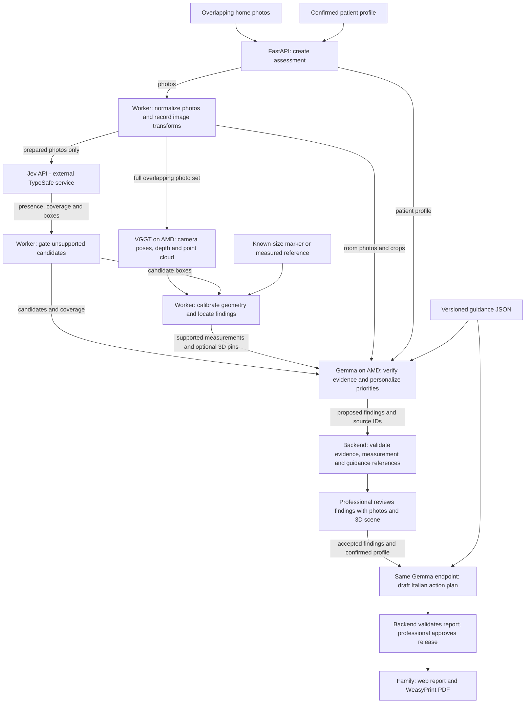

# Safe Home — Tech Stack

Proposed hackathon stack, based on [SAFE_HOME.md](SAFE_HOME.md). Status: 16 October 2026.

## Current implementation

The repository contains a Python Jev evaluation harness using `requests` and Pillow, public test images, and saved results. The application, 3D pipeline, and AMD deployment are not implemented yet.

The [Jev smoke test](eval/jev/README.md) matched 42/42 presence labels and localized 8/8 positive targets above IoU 0.5 in each of two passes; median API latency was 1.61 seconds. This small, selected test does not establish end-to-end hazard accuracy.

## Planned data flow

SQLite stores profiles, job states, findings and review decisions; a mounted volume stores photos, evidence, reconstruction outputs and reports. Patient profiles stay on our infrastructure. Findings without reliable 3D locations remain available as photo evidence; dimensions stay unknown without validated scale. The branches show data dependencies; heavy GPU stages are scheduled sequentially.

## Planned stack

| Layer | Technology | Role |
|---|---|---|
| Web app | React, Vite, TypeScript, Tailwind CSS | Photo/profile intake, processing status, professional review |
| 3D viewer | three.js | Point cloud and clickable hazard pins |
| API | Python, FastAPI, Pydantic | Assessments, uploads, validated findings, review and reports |
| Jobs | One Python background worker; progress polling | Persist job states in SQLite; process one assessment at a time |
| Persistence | SQLite and a mounted filesystem volume | Structured records; photos, evidence and reconstruction files |
| Photo preparation | Pillow, OpenCV | Orientation, format normalization and quality checks |
| Visual candidates | TypeSafe API, pinned `jev-1.14.0` | Checklist responses and candidate bounding boxes |
| Reconstruction | VGGT with PyTorch on ROCm | Camera poses, depth and point cloud |
| Geometry | OpenCV ArUco, Open3D, NumPy | Scale calibration, measurements and supported 3D anchors |
| Assessment and drafting | Target: `google/gemma-4-31B-it`, BF16, vLLM on ROCm | Verify evidence, personalize priorities and draft Italian action plans |
| Guidance | Versioned JSON checklist with source URLs | Explicit guidance selection by hazard type |
| PDF | HTML templates and WeasyPrint | Export the professionally approved report |
| Deployment | Docker Compose: `api`, `worker`, `vllm` | API serves the built frontend; target one AMD Instinct MI300X |

## Boundaries and validation

- Jev is an external API. Send prepared photos only; keep patient profiles on our infrastructure. Gate boxes and dependent attributes on object presence.
- Gemma and VGGT are intended AMD workloads. GPU access, checkpoint compatibility, image/JSON inference, latency and peak memory remain unvalidated. Pin runtime versions after smoke tests; cap vLLM memory to leave reconstruction headroom.
- Measurements require validated physical scale. Preserve image evidence when reconstruction or 3D placement fails; leave unsupported dimensions unknown.
- Validate evidence, measurement and guidance references in the backend. A professional approves findings and the final report before release.

First integration target: one overlapping room-photo set and a fictional profile through findings, reliable 3D pins, review and an Italian report. Video, SAM 2 and Evolus integration are deferred.
