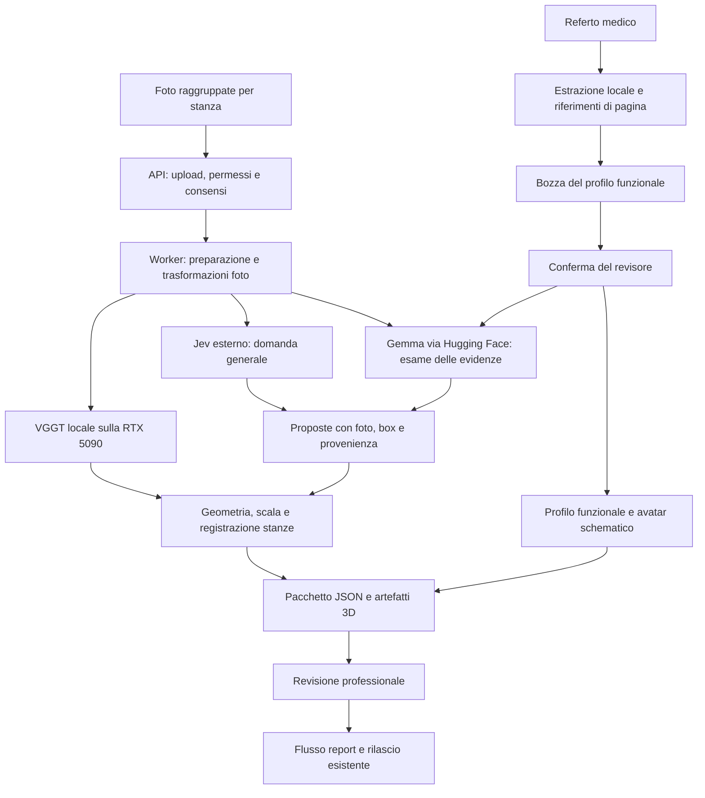

# Step Wise — stack e flusso backend

**Direzione corrente:** sviluppo del backend sul PC con NVIDIA RTX 5090 Laptop; VGGT locale; Gemma tramite Hugging Face; Jev tramite API esterna. L’interfaccia web esistente non rientra nel prossimo ciclo. Il piano backend dettagliato e aggiornato è in [`docs/piano-3d-locale.md`](docs/piano-3d-locale.md).

## Cosa funziona già

Il repository contiene una API FastAPI autenticata, archivio SQLite, coda worker persistente, preparazione delle foto, casi di fixture dichiarati, revisione professionale, rilascio protetto e generazione HTML/PDF in italiano. Le verifiche CPU e fixture riportate in [`docs/runtime.md`](docs/runtime.md) non equivalgono al flusso reale.

VGGT ha già ricostruito una singola foto dell’utente sulla RTX 5090, esportando camera, mappa e nuvola di punti. Jev è stato provato separatamente sulla stessa foto con uno screening generale: la prova ha proposto il tappetino come rischio d’inciampo. Nessuna inferenza Gemma e nessun flusso live completo sono ancora verificati. Il piccolo evaluation set Jev con 42/42 presenze e 8/8 localizzazioni corrette sopra IoU 0,5 resta una valutazione selezionata e separata, non una stima dell’accuratezza di sistema: [report Jev](eval/jev/README.md).

## Flusso backend previsto

Referto e consensi rimangono separati dalle foto inviate a Jev. Gemma può ricevere solo dati essenziali con consenso esplicito, tramite Hugging Face; il token resta sul backend. Profilo, rischi e avatar mantengono riferimenti alla fonte e ai campi confermati. Le geometrie senza calibrazione dichiarano unità relative. Le stanze senza foto di collegamento restano componenti separate, non una casa allineata per supposizione.

## Componenti

| Area | Tecnologia attuale o prevista | Scopo |
|---|---|---|
| API | Python, FastAPI, Pydantic | Intake per stanza/documenti, job, output e asset autenticati |
| Coda | Worker Python esistente, un job per volta | Esecuzione CPU e scheduling del lavoro GPU locale |
| Persistenza | SQLite e filesystem protetto | Revisioni strutturate, input, scene e report |
| Preparazione | Pillow, OpenCV già presenti | Orientamento, normalizzazione foto e coordinate di ritorno |
| Screening visivo | Jev, servizio esterno già integrato | Candidato generale, box, copertura e riferimento alla foto |
| Modello linguistico | Gemma 4 31B IT via Hugging Face Inference Providers | Evidenze strutturate e profilo funzionale limitato alle fonti |
| Ricostruzione | VGGT-1B, PyTorch CUDA | Pose, profondità e nuvola; ambiente GPU e pesi già verificati per la prova singola |
| Geometria | NumPy e componenti OpenCV esistenti | Associazioni multivista, calibrazione esplicita e registrazione delle stanze |
| Avatar | MPFB2/Blender headless, profilo JSON, export GLB | Figura umanoide parametrica e ausili confermati; sorgenti e consenso nel JSON privato |
| Report | Template HTML/PDF e flusso professionale esistente | Proposta del sistema, revisione e rilascio controllati |

## Confini e condizioni

- La domanda per Jev è generale e non suggerisce oggetti o categorie che potrebbero non esserci. Jev propone candidati; non certifica tutti i pericoli presenti.
- Il referto può sostenere una bozza del profilo. Il reviewer conferma i fatti prima che personalizzino un rischio o l’avatar. La storia di una lesione non indica automaticamente una condizione attuale.
- La singola foto della cucina dimostra che il modello può produrre una stima 3D locale. Non dimostra una scena coerente, ancore multivista, misure metriche o ricostruzione della casa.
- Una o più stanze si uniscono solo tramite acquisizioni di passaggio, viste sovrapposte o riferimenti geometrici sufficienti. ArUco fissa la scala, ma non allinea da solo origine e orientamento di due stanze.
- Quando una box riguarda un cavo o un oggetto sottile a terra, la profondità dei pixel può essere quella del pavimento. Se non si può verificare la geometria, il backend conserva la prova in foto e omette l’ancora 3D.
- API, modelli e validatore devono preservare privacy, ownership, riferimenti di provenienza, revision guards e rilascio professionale già presenti.

## Fuori dall’ambito corrente

Frontend, NVIDIA-to-AMD portability, vLLM su AMD, video e Gaussian Splatting. Queste direzioni sono future e non configurano l’implementazione richiesta ora.
