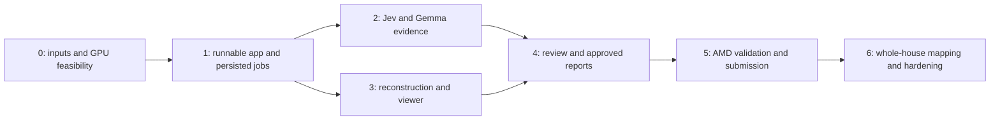

# Step Wise implementation plan

**Prepared:** 16 October 2026 · **Complexity:** High · **AMD access:** Not confirmed

**First beta status — 16 October 2026:** CPU fixture workflow implemented and verified with 22 offline tests, production frontend build, CPU Compose HTTP smoke, desktop/phone browser checks and multipage PDF inspection. Live Jev/Gemma/VGGT adapters exist but have no validated service/AMD execution. The user requested convergence on this beta; real capture/GPU evidence, the inspected real baseline, full evaluation and P1/P2 remain open. Checkboxes below refer only to tasks whose applicable CPU acceptance was verified; they do not close the P0 hardware/quality gates. See [runtime evidence and remaining gates](docs/runtime.md).

**Backend direction updated 16 October 2026:** the proposed target is the NVIDIA RTX 5090 Laptop on the developer PC, with local VGGT, Gemma via Hugging Face, room-grouped photos plus a clinical report, and reviewer-visible hazard evidence and functional avatar. AMD and frontend are outside this backend pass. Use the [current backend plan](docs/piano-3d-locale.md) for scope and sequence; implementation awaits the user's explicit go-ahead. Older AMD milestones below describe the previous proposal.

## 1. Objective and scope

Build a working assessment from overlapping home photos and a confirmed patient profile to evidenced findings, a 3D point cloud, professional review, and an approved Italian web/PDF action plan.

This is the earlier AMD-first implementation handoff. The repository also contains [the product blueprint](STEP_WISE.md), [the stack and data flow](TECH_STACK.md), and [the Jev evaluation](eval/jev/README.md). The CPU application and fixture workflow exist; the proposed backend work for the RTX 5090, Hugging Face Gemma, clinical intake and avatar is tracked in [the backend plan](docs/piano-3d-locale.md). Preserve the existing evaluation, raw results, attribution, and uncommitted user changes.

Build one complete room first. Then test a connected bedroom–hallway–bathroom capture. Support multiple separate room scenes within one assessment from the outset; automatic whole-house alignment is an extension after the core product works.

### Priority and completion criteria

| Priority | Deliverable | Completion evidence |
|---|---|---|
| P0 | Full workflow for one staged room and a fictional profile | A fresh upload produces real model findings, an AMD reconstruction, supported pins, review decisions, and a released Italian report |
| P0 | Meaningful AMD execution and meaningful Gemma use | Hardware/runtime manifest, actual image-plus-JSON requests, outputs, stage timings, GPU memory observations |
| P0 | Evidence and review integrity | Findings cite existing evidence; rejected findings cannot become actions; unapproved or stale reports cannot be released |
| P0 | CPU development path | The same application works with explicitly labelled fixtures while GPU access is pending |
| P0 | Repeatable single-case development loop | One fixed room/profile can be run, inspected, checked and compared; a failing stage can be rerun using compatible saved inputs |
| P1 | Validated scale and a few measurements | Known-size reference, stored calibration evidence, comparison with tape measurements; unsupported dimensions remain unknown |
| P1 | Connected rooms and profile comparison | One connected capture, if reconstruction validates; same visual evidence assessed for two confirmed profiles |
| P2 | Automatic whole-house mapping and other extensions | Separate milestones in Sprint 6; never prerequisites for P0 |

The five-minute processing target and median measurement-error target below 3 cm are evaluation goals, not promised capabilities. Do not claim reduced falls, clinical accuracy, or reviewer time savings without corresponding evidence.

### Instructions for the coding agent

- Read this file, `TECH_STACK.md`, `STEP_WISE.md`, and applicable `AGENTS.md` instructions before editing. Use this plan for implementation order; keep the product constraints from the blueprint.
- Implement the P0 path before extensions. Complete each task's acceptance checks before marking it done. Tasks are small reviewable changes; committing or pushing still requires the user's authorization under the workspace rules.
- Use ordinary functions and a few modules. Keep one worker, SQLite, filesystem storage, HTTP calls, React state, and polling. Add a dependency only for a concrete requirement.
- Work through independent CPU tasks while GPU access is pending. Record blocked GPU tasks explicitly. A fixture run is development progress, not proof of AMD execution.
- Pin dependencies and GPU images once a smoke test passes. Do not invent successful versions, benchmark numbers, detection results, guidance, or centimeter measurements.
- Use staged homes and fictional profiles throughout the hackathon build. No real patient intake is part of this plan's P0 scope.
- Make `room-001` the first reproducible case and keep its check loop working as each stage is implemented. Fix its failures before expanding the dataset; one passing case establishes a development baseline, not general accuracy.

## 2. Architecture and implementation decisions

### Processes

| Process | Responsibilities | Runtime |
|---|---|---|
| `api` | FastAPI endpoints, database access, protected assets, reviewer actions, built React app | CPU Python; same-origin frontend |
| `worker` | Persisted jobs, photo preparation, Jev, VGGT, geometry, Gemma calls, report/PDF generation | CPU fixture image locally; ROCm PyTorch image for live reconstruction |
| `vllm` | One Gemma endpoint used for evidence assessment and report drafting | Separate validated ROCm container; internal access |

The API enqueues work and returns promptly. GPU work never runs inside an HTTP request or FastAPI `BackgroundTasks`. A separate worker makes job status survive API restarts. FastAPI documents the limits of in-process background computation; the single-host SQLite queue below is our chosen small deployment design. [FastAPI background tasks](https://fastapi.tiangolo.com/tutorial/background-tasks/)

Use `sqlite3` from Python's standard library with parameterized SQL, foreign keys, short transactions, a busy timeout, and WAL mode. API and worker share one local persistent volume on one host. WAL is not a multi-host/network-filesystem deployment design. [SQLite transactions](https://www.sqlite.org/lang_transaction.html), [WAL](https://www.sqlite.org/wal.html)

### GPU strategy

- Target `google/gemma-4-31B-it` in BF16 on one MI300X. Treat this as a target until the exact image, GPU access, and image/JSON inference pass validation. The official vLLM recipe includes an AMD Gemma deployment. [Gemma recipe](https://docs.vllm.ai/projects/recipes/en/stable/Google/Gemma4.html)
- Keep reconstruction and vLLM in separate dependency environments. VGGT's upstream PyTorch pins must not replace the validated PyTorch installation inside the serving container. [VGGT requirements](https://github.com/facebookresearch/vggt/blob/main/requirements.txt)
- On a 192 GB MI300X, start with one request at a time, an 8K Gemma context, at most four images per request, and a vLLM memory fraction around 0.55. These are starting settings to measure, not a tested launch configuration. Increase only from observed requirements.
- Feed Gemma room views in bounded batches and combine structured findings. The reconstruction photo count is separate from the per-request Gemma image limit. Every selected overview must participate in the checklist sweep or be marked unassessed.
- Run heavy stages sequentially. vLLM remains resident unless explicitly stopped or unloaded; idle requests do not free its allocations. Reserve measured headroom for VGGT, or reconstruct before starting Gemma on a smaller GPU.
- Prefer standard PyTorch operators and CPU geometry. PyTorch on ROCm retains the `torch.cuda` interface; do not replace device strings with `rocm`. Recheck dtype selection and hardware-specific branches. [PyTorch ROCm semantics](https://docs.pytorch.org/docs/stable/notes/hip.html)
- If 31B does not meet measured latency/memory limits, evaluate the blueprint's 26B-A4B fallback or another explicitly documented Gemma variant. Record the actual model and rerun quality checks. Quantization is a separate evaluated configuration.

### Execution modes and access branches

| Condition | Coding agent action | What can be claimed |
|---|---|---|
| No GPU access yet | Build CPU fixture workflow; prepare runtime scripts and staged captures | Application flow only |
| AMD model API only | Inspect supported model, image input and JSON output; configure it if suitable; continue seeking a supported reconstruction runtime | Only stages actually executed there; a text-only endpoint cannot replace VGGT |
| Raw compatible AMD GPU access | Run both GPU smoke tests and the co-residency test; capture manifests | Measured AMD stages |
| NVIDIA GPU available during development | Validate portable worker logic with a separate CUDA environment | CUDA development results; still repeat on AMD |

Use explicit per-stage backends: `RECON_BACKEND=fixture|vggt`, `GEMMA_BACKEND=fixture|http`, and `JEV_ENABLED=true|false`. Record `fixture`, `live`, or `replay` provenance on every generated artifact. Never silently change a failed live request into fixture output. Replay requires matching source checksums, model/prompt versions, and a visible label.

### Proposed files

Create files as their tasks need them; this is a placement guide, not a request to scaffold empty modules.

```text
pyproject.toml
backend/src/step_wise/
  config.py                 # environment configuration
  models.py                 # Pydantic contracts
  db.py                     # sqlite3 access and schema setup
  schema.sql
  api.py                    # HTTP routes and built frontend
  worker.py                 # persisted jobs and stage orchestration
  cli.py                    # init, seed, single-case run/check/inspect/compare, cleanup
  pipeline/
    photos.py               # decoding, normalization and transforms
    jev.py                  # external typed inspection
    reconstruction.py       # VGGT, cameras, depth, PLY export
    geometry.py             # calibration, measurements, anchors
    gemma.py                # HTTP assessment and report calls
    reports.py              # validated report snapshots and PDF
  prompts/
    assessment.txt
    report.txt
  templates/report.html
web/
  package.json
  package-lock.json
  src/
    App.tsx
    api.ts
    types.ts
    components/             # intake, progress, findings, viewer, report
guidance/checklist.json
demo/
  manifest.json
  profiles.json
  cases/room-001.json        # fixed capture/profile selection and expected behavior
  fixtures/                 # small labelled development artifacts
scripts/
  gpu_smoke.py
  benchmark.py
  smoke_e2e.py
tests/                      # focused Python unittest checks
Dockerfile.api
Dockerfile.worker
compose.yaml
compose.rocm.yaml
.env.example
README.md
docs/runtime.md
```

Store uploaded media and generated outputs under a gitignored `data/` volume. Keep downloaded checkpoints in a separate persistent model cache. Reuse `requests` and Pillow where appropriate. Use FastAPI/Pydantic, `python-multipart`, Uvicorn, Jinja2, WeasyPrint, NumPy, OpenCV with ArUco support, and Open3D only in the processes that need them. Runtime images supply the tested GPU stack.

Use Node 22.12+ with a pinned supported release, React/Vite/TypeScript, Tailwind's Vite integration, and three.js directly. Use `fetch`, ordinary component state, and a small polling hook; add no global state framework. Commit the npm lockfile when commits are authorized. [Vite setup](https://vite.dev/guide/), [Tailwind Vite integration](https://tailwindcss.com/docs/installation/using-vite)

## 3. Contracts to settle before integration

### Database and API records

Use UUIDs, UTC timestamps, schema versions, explicit foreign keys, and nullable unknown values. Store rich immutable stage payloads as validated JSON where separate relational columns add no query value.

| Record | Required contents |
|---|---|
| `Assessment` | ID, fictional display label, profile, confirmation state, processing disclosure/consent, status, input revision, review revision, timestamps |
| `Photo` | Assessment/scene IDs, room label, overview/detail role, checksum, dimensions, protected asset paths, preparation/transformation metadata |
| `Asset` | Opaque ID, assessment/report scope, server-generated relative path, media type, byte size, checksum and provenance; raw and family-visible assets have separate access rules |
| `Scene` | Room/group label, selected reconstruction photo IDs, reconstruction status, coordinate manifest, scale state and calibration evidence |
| `Job` | Kind (`analyze` or `report`), input/review revisions, status, current stage, stage timings, attempt/parent ID, heartbeat, safe error, output manifest |
| `CandidateFinding` | Photo ID, checklist question, producing model/version, typed response, presence/coverage, optional canonical box, unknown attributes, provenance |
| `Measurement` | Scene ID, endpoints/feature, value/unit or null, method, calibration ID, uncertainty/validation status, source photos |
| `Hazard` | Stable ID, category, observation, profile relevance, proposed priority, evidence regions, measurement/guidance IDs, optional anchor, uncertainty, suggested action, producer |
| `Review` | Hazard ID, approve/edit/reject/defer decision, reviewed effective fields, reviewer identity, note, revision and time |
| `Report` | Assessment and source revisions, accepted hazard snapshot, coverage limitations, validated plan JSON, HTML/PDF paths, draft/released status, approver, release time, family-token hash/expiry |

The confirmed profile contains a free-text description plus mobility aid, supplied aid width if relevant, vision/support needs, relevant history, and named daily routes. Unknowns remain null/unknown. A model may suggest a question; it cannot silently populate diagnoses or reviewer-confirmed fields.

Keep environmental observation separate from priority. Object presence, image coverage, attachment uncertainty, model confidence, geometry confidence, and professional approval are different fields. Do not present a model score as fall probability.

Schema and reference validation establish structural integrity, not visual or clinical correctness. A professional still checks the evidence and final wording. Findings, measurements and assets must belong to the same assessment and compatible scene/revision, even when every referenced UUID exists somewhere in the database.

Use these shared values rather than different strings in each layer:

- Priority: `urgent | important | recommended`; review decisions: `pending | approve | edit | reject | defer`.
- Presence: `present | absent | unknown`; coverage: `visible | partial | obscured | out_of_frame | unknown`. Preserve the provider's original response separately from this application interpretation.
- Store physical measurements in meters internally; format centimeters for readers. A metric value requires method, scene, calibration/reference and validation state. A known manual tape value is explicitly `manual_tape`, never attributed to reconstruction.
- Store anchors as `scene_id`, `position_world: [x, y, z]`, method and source IDs, or null. Relative anchors do not imply metric scale.
- Gemma assessment output contains bounded `hazards`, per-photo/category `coverage`, and `follow_up_requests`. Each hazard uses the fields listed above. The backend assigns database IDs and provenance; the model cannot assign trusted measurements or change lifecycle state.
- Demo reports identify staged data and fictional profiles. If a team member simulates the reviewer, label that role accurately rather than implying an actual clinical approval.

### Coordinates and reconstruction manifest

Adopt canonical **upright original-image pixels** for evidence. Jev boxes are normalized `[left, top, right, bottom]` in its prepared input; convert them back through recorded transforms before storing canonical evidence. [TypeSafe Box](https://docs.typesafe.ai/primitives/box)

Persist, per image:

- Raw and upright sizes, EXIF rotation already applied, and checksums.
- Jev input size and resize/padding transform.
- VGGT input size, exact crop/resize/padding transform, intrinsics, world-to-camera extrinsics, depth and confidence asset paths.
- Coordinate conventions, depth interpretation, and photo ID to tensor-index mapping.

Persist, per scene: checkpoint/commit, selected photo IDs, raw coordinate units, metric-scale status/factor, calibration evidence, point-cloud path, and display transform. VGGT's image loader performs cropping/resizing; capture those actual transforms rather than assuming normalized Jev coordinates transfer directly. Use the upstream unprojection utility where possible. [VGGT loader](https://github.com/facebookresearch/vggt/blob/main/vggt/utils/load_fn.py), [VGGT outputs](https://github.com/facebookresearch/vggt)

Keep one raw world coordinate system. Apply any viewer rotation/scale consistently to the point cloud, camera markers, pins, and measurement endpoints. A display transform must not change the backend's measurement meaning. Reject cross-scene distances unless alignment and scale are validated.

### State and revision rules

```text
Assessment: draft -> queued -> processing -> review_ready
                                             |
                                             v
                         report_drafting -> report_ready -> released

Job: queued -> running -> succeeded | failed | interrupted
Scene: pending -> ready | insufficient_coverage | failed
Scale: unknown -> proposed -> validated | rejected
```

- An analysis may finish `review_ready` with explicit failed/unassessable scenes. Preserve valid image findings when 3D fails. A total inference failure is a failed job, not an empty safe assessment.
- A failed/interrupted analysis sets the assessment to `failed` with an explicit retry action. A failed report job returns it to `review_ready` with the draft error; it does not discard valid review decisions. Job status is the source of stage-level failure detail.
- Enforce one active job per assessment. Lock uploads/profile edits during active processing. Afterward, an input edit increments `input_revision` and invalidates analysis, reviews, and report readiness; preserve old artifacts as superseded.
- Each review edit increments `review_revision`. A report job captures input and review revisions. Commit results only if those revisions still match; release has the same transactional guard.
- Report generation requires all actionable findings to have a review decision. Deferred items become clearly stated limitations or follow-up requests, not accepted actions. Rejected items never enter the action list.
- Released reports are immutable snapshots. Further assessment changes require a new assessment/explicit revision workflow; do not alter an already shared report in place.
- Missing guidance or measurements must never be repaired by accepting an invented reference. Validation failure produces a reviewable error or deterministic fallback.

### HTTP surface

Use `/api` for every API route. These are the implementation contract, not existing endpoints.

| Method/path | Behavior |
|---|---|
| `GET /api/health` | Process health and backend readiness without secrets |
| `POST /api/assessments` | Create profile, confirmation/disclosure fields, and assessment |
| `GET/PATCH /api/assessments/{id}` | Fetch or edit draft inputs with revision checking |
| `POST /api/assessments/{id}/photos` | Multipart upload for one scene/room; return stable photo IDs |
| `DELETE /api/assessments/{id}/photos/{photo_id}` | Remove a draft photo and invalidate downstream inputs |
| `POST /api/assessments/{id}/analyze` | Validate inputs and enqueue; return `202` with job ID |
| `GET /api/jobs/{job_id}` | Stage, counts, status, warnings, timings and safe error |
| `GET /api/assessments/{id}/findings` | Candidates, hazards, coverage, measurements and review decisions |
| `GET /api/assessments/{id}/scenes` | Scene manifests and protected viewer-asset URLs |
| `PUT /api/assessments/{id}/scenes/{scene_id}/calibration` | P1: propose or confirm a known reference and store independent validation evidence |
| `PUT /api/assessments/{id}/reviews/{hazard_id}` | Save reviewed fields/decision with expected revisions |
| `POST /api/assessments/{id}/measurements` | Record reviewer-selected endpoints against a scene manifest |
| `POST /api/assessments/{id}/reports` | Enqueue report draft from a validated accepted snapshot |
| `GET /api/reports/{report_id}` | Reviewer-only draft or released snapshot |
| `POST /api/reports/{report_id}/release` | Final approval; validate revisions and create family capability |
| `GET /api/family/{token}` | Released report only; no assessment editing or draft access |
| `GET /api/assets/{asset_id}` | Authorized, server-resolved asset; never a caller-provided disk path |
| `DELETE /api/assessments/{id}` | Delete metadata/assets and revoke family capability; reject during active work |

Use `409` for stale revisions, invalid lifecycle transitions, and duplicate active work; `413` for configured size limits; `422` for invalid inputs. Use a consistent safe error body. Route profile JSON separately from multipart images. FastAPI file uploads require `python-multipart` and support spooled `UploadFile` handling. [FastAPI uploads](https://fastapi.tiangolo.com/tutorial/request-files/)

## 4. Delivery order and dependencies

Sprints are runnable increments, not promises that each will fit a day. With the event ending 18 October, implement the P0 slice across Sprints 1–5 before expanding any individual subsystem. Keep the GPU access request visible from the start.



Independent work becomes possible after the shared contracts exist: browser intake, model clients, and reconstruction can progress separately. A single coding agent should follow task dependencies and integrate early; no multi-agent framework is needed in the product.

## 5. Sprint 0 — Inputs and feasibility

**Goal:** Establish usable test data and identify whether the planned GPU stages can run. GPU tasks may remain explicitly blocked while CPU work continues.

### [x] 0.1 Record runtime choices and backend readiness — P0

- **Files:** `docs/runtime.md`, `.env.example`, later `backend/src/step_wise/config.py`.
- **Work:** Document confirmed/unconfirmed GPU access, desired stage backends, model/checkpoint access, model licenses, available RAM/disk, and external image-processing boundary. Record environment variable names without values. Check actual AMD access for shell/container/device permissions versus a hosted API.
- **Dependencies:** None.
- **Accept/verify:** A readiness checklist identifies which real stages can run and why others cannot. No key or private credential appears in documentation or logs. No GPU is provisioned by merely starting fixture mode.

### [ ] 0.2 Prepare a reproducible staged capture — P0

- **Files:** `demo/manifest.json`, `demo/profiles.json`, `demo/cases/room-001.json`, gitignored `data/demo/`, small fixtures under `demo/fixtures/`.
- **Work:** Capture 12–20 overlapping views of one room, including a known-size printed marker and staged visible hazards; add detail photos separately. Record checksums, room labels, capture roles, a few tape measurements, and hand-labelled presence/coverage/regions before model calls. Supply two fictional profiles for later comparison. Freeze `room-001` as a reference to a specific photo selection/profile plus expected observations, negatives, unknowns and manual checks, following Section 12. The existing Wikimedia set remains the Jev regression set; it is not an overlapping reconstruction dataset.
- **Dependencies:** None; independent of 0.1.
- **Accept/verify:** Manifest paths/checksums resolve, the scene has changing viewpoints rather than a pure rotation, at least one region is intentionally unassessable, and the fixture has attribution/permission records. A small synthetic point cloud may unblock viewer development only if labelled synthetic.

### [ ] 0.3 Smoke-test Gemma on the intended AMD runtime — P0, GPU-dependent

- **Files:** `scripts/gpu_smoke.py`, `docs/runtime.md`, gitignored run artifacts.
- **Work:** Once access exists, load the target through the official ROCm serving path. Send one image, then several images, with a small Pydantic-derived JSON schema. Initially use a standalone smoke schema; switch to the canonical schema once 1.2 exists. Check the returned content with Pydantic and known source IDs. Test a missing/ambiguous object. Start with the GPU settings in Section 2, then record actual working settings and image digest.
- **Dependencies:** 0.1, 0.2 and compatible AMD access.
- **Accept/verify:** Save hardware identity, exact model revision, server/container versions, sanitized request, final JSON response, elapsed time, usage, and observed peak device memory. Record failure precisely if unavailable. A text-only response does not pass the vision test. Use current `response_format` JSON schema support rather than obsolete structured-output flags. [vLLM structured outputs](https://docs.vllm.ai/en/latest/features/structured_outputs/)

### [ ] 0.4 Smoke-test VGGT and GPU coexistence — P0, GPU-dependent

- **Files:** `scripts/gpu_smoke.py`, `docs/runtime.md`.
- **Work:** In a separate ROCm PyTorch environment, pin a VGGT commit/checkpoint and reconstruct the staged scene. Save depth, cameras, confidence and PLY. Increase frame count gradually. Test with Gemma resident under a capped memory budget; if that fails, test explicit unload/reload scheduling.
- **Dependencies:** 0.1, 0.2 and compatible GPU access; coexistence check also needs 0.3.
- **Accept/verify:** A real point cloud is visually coherent, artifacts are readable, NaN/invalid poses are rejected, and memory/latency are measured for the exact frame count and resolution. Save the successful schedule or a blocked status. Use reference images for geometry checks rather than trusting a plausible-looking cloud.

**Sprint demo:** Show the staged dataset, the readiness record, and any real saved GPU outputs. Until GPU access exists, demonstrate the manifest validator and identify the exact blocked checks.

## 6. Sprint 1 — Runnable application and persisted jobs

**Goal:** A CPU-only browser workflow uploads data, processes a labelled fixture job, and reloads its results from disk/database.

### [x] 1.1 Create the minimal runnable services — P0

- **Files:** `pyproject.toml`, `backend/src/step_wise/{config.py,api.py,cli.py}`, `web/package.json`, `web/src/App.tsx`, `.env.example`, `.gitignore`, `README.md`.
- **Work:** Add package/runtime entry points, health endpoint, React/TypeScript Vite app, Tailwind plugin and Vite `/api` proxy. Configure the API to serve built frontend assets in deployment. Default to explicit fixture settings for local development; keep secrets server-side. Include `data/`, model caches and build outputs in ignore rules.
- **Dependencies:** 0.1; CPU work can proceed before GPU checks.
- **Accept/verify:** API health and a browser page run locally; frontend production build/typecheck passes. SPA fallback never turns `/api` errors into HTML. Startup reports execution mode without printing secrets.

### [x] 1.2 Implement records, validators and schema initialization — P0

- **Files:** `backend/src/step_wise/{models.py,db.py,schema.sql}`, `web/src/types.ts`, `tests/test_contracts.py`.
- **Work:** Implement Section 3 records, JSON contracts, foreign keys, indexes and revision fields. Use a schema version and one initialization command; add versioned SQL migrations only when changes require them. Export or explicitly synchronize TypeScript API types. Keep model output strict and bounded.
- **Dependencies:** 1.1.
- **Accept/verify:** A fresh and existing database initialize safely; invalid boxes, non-finite coordinates, invalid enums and dangling references fail validation. Unknown profile fields and unassessable coverage round-trip without becoming false/safe.

### [x] 1.3 Implement protected assessment and asset storage — P0

- **Files:** `backend/src/step_wise/{api.py,db.py,config.py}`, `tests/test_api.py`.
- **Work:** Create/get/edit assessments and store uploads under generated IDs with `Asset` records. Start with configurable limits of 20 MiB/file, 200 MiB/assessment, 40 photos and 40 megapixels/decoded image; these are chosen app limits. Validate decoded format, count and dimensions, reject traversal/caller-supplied paths, stream bounded uploads, clean partial files, and add a shared reviewer-auth guard. One configured reviewer can access demo assessments; this is not a multi-tenant ownership system. Require acknowledgement of external photo processing before Jev is enabled for an assessment.
- **Dependencies:** 1.2.
- **Accept/verify:** Upload and fetch a valid image; reject corrupt, oversized and non-image files. An unauthenticated request cannot fetch source photos, and another assessment's asset cannot be substituted as evidence. No raw filesystem path or credential is returned. Files and rows remain consistent after a simulated write failure.

### [x] 1.4 Implement the SQLite worker queue — P0

- **Files:** `backend/src/step_wise/{worker.py,db.py,api.py}`, `tests/test_jobs.py`.
- **Work:** Enqueue `analyze`/`report` jobs with revision snapshots. Claim queued work in a short `BEGIN IMMEDIATE` transaction; use a process-lifetime Linux file lock on the shared local volume to enforce one worker. Track stage completion, heartbeat, warnings and safe errors. Write attempt outputs to temporary paths and publish completed manifests atomically. At exclusive worker startup, mark abandoned running jobs interrupted; retry is an explicit new attempt.
- **Dependencies:** 1.2, 1.3.
- **Accept/verify:** API restart preserves queued work; worker restart identifies interrupted work; duplicate submissions do not launch duplicate active jobs. No database transaction stays open during HTTP/GPU computation. Repeated completion cannot duplicate hazards or report snapshots. A heartbeat timeout alone must not launch a second worker over a still-running GPU call.

### [x] 1.5 Add an explicitly labelled fixture pipeline — P0

- **Files:** `backend/src/step_wise/worker.py`, `demo/fixtures/`, `backend/src/step_wise/cli.py`.
- **Work:** Read small fixture candidates/hazards/scene manifests through the same contracts and persist them through the worker. Add seed/reset commands restricted to the development dataset. Record provenance per artifact and return it through the API. Keep fixtures out of live-stage success paths.
- **Dependencies:** 0.2, 1.4.
- **Accept/verify:** A fixture assessment reaches `review_ready`, survives refresh, and visibly identifies generated fixture content. Live backend failure stays failed/degraded rather than returning fixture success.

### [x] 1.6 Build intake and progress screens — P0

- **Files:** `web/src/{App.tsx,api.ts}`, `web/src/components/{IntakeForm.tsx,PhotoUpload.tsx,JobProgress.tsx}`.
- **Work:** Add patient description and confirmed fields, overview/detail roles, room labels, upload previews, external-processing disclosure, capture guidance, submit and processing states. Poll job status, show completed/failed stages and recoverable errors, and stop polling on completion/unmount. Use one assessment detail view or simple routes; avoid a broad dashboard.
- **Dependencies:** 1.3, 1.4; fixture demonstration needs 1.5.
- **Accept/verify:** Phone-width and desktop layouts work; keyboard labels/focus and readable errors are present. Refresh resumes an existing assessment. Duplicate submit is prevented in the UI and still rejected safely by the backend.

### [ ] 1.7 Add the single-case runner and inspectable outputs — P0

- **Files:** `backend/src/step_wise/{cli.py,worker.py}`, `demo/cases/room-001.json`, `tests/test_case_runner.py`, `README.md`.
- **Work:** Implement `case run`, `case check`, `case inspect` and `case compare` as small CLI commands around the same stage functions/validators used by the worker. Begin with the fixture path and extend it in Sprints 2–4. Give each run an isolated development assessment/database and distinct artifact directory with immutable stage outputs; obey the same GPU lock as normal processing. Save stage fingerprints, inputs/outputs, execution provenance, errors and expectation results. Support rerunning a selected stage with compatible saved prerequisites; see Section 12 for commands and invalidation rules. Do not build a second inference pipeline or general experiment framework.
- **Dependencies:** 0.2, 1.2, 1.4, 1.5.
- **Accept/verify:** Run the fixture case twice, inspect its gallery, and compare semantic results. Deliberately fail one expectation and surface the exact observation/artifact. Deliberately corrupt one cached artifact or change an input hash and refuse reuse. A failed run retains partial diagnostics without overwriting a prior success. Missing live dependencies report blocked; fixture mode performs no external model calls.

**Sprint demo:** Start CPU services, create a fictional assessment, upload staged photos, run fixtures, refresh the page, and inspect persisted findings and job stages. Run `room-001` through the CLI and show its saved check summary and evidence gallery. Record fixture labels in both walkthroughs.

## 7. Sprint 2 — Real image evidence and Gemma assessment

**Goal:** Replace fixture image findings with live Jev and Gemma outputs while retaining source evidence and an image-only review path.

### [x] 2.1 Prepare photos and record transforms — P0

- **Files:** `backend/src/step_wise/pipeline/photos.py`, `tests/test_photos.py`.
- **Work:** Decode safely, rotate pixels upright with EXIF handling, preserve canonical upright coordinates, strip metadata from processed copies, hash normalized bytes, and flag exact duplicates/blur. Produce thumbnails, Jev-compatible copies and reconstruction inputs without overlays. Resize/pad deliberately and store transforms. Begin with JPEG/PNG uploads; explicitly reject HEIC until a tested decoder is added.
- **Dependencies:** 1.2, 1.3.
- **Accept/verify:** Portrait EXIF, padded panorama, duplicate, corrupt and small-image cases behave predictably. Map a known box through resize/padding and back within a pixel tolerance. Jev copies meet its 280–1568 pixel-per-side limits; quality flags never assert room safety. [TypeSafe image preparation](https://docs.typesafe.ai/images)

### [x] 2.2 Add a small versioned guidance checklist — P0

- **Files:** `guidance/checklist.json`, `backend/src/step_wise/models.py`, `tests/test_guidance.py`.
- **Work:** Create a small set of hazard categories, observation/coverage questions, permitted suggested actions, source title/URL/date and applicability. Start with verified public material such as CDC STEADI's home checklist. Clearly mark regional applicability; do not convert general guidance into Italian building law. Add numeric thresholds only when a verified source supports the specific use. Select entries directly by category.
- **Dependencies:** 1.2.
- **Accept/verify:** IDs are unique; referenced sources and category mappings resolve. Every proposed action can cite an existing entry. Unsupported cost estimates and numeric requirements remain absent. [CDC STEADI resources](https://www.cdc.gov/steadi/patient-resources/)

### [ ] 2.3 Implement Jev inspection with application-level gates — P0

- **Files:** `backend/src/step_wise/pipeline/jev.py`, `tests/test_jev.py`; reuse `eval/jev/manifest.json` and saved responses as regression inputs.
- **Work:** Adapt the existing tested HTTP request structure without modifying its historical experiment. Pin `jev-1.14.0`, fixed API host, no redirects, explicit images header and timeouts. Send prepared photos only, using one image reference in state. Ask atomic presence/coverage/attribute questions; pair each target box with presence. Gate absent boxes and dependent attributes; preserve unknown attachment. For repeated objects use bounded, explicit target descriptions or bounded crop passes and retain the distinction from exhaustive discovery.
- **Dependencies:** 2.1, 2.2.
- **Accept/verify:** Existing absent-target boxes are suppressed; no-rug attachment answers are ignored; malformed/out-of-range boxes fail; padded-only boxes do not become evidence. A request containing profile fields fails a payload-boundary test. Record model, question/prompt version, response, usage and duration. Do not automatically retry an ambiguous billed timeout; classify 429/5xx separately and apply only a documented bounded policy. [TypeSafe images](https://docs.typesafe.ai/images), [Box semantics](https://docs.typesafe.ai/primitives/box)

### [ ] 2.4 Implement the Gemma HTTP client and assessment prompt — P0

- **Files:** `backend/src/step_wise/pipeline/gemma.py`, `backend/src/step_wise/prompts/assessment.txt`, `tests/test_gemma.py`.
- **Work:** Call the configured internal OpenAI-compatible endpoint through `requests` with bounded timeouts. Supply confirmed profile, original room views/crops, candidates, coverage and selected guidance. Use a Pydantic-derived JSON schema, bounded output, and concise evidence-based explanations. Treat image text, patient free text and model outputs as data, never instructions to call tools or change configuration. Stream no private reasoning into the UI.
- **Dependencies:** 1.2, 2.1, 2.2; candidates from 2.3 are optional when Jev is disabled. Live verification requires 0.3.
- **Accept/verify:** Parse structured final JSON, reject unknown evidence/guidance IDs and invented measurement IDs, and reject unconfirmed profile facts. Handle timeout/truncation/schema failure explicitly, with at most one bounded repair request. Log final outputs/provenance safely. Input photos are sent as controlled inline data, not arbitrary model-selected fetch URLs.

### [ ] 2.5 Fuse findings and run the additional checklist sweep — P0

- **Files:** `backend/src/step_wise/pipeline/gemma.py`, `backend/src/step_wise/worker.py`, `backend/src/step_wise/models.py`.
- **Work:** Let Gemma inspect overview views beyond Jev positives, in bounded batches. Mark new Gemma candidates by producer and validate them identically. Merge only supported duplicates; preserve evidence and disagreement. Produce image-only hazards when geometry is unavailable, retaining null measurements/anchors. Reject an all-failed assessment instead of publishing a zero-hazard success.
- **Dependencies:** 2.3, 2.4; can use Jev-disabled mode deliberately.
- **Accept/verify:** A finding outside Jev positives can reach review with evidence; two genuinely separate rugs are not merged just because their category matches. Missing coverage stays visible. Jev failure may continue with real Gemma inspection and a degraded-stage warning; Gemma failure cannot be reported as completed personalization.

### [x] 2.6 Build the evidence findings panel — P0

- **Files:** `web/src/components/{FindingsPanel.tsx,EvidenceImage.tsx}`, `web/src/types.ts`.
- **Work:** Show observation, profile relevance, priority, source photo boxes, producing stage, uncertainty and coverage. Map canonical boxes to the actual contained image rectangle, accounting for browser letterboxing. Keep observation distinct from proposed action and approval state.
- **Dependencies:** 1.6, 2.5.
- **Accept/verify:** Clicking a finding selects the right photo/box across viewport sizes. Unsupported/absent boxes never appear as confirmed hazards. Show image-only and unassessable states clearly. A fixture result cannot lose its provenance label.

**Sprint demo:** Process one staged upload through live inspection and Gemma assessment; inspect evidence and uncertainty. Repeat with Jev disabled to exercise Gemma-only inspection. If GPU access is blocked, run client-contract fixtures and keep the live Gemma check pending.

## 8. Sprint 3 — 3D reconstruction, geometry and viewer

**Goal:** Attach reliable findings to a real point cloud; add scale/measurements only when supported. Keep review useful if a scene fails.

### [ ] 3.1 Implement the VGGT reconstruction adapter — P0

- **Files:** `backend/src/step_wise/pipeline/reconstruction.py`, `backend/src/step_wise/worker.py`.
- **Work:** Feed each selected overlapping scene set to the pinned checkpoint using inference mode and validated mixed precision. Preserve stable photo ordering and actual input transforms. Export full analysis depth/confidence/cameras plus a filtered colored PLY for display. Use independent scenes for disconnected groups. Start with a configurable 20-frame cap per scene; exceeding it requests selection/more deliberate grouping rather than silently merging chunks.
- **Dependencies:** 2.1; live execution needs 0.4.
- **Accept/verify:** Real saved output conforms to Section 3, reloads without the model and contains finite valid geometry. Reject corrupted manifests, invalid poses and unusable coverage. Save timing and memory. Preserve raw outputs separately from decimated display points.

### [ ] 3.2 Add known-reference scale calibration — P1

- **Files:** `backend/src/step_wise/pipeline/geometry.py`, `backend/src/step_wise/api.py`, `tests/test_geometry.py`, `demo/manifest.json`.
- **Work:** Detect a specified ArUco dictionary/ID and use the printed marker's measured physical side length. Match detected corners to reliable reconstructed geometry, or triangulate with corresponding scene cameras; do not substitute background depth for marker corners. Estimate scale robustly across usable observations and store residuals. Support a reviewer-entered physical length between two verified scene points as an explicit manual-reference method. Expose the calibration endpoint, with proposed/validated/rejected decisions and independent check records. Marker pose estimation requires matching intrinsics/distortion; do not mix original-image and VGGT intrinsics. [OpenCV ArUco](https://docs.opencv.org/4.x/d5/dae/tutorial_aruco_detection.html)
- **Dependencies:** 3.1, 0.2.
- **Accept/verify:** Synthetic known-scale geometry recovers the expected factor; a real reference is checked against independent tape measurements. Missing/wrong-size/poorly reconstructed markers keep scale unknown or proposed. Never validate a scene solely by checking the same length used to calibrate it.

### [ ] 3.3 Implement reviewer-assisted measurements — P1

- **Files:** `backend/src/step_wise/pipeline/geometry.py`, `backend/src/step_wise/api.py`, `tests/test_geometry.py`.
- **Work:** Compute distances/heights from validated same-scene geometry with known scale. Start with reviewer-selected endpoints and optionally a verified floor plane. Store endpoints, feature meaning, calibration ID and uncertainty. A selected pair of points provides a distance; it does not automatically establish a minimum passage width or walker clearance. Manual tape values are a separately labelled method.
- **Dependencies:** 3.2.
- **Accept/verify:** Unit, rotated-camera and scale checks pass. Unknown scale, points from different scenes and unstable endpoints cannot produce metric claims. Independently verify selected demo distances; withhold clearance conclusions when measurement uncertainty overlaps the relevant threshold.

### [ ] 3.4 Propose and validate 3D hazard anchors — P0

- **Files:** `backend/src/step_wise/pipeline/geometry.py`, `tests/test_geometry.py`.
- **Work:** Transform evidence regions into reconstruction pixels. Unproject a confidence-filtered foreground region using the scene camera/depth conventions. A box center alone is insufficient: require a supported surface/region, consistent views, or explicit reviewer correction. Store anchor method, supporting views and uncertainty. Missing-object findings reference a verified fixture/area. Keep uncertain findings image-only.
- **Dependencies:** 3.1, 2.5; metric scale is not required for relative pins.
- **Accept/verify:** A synthetic rotated/translated camera projects and unprojects consistently; resize/crop/pad round-trips are checked. An ambiguous foreground/background box abstains. Inspect all final demo pins for wrong-surface placement and preserve rejected-anchor reasons.

### [ ] 3.5 Build the three.js scene viewer — P0

- **Files:** `web/src/components/{SceneViewer.tsx,FindingsPanel.tsx}`, `web/src/api.ts`.
- **Work:** Load binary colored PLY using three.js `PLYLoader`, render points and finding markers, fit the view, add orbit controls and synchronize selection with the evidence panel. Show a room/scene selector. Use a shared parent transform for points, pins, cameras and measurement endpoints. Dispose of GPU resources/listeners and resize correctly. Support reviewer anchor picking/correction through the review controls. Add P1 distance picking and calibration confirmation controls for 3.2–3.3 after basic inspection works. [three.js PLYLoader](https://threejs.org/docs/pages/PLYLoader.html)
- **Dependencies:** 1.6, 2.6, 3.1, 3.4; picking depends on 3.3.
- **Accept/verify:** Known fixture pins align, real source photos match selected findings, scene switching frees old resources, and a downsampled cloud remains usable on the target laptop. Loading/WebGL failure leaves the photo review path available. Browser point-cloud rendering is distinct from AMD server inference.

### [ ] 3.6 Integrate geometry into personalized assessment — P0 for pins; P1 for dimensions

- **Files:** `backend/src/step_wise/{worker.py,models.py}`, `backend/src/step_wise/pipeline/gemma.py`.
- **Work:** Run the final personalized assessment once available geometry is known; early image candidates can remain visible while it runs. Provide trusted measurement records and coverage, not just naked numbers. Validate all referenced IDs and permit only existing measurements in actions. Maintain the Jev-disabled path. Keep calibrated scene geometry optional when reconstruction fails.
- **Dependencies:** 2.5, 3.1, 3.4; numeric measurement input needs 3.2–3.3.
- **Accept/verify:** Final hazards use valid geometry references or explicit unknowns. A failed room preserves other rooms and its image evidence; no global safe status is inferred. No accepted review is overwritten by a late inference result because review starts only after the final analysis revision is ready.

**Sprint demo:** Upload the staged room, display its real cloud and a few visually checked pins, select a pin to open the photo, and demonstrate image-only fallback. If P1 calibration passes, show an independently checked distance and its method.

## 9. Sprint 4 — Professional review and released reports

**Goal:** A professional controls actionable findings and releases a validated Italian plan through web and PDF.

### [ ] 4.1 Implement review decisions and revision guards — P0

- **Files:** `backend/src/step_wise/{api.py,db.py,models.py}`, `tests/test_reviews.py`.
- **Work:** Approve/edit/reject/defer hazards, retain original proposals and reviewed effective fields, store reviewer identity/time, and enforce input/review revision checks. Include an optional reviewer-corrected anchor with scene ID, finite raw-world coordinates and method; validate it against the referenced scene. Provide explicit follow-up notes for unassessable observations. Block report drafting until required decisions exist. Editing source inputs invalidates old analysis; editing reviews invalidates draft report readiness.
- **Dependencies:** 1.2, 2.5; integrate scene links from 3.6.
- **Accept/verify:** Rejecting a hazard removes it from accepted actions, edits survive refresh, pending decisions block drafting, stale browser submissions receive `409`, and changes during generation cannot yield a releasable stale report.

### [ ] 4.2 Build the reviewer controls — P0

- **Files:** `web/src/components/{FindingsPanel.tsx,ReviewControls.tsx,ReportPreview.tsx}`.
- **Work:** Add decision controls, editable observation/priority/action text, notes, remaining-review count, deferred follow-ups, and report generation. Allow selecting/correcting a supported anchor or removing it in favor of image-only evidence. Explain why actions are disabled. Use explicit save feedback and accessible controls; distinguish loading, generation failure and stale revision states.
- **Dependencies:** 2.6, 4.1; viewer integration needs 3.5.
- **Accept/verify:** Review all sample hazards using keyboard/mouse, edit one, reject one and defer an unassessable item. Refresh preserves decisions. A concurrent update prompts reload rather than silently discarding review work.

### [ ] 4.3 Generate a constrained Italian action-plan draft — P0

- **Files:** `backend/src/step_wise/pipeline/{gemma.py,reports.py}`, `backend/src/step_wise/prompts/report.txt`, `tests/test_reports.py`.
- **Work:** Snapshot accepted reviewed findings, confirmed profile, trusted measurements and selected guidance. Ask the same Gemma endpoint for schema-constrained plan items referencing those hazard IDs. Permit wording/prioritization explanations within reviewed constraints; do not add new hazards, diagnoses, measurements or unsourced prices. Validate completeness, duplicate IDs, referenced values and priority changes. Use deterministic structured fields for measurements, priorities and source links in the rendered report. If Gemma fails, construct a plainly labelled deterministic draft from accepted findings.
- **Dependencies:** 2.4, 4.1, 1.4.
- **Accept/verify:** Only accepted IDs appear as actions, each accepted item is represented, rejected/deferred items do not become accepted actions, and supplied trusted measurements are unchanged. A model response inventing an ID or price is rejected. Deterministic fallback still requires final professional approval and does not masquerade as a successful Gemma call.

### [x] 4.4 Render web and PDF reports from the same snapshot — P0

- **Files:** `backend/src/step_wise/pipeline/reports.py`, `backend/src/step_wise/templates/report.html`, `web/src/components/ReportPreview.tsx`, `Dockerfile.worker`.
- **Work:** Render overview, prioritized actions, evidence thumbnails, verified measurements, guidance links, coverage limits, reviewer and date. Use Jinja2 autoescaping and fixed templates; the model never supplies executable HTML. Install/test WeasyPrint's Pango/font dependencies in the worker image. Restrict renderer asset fetching to known local report assets; forbid arbitrary network URLs and unrelated filesystem access. [WeasyPrint installation](https://doc.courtbouillon.org/weasyprint/stable/first_steps.html)
- **Dependencies:** 4.3.
- **Accept/verify:** Italian accents, long text, multi-page lists, uncertainty labels, source links and images render correctly. Inspect generated pages at normal zoom; no clipped text or overlapping blocks. HTML/PDF share the same snapshot hash. Escaped HTML and an external image URL cannot inject markup or trigger unwanted fetches.

### [x] 4.5 Implement final release and family access — P0

- **Files:** `backend/src/step_wise/{api.py,db.py}`, `web/src/components/ReportPreview.tsx`, `tests/test_reports.py`.
- **Work:** Release the reviewed snapshot only after a final transaction checks current revisions, required decisions, references and generated artifact hashes. Create a high-entropy, revocable, expiring family capability; store its hash, not the plaintext token. Limit it to that released report and its approved report assets. Keep drafts and source assessment editing behind reviewer access.
- **Dependencies:** 4.1, 4.4.
- **Accept/verify:** Draft and stale reports cannot be released or fetched by family links. Released contents remain immutable. Expired/revoked/unknown tokens fail. The family link cannot enumerate or access another assessment's media. Repeated release cannot create inconsistent snapshots.

### [ ] 4.6 Add minimal access controls and retention — P0 for hosted demo

- **Files:** `backend/src/step_wise/{api.py,config.py,cli.py,db.py}`, `.env.example`, `README.md`.
- **Work:** Finish the reviewer-auth guard from 1.3 for every reviewer/media route, using the configured login behind HTTPS; keep public deployment restricted to staged data. Protect mutation routes against cross-origin browser requests. Keep worker/vLLM internal. Add explicit assessment deletion and a dry-run-first retention cleanup command; reject deletion while a job is active. Redact secrets/profile/media and family-token paths from application/proxy access logs; prevent public caching of private assets.
- **Dependencies:** 1.3, 4.5; deploy before any hosted test.
- **Accept/verify:** Unauthorized review/media requests fail, family capabilities grant only report access, deletion revokes links and removes derived media/rows, and cleanup reports affected assessment IDs before execution. Public demo documentation accurately describes external image processing and limits use to fictional/staged data.

**Sprint demo:** Process a room, review/edit/reject/defer findings, generate an Italian draft, inspect its PDF, approve release, and open the family link. Change a review before release to demonstrate stale-report protection.

## 10. Sprint 5 — Deployment, evaluation and hackathon evidence

**Goal:** Run the complete product on its declared infrastructure and assemble reproducible evidence. This is required before calling P0 complete.

### [ ] 5.1 Package the CPU and ROCm deployments — P0

- **Files:** `Dockerfile.api`, `Dockerfile.worker`, `compose.yaml`, `compose.rocm.yaml`, `.env.example`, `docs/runtime.md`.
- **Work:** Use a multi-stage frontend build in the CPU API image. Provide a CPU fixture worker and an override using a validated ROCm worker plus internal vLLM service. Share the data volume on one host, separate model cache, add health/readiness checks and persistent directories. Expose only the API at localhost by default. Pass required AMD device permissions explicitly; adapt the official container guidance to least permissions that actually work. Record immutable image digests after validation.
- **Dependencies:** 1.1, 1.4, 4.4, 0.3, 0.4 for live image choices.
- **Accept/verify:** CPU compose runs without a GPU. ROCm compose sees the expected AMD device and executes real model calls. Restart retains assessments and identifies interrupted work. No key is embedded in a frontend bundle/image layer; no `.env` or private data is committed. Invalid live configuration fails clearly.

### [ ] 5.2 Add one end-to-end smoke workflow — P0

- **Files:** `scripts/smoke_e2e.py`, `tests/`, `README.md`.
- **Work:** Exercise create/upload/analyze/poll/review/draft/release/family fetch against the running API with bounded deadlines, using the same `room-001` case as the CLI runner. Provide an offline fixture mode and an explicit live mode. Include negative checks for absent boxes, unknown scale, rejected hazard exclusion, stale releases and unauthorized assets. Confirm the CLI and API paths produce equivalent contracts for the same saved stage inputs. Use a small browser smoke check for intake, pin/photo synchronization, review and download; automate with Playwright if available/needed rather than creating a broad UI test suite.
- **Dependencies:** Sprints 1–4, including 1.7.
- **Accept/verify:** Fixture path passes on a fresh temporary volume; live path passes on the actual staged capture. Save an explicitly selected passing baseline and demonstrate a failing run, targeted rerun and comparison after a fix. A deliberate inference failure remains visible. User-facing flows work at desktop and phone widths; frontend build/typecheck and focused backend checks pass.

### [ ] 5.3 Measure quality, time, memory and cost — P0

- **Files:** `scripts/benchmark.py`, `eval/pipeline/`, `demo/manifest.json`, `docs/runtime.md`.
- **Work:** Record hardware/model/checkpoint/container/prompt versions, frame counts/resolution, stage and total wall times, warm/cold status, Jev usage/cost assumptions, Gemma token usage, GPU peak observations and provisioned GPU time. Compare Jev-only candidates, Gemma-only and combined findings on labelled inputs. Inspect localization, duplicate handling and abstentions. If measuring dimensions, compare 15–20 independent tape-measured features when available; report the actual sample size otherwise.
- **Dependencies:** 5.1, 5.2 and real model access; measurement evaluation needs 3.2–3.3.
- **Accept/verify:** Machine-readable results are reproducible from a pinned manifest. Include failures, denominators, matching criteria and small-sample limitations. Use actual provider rates with date/source and include idle/provisioned time; keep external API cost separate from AMD cost. Do not reuse Jev's 42 presence labels as end-to-end clinical accuracy or invent an in-person reviewer baseline.

### [ ] 5.4 Validate Gemma's profile-specific contribution — P1, high value for Google

- **Files:** `demo/profiles.json`, `eval/pipeline/`, `docs/demo-script.md`.
- **Work:** Reuse identical photos/geometry with two supplied profiles, run real Gemma assessments, and inspect changes in relevance, priority and explanation. Confirm changes follow supported profile facts and guidance. Preserve unchanged scene measurements and avoid forcing artificial differences where the evidence does not warrant them.
- **Dependencies:** 2.4, 3.6, 5.3.
- **Accept/verify:** A side-by-side result clearly attributes any justified difference to the confirmed profile; no new diagnosis/measurement appears. Save the actual outputs and have a reviewer inspect the example.

### [ ] 5.5 Finish runbook and submission demo — P0

- **Files:** `README.md`, `docs/runtime.md`, `docs/demo-script.md`, `TECH_STACK.md`.
- **Work:** Document setup, exact tested commands, backend modes, credentials by name, model access, capture instructions, restart/retry/deletion, known limitations and hardware evidence. Update the stack document to distinguish implemented from planned. Record a short story-driven demo from upload through approval. Preserve a labelled replay for presentation reliability after at least one real run. Keep a list of live, replayed and fixture stages in the submission.
- **Dependencies:** 5.2, 5.3; incorporate 5.4 if complete.
- **Accept/verify:** Another developer can start the fixture app from a clean checkout and repeat the live workflow with authorized GPU access. The video shows source evidence, a checked pin, reviewer correction and final report. Claims match recorded outputs; real AMD execution is demonstrated rather than inferred from configuration.

**Sprint demo:** A complete fresh assessment on AMD, with an evidence bundle and a working runbook. If GPU access remains unavailable, explicitly report which P0 requirements are unfinished; a replay from another backend is not an AMD result.

## 11. Sprint 6 — Extensions after the working submission

### [ ] 6.1 Validate a connected multiroom capture — P1

- **Files:** `demo/manifest.json`, `backend/src/step_wise/pipeline/reconstruction.py`, `eval/pipeline/`.
- **Work:** Capture overlapping room-to-doorway-to-hallway transitions and a return to a previously viewed area. Try a bounded connected reconstruction, raising the frame cap only after measuring memory. Record connected components, cross-room consistency and independent scale checks. Add room labels/route selection without assuming capture trajectory equals a patient route.
- **Dependencies:** 3.1, 3.5, 5.3.
- **Accept/verify:** Shared doorway geometry agrees across views and selected cross-room features validate. If the reconstruction is inconsistent, show separate scenes under one assessment. A room label alone cannot establish spatial adjacency.

### [ ] 6.2 Add overlapping chunk alignment and loop correction — P2

- **Files:** `backend/src/step_wise/pipeline/mapping.py`, `backend/src/step_wise/models.py`, `web/src/components/SceneViewer.tsx`, `eval/pipeline/`.
- **Work:** Benchmark direct overlapping-chunk alignment against a mapping layer such as VGGT-SLAM. Audit the chosen layer's own VGGT fork, compiled dependencies, licenses, and ROCm support before adopting it. Estimate common transforms from shared views/correspondences with geometric verification; handle scale and accumulating drift. Use loop closure/global optimization where needed. Similarity registration is a first candidate, not a guarantee that all raw VGGT chunk distortions can be reconciled. [VGGT-SLAM](https://github.com/MIT-SPARK/VGGT-SLAM), [Open3D registration](https://www.open3d.org/docs/release/tutorial/pipelines/global_registration.html)
- **Dependencies:** 6.1 and a separately validated mapping runtime.
- **Accept/verify:** Evaluate on a real multiroom dataset with independently measured cross-room references. Wrong alignments, low overlap and ambiguous repeated doorways are rejected. Transform points, cameras, anchors and scale together; preserve provenance. Keep disconnected scenes separate and preserve the baseline pipeline behind an explicit mapping option.

### [ ] 6.3 Add segmentation or video only for observed needs — P2

- **Files:** `backend/src/step_wise/pipeline/photos.py`, optional segmentation module, frontend capture controls.
- **Work:** Add SAM 2 only if a measured foreground-localization failure needs it. Add video-to-photo extraction only if capture usability warrants it; choose sharp, diverse overlapping frames and keep all transforms/IDs. Benchmark quality, runtime and memory before making either default.
- **Dependencies:** 5.3 demonstrates the need; mapping is not required for video extraction.
- **Accept/verify:** Existing photo-only assessments remain reproducible. Additional stages improve a documented failure case; video frame count stays bounded. Update external-processing disclosures if media handling changes.

### [ ] 6.4 Prepare for a real pilot and optional partner integration — P2

- **Files:** Product-specific auth/config/routes, operations documentation, optional Evolus client.
- **Work:** Before real patient data, define organizational access, reviewer identity, consent/legal basis, retention, encryption, hosting and processor arrangements, audit history, support and formal regulatory review. Select a pilot with a care professional and measure the actual review workflow. Add Evolus only after confirming award requirements and choosing a concrete sanitized workflow; do not transfer raw media or patient profiles by default.
- **Dependencies:** Stable core app, pilot requirements and applicable external approvals/access.
- **Accept/verify:** Use a documented pilot-readiness review, real access-control tests and a defined data lifecycle before opening patient intake. Partner integration has a verified purpose and data boundary. Do not claim the hackathon prototype already satisfies clinical deployment requirements.

**Sprint demo:** Each extension is a separately evaluated feature. Whole-house alignment, video and partner integration do not retroactively change the provenance of the baseline demo.

## 12. Verification strategy

Use Python `unittest` and temporary files/databases for a small set of meaningful boundary and lifecycle checks. Do not write tests that merely repeat implementation constants. Reuse saved Jev responses offline; live billed calls are explicit integration checks. Use a few synthetic geometry cases with known transforms, plus the actual staged capture. Keep fixture/live results distinguishable in CI and UI.

### Single-case development loop — required before expanding scope

Use **one fixed staged room**, `room-001`, to make each stage work and inspect regressions quickly. This case is a development acceptance example. Keep later held-out captures separate so tuning against this room is not reported as general performance.

`demo/cases/room-001.json` must contain a schema version, case/version ID, reference to the dataset manifest and selected photo IDs, fictional profile ID, selected scene/calibration reference, checklist version, and expectations recorded before model calls. Reuse the existing demo manifests rather than copying photos or maintaining a second set of labels.

Start with a small set of expectations tied to actual captured evidence:

- Several visible objects/conditions with source photo IDs and approximate reference regions, including at least one plausible candidate worth review.
- An absent target whose returned box must be suppressed; a visible rug with attachment unknown; an intentionally obscured/out-of-frame area that must remain unassessed. Create labelled control variants only if these are not present in the base capture.
- Source/reference validity, bounded finite geometry, and reviewed landmark/anchor checks. If metric scale is enabled, include an independent tape measurement with an explicit case-specific tolerance; keep uncalibrated dimensions null.
- A scripted approve/edit/reject/defer example for isolated lifecycle tests, plus a manual check of the actual evidence, point cloud, pins and final report. Automated simulated review must never be presented as professional clinical approval.

Compare semantic behavior and tolerances, not exact generated prose, database UUIDs or bit-identical point clouds. Match findings across runs by stable photo/checklist/category/region evidence. Pin model revisions/prompts and request settings where possible, while preserving actual nondeterministic results.

#### Runner and saved artifacts

`case run` invokes the worker's existing stage execution entry point synchronously in an isolated development workspace. It does not require the browser or a second implementation of model logic. If another process owns the GPU/worker lock, fail clearly instead of racing it. The API smoke workflow remains the check that queueing, HTTP and browser integration work too.

For every attempt, create `data/case-runs/room-001/<run-id>/` containing:

```text
run.json                   # case/input hashes, code/config/model versions, execution modes
assessment.sqlite3         # isolated records; normal schema and review/release rules
stages/<stage>/
  manifest.json            # status, dependencies, fingerprints, timings, artifact checksums
  input.json               # sanitized metadata and references; no credentials
  output.json              # validated output and permitted sanitized model response
  error.json               # when failed: category, stage, actionable message
assets/                    # prepared photos, overlays, camera/depth files, PLY, report
checks.json                # expectation, observed value, pass/fail/pending and evidence paths
index.html                 # local evidence gallery and summary
```

Keep fictional profile/media artifacts local and gitignored, and never store auth headers or keys. A new run may reference immutable upstream assets from an older compatible run; avoid copying large depth/point-cloud files unnecessarily. Missing or checksum-mismatched referenced files invalidate reuse.

`case inspect` prints the run summary and local gallery path, with photo overlays, expected-versus-observed checks, coverage, relevant source IDs, stage errors and timing. Print a concrete launch command for the normal reviewer UI against that isolated database using the existing API entry point/configuration when 3D/manual review is needed; do not create a separate debug web application. A gallery alone cannot validate 3D anchor placement.

#### Commands to implement

These are CLI targets for task 1.7, not commands already available today. Run them inside the configured worker environment; live mode needs credentials, model readiness and compatible GPU access.

```bash
# First prove the local case runner, contracts and checks without model calls.
python -m step_wise.cli case run demo/cases/room-001.json --mode fixture

# Replace fixtures with real stages for the same immutable inputs.
python -m step_wise.cli case run demo/cases/room-001.json --mode live

# Inspect and check an actual run ID returned by the previous command.
python -m step_wise.cli case inspect --run <run-id>
python -m step_wise.cli case check --run <run-id>

# After fixing the Gemma prompt/client, reuse compatible photo/Jev/3D inputs.
python -m step_wise.cli case run demo/cases/room-001.json --mode live --stage gemma --reuse-run <run-id>

# Compare the saved baseline with the new attempt; never overwrite the baseline.
python -m step_wise.cli case compare --baseline <baseline-run-id> --candidate <new-run-id>
```

Accept stage names `prepare`, `jev`, `reconstruct`, `geometry`, `gemma`, and `report`. A normal run stops at `review_ready`; the report stage requires a saved, revision-compatible review snapshot. Scripted review/release is permitted only in the isolated development/lifecycle-test path with its simulated identity recorded.

Fixture mode checks contracts and lifecycle behavior; real-model quality checks remain skipped/blocked rather than passing because fixture answers mirror the labels. Live mode may reuse compatible outputs from prior real inference with replay provenance, but must refuse fixture prerequisites. Each run summary identifies exactly which checks and stages were actually exercised.

`--stage` reruns that stage and marks dependent outputs stale; it does not silently reuse their previous success. A subsequent normal run with `--reuse-run` rebuilds the invalidated stages. If prerequisites are missing or incompatible, print the required stage and a concrete rerun command rather than silently calling extra billed services.

#### Reuse and invalidation rules

Use a small fixed dependency map, not a generic workflow engine. A stage fingerprint covers its actual inputs, relevant code/schema version, model/checkpoint, prompts, guidance and settings. Record how reused live output became a replay in this attempt, including the originating run/hardware; changing a mode cannot relabel replay as fresh inference.

| Change | Recompute/invalidate |
|---|---|
| Photo bytes, selection or preparation transform | Prepared inputs and every dependent visual/geometry/assessment result |
| Jev questions/model/gating | Jev candidates, affected anchors, Gemma findings, reviews and report; reuse unchanged reconstruction |
| VGGT checkpoint/input settings | Reconstruction, geometry/anchors, affected assessment/reviews/report |
| Scale reference or geometry code | Measurements/anchors and dependent assessment/reviews/report; reuse camera/depth predictions if valid |
| Profile, guidance or Gemma assessment prompt/model | Gemma assessment and dependent reviews/report; reuse unchanged visual candidates and reconstruction |
| Reviewed fields/decisions | Report draft/release readiness; reuse inference |
| Report prompt/template | Report draft/rendering and release readiness; reuse accepted review snapshot if its inputs still match |

Saving a new prompt/config never edits old stage outputs. Reviews/check results can be recorded while an attempt is under inspection; once selected as a baseline, freeze its checked records and artifacts, and perform further edits in a new attempt. Baselines are explicit run IDs selected after automatic checks and relevant manual inspection; never automatically promote the newest output or rewrite expectations until they pass. If a ground-truth label was wrong, record a new case version and compare both runs against that version explicitly.

#### Failure-to-fix loop

1. Run `room-001`; identify the **first failing execution stage or unmet expectation** in `checks.json` and its linked artifacts. Runtime failures retain earlier outputs; coverage/quality failures stay visible even if later safe stages can run.
2. Inspect the relevant evidence: prepared image/transforms for box errors, camera/depth/foreground support for pin errors, and Gemma's supplied evidence/profile/guidance for reasoning errors. Avoid debugging only from the final report.
3. Change one cause, rerun the smallest affected stage, and compare with the selected baseline. Review both improvements and newly introduced failures.
4. Rebuild invalidated downstream stages, repeat the API/browser smoke flow, and select a new baseline only after the complete case passes its required checks.

Report `pass`, `fail`, `blocked`, `skipped`, or `manual_pending` per check/stage. Missing credentials/GPU is blocked, a missing marker is an expected unknown-scale condition when the case says so, and missing manual inspection is pending rather than a full pass. Suggested command exit codes: `0` required checks passed, `1` runtime error, `2` unmet expectation, `3` missing prerequisite, `4` required manual checks pending. Inference success alone must not imply case success.

### Checks across the stack

| Area | Required check |
|---|---|
| Media | Corrupt/oversized input, EXIF orientation, metadata removal, resize/crop/pad coordinate round-trip |
| Jev | Absent boxes suppressed, no-object attributes gated, unknown attachment retained, profile never transmitted |
| Gemma | Invalid JSON/truncation, invented references, unsupported profile facts, bounded repair and explicit failure |
| Geometry | Known camera transform, unknown scale, independent calibration check, cross-scene rejection, ambiguous-anchor abstention |
| Jobs | Duplicate start, interrupted restart, bounded external calls, revision mismatch, idempotent completion |
| Review/report | Rejected items excluded, required decisions enforced, snapshot completeness, stale release blocked, family capability restricted |
| Browser | Mobile/desktop intake, source box alignment, pin/photo selection, keyboard review, report download, WebGL fallback |
| AMD | Real hardware identity, exact versions, live image/JSON and reconstruction success, observed memory and timings |

Commands the implementation must provide and document; these are targets, not commands that work in the repository today:

```bash
# Existing, offline regression check
python3 eval/jev/evaluate.py self-check

# Implemented application checks
python -m unittest discover -s tests
npm --prefix web ci
npm --prefix web run typecheck
npm --prefix web run build

# CPU development with explicitly labelled fixture backends
docker compose -f compose.yaml up --build
python scripts/smoke_e2e.py --mode fixture --base-url http://localhost:8000

# GPU validation after compatible AMD access is confirmed
docker compose -f compose.yaml -f compose.rocm.yaml up --build
python scripts/smoke_e2e.py --mode live --base-url http://localhost:8000
python scripts/benchmark.py --manifest demo/manifest.json
```

The live smoke and benchmark commands perform model/API work and incur whatever usage the configured services charge; the application must display/run the configured backend explicitly. Do not enable live workloads in an ordinary offline test suite.

## 13. Risks, scope cuts and recovery

| Risk | Detection and response |
|---|---|
| AMD access never arrives | Continue CPU app work; document blocked GPU requirements. Do not claim AMD eligibility from fixtures or a non-AMD replay. |
| GPU image/version incompatibility | Keep API/worker/vLLM environments separate; preserve the last working image digest and smoke result. |
| vLLM consumes reconstruction headroom | Cap memory/context/image batch size; measure co-residency or explicitly unload/reload. |
| Reconstruction fails or disconnected rooms drift | Retain image review, request better overlap, show separate scene tabs. Skip automatic house merging. |
| Calibration or narrow-width inference is unreliable | Keep relative geometry, label manual measurements, withhold unsupported dimensions/clearance conclusions. |
| Jev preview or localization quality is inadequate | Disable Jev deliberately and use real Gemma inspection under the shared schema. Preserve errors and attribution. |
| Too many findings or duplicate objects | Start with a small checklist, bounded crop passes and reviewer decisions; show incomplete coverage rather than pretending exhaustiveness. |
| Report changes accepted meaning | Render trusted structured values; validate IDs/completeness and require professional approval of the final wording. |
| Two tabs or late jobs overwrite reviewed evidence | Revision guards at writes, job completion, drafting and release; released snapshots immutable. |
| Large point cloud freezes browser | Downsample display-only PLY, keep full analysis depth, bound asset sizes and preserve image review. |
| External calls time out or repeat billing | Explicit deadlines and attempt records; no blind POST retry after ambiguous timeout; reuse only exact validated cached artifacts. |
| Demo deadline approaches | Finish P0 workflow. Defer automatic widths, elaborate navigation, whole-house SLAM, segmentation, video, multilingual expansion and extra integrations. |

### Recovery and rollback

- Keep the last validated container digests/config and restore them if a GPU upgrade fails. Do not upgrade the model stack immediately before the demo.
- Each attempt publishes new immutable artifacts; failed runs cannot replace a completed scene/report pointer. Retry creates a new attempt and uses current input revisions.
- Before any schema migration, back up the local database and associated asset manifest consistently. Restore database and files together; do not restore metadata pointing to missing artifacts.
- Reset only the explicitly selected development assessment/fixture dataset. Deleting an assessment must revoke access and avoid racing active jobs.
- If a live stage fails, expose its failure/degraded state and retain valid evidence. Selecting replay is a deliberate visible operation; it never rewrites a failed live run as success.

## 14. Final completion checklist

- [ ] A fresh staged photo set and confirmed fictional profile reach a released Italian web/PDF report.
- [ ] Gemma genuinely consumes images/profile/evidence and contributes to the assessment, with validated source IDs.
- [ ] Reconstruction and Gemma stages run on the declared AMD hardware and have preserved evidence.
- [ ] Real 3D pins link back to correct source photos; uncertain localization remains image-only.
- [ ] Unknown scale/coverage, rejected findings and deferred follow-ups remain correctly represented.
- [ ] A reviewer can correct findings; draft/stale reports cannot be released; family access is limited to the released snapshot.
- [ ] CPU fixture workflow, focused tests, frontend build and live smoke checks pass as applicable.
- [ ] `room-001` has a saved inspected baseline, readable per-stage artifacts, and a demonstrated targeted-rerun/comparison loop; failures and stale outputs remain visible.
- [ ] Benchmarks show actual denominators, failures, runtime versions, timing/memory and dated cost assumptions.
- [ ] Clean-checkout setup, runtime limitations, data handling and live/replay/fixture provenance are documented.
- [ ] P1/P2 features are described as pending unless their own acceptance checks pass.

## 15. Coding-agent kickoff prompt

> Implement Step Wise following `step-wise-implementation-plan.md`. Preserve existing user changes and the Jev evaluation. Start with tasks 0.1–0.2 and Sprint 1, including the `room-001` case runner in 1.7, while preparing the GPU checks in 0.3–0.4. GPU access is currently unconfirmed: complete independent CPU tasks and record GPU tasks as pending, without inventing live outputs. Work task by task, run the specified checks, and update checkboxes with evidence as tasks finish. As each real stage is added, run the same case, inspect saved artifacts, fix the first failure, rerun the affected stage and compare with the selected baseline. Keep model interfaces, source IDs, coordinate transforms, revisions, professional review and report-release rules consistent. Deliver one staged room end to end before whole-house mapping or other extensions. Follow applicable `AGENTS.md` rules; do not commit or push without authorization.

## 16. Documentation basis

Official documentation was reviewed directly on 16 October 2026; the planner's suggested Context7 skill/tool was unavailable in this environment. Links are placed beside the implementation details they support. Resolve exact package versions and immutable GPU image/checkpoint revisions during smoke testing, then record the tested combination in `docs/runtime.md`. Existing feasibility results remain scoped to the public-photo Jev experiment until the new pipeline evaluation is complete.
