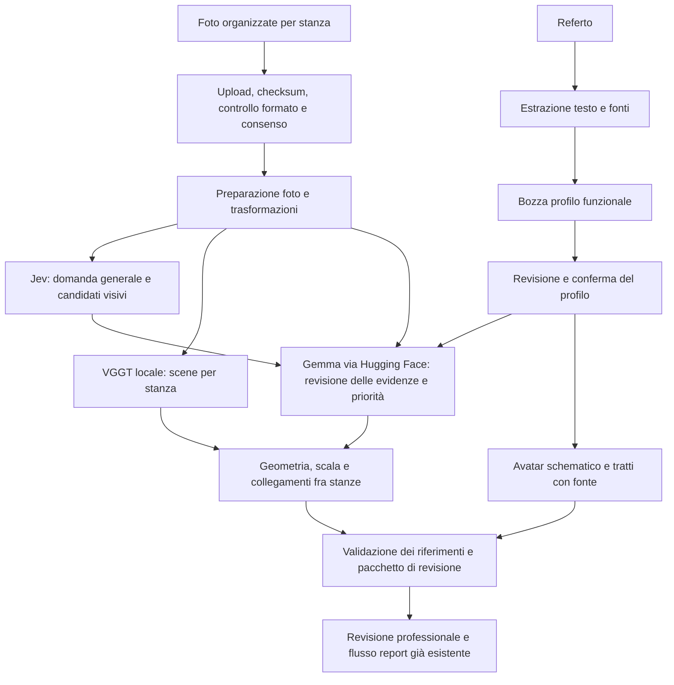

# Piano unico per il backend di ricostruzione e revisione domestica

**Stato al 17 ottobre 2026:** implementazione backend locale completata per i contratti e i percorsi verificabili con gli input disponibili; accettazione live completa ancora aperta. Intake clinico con consenso separato, Jev a domanda generale, worker VGGT isolato, bundle API tipizzato con revisioni, collegamenti metrici tra stanze, calibrazione con holdout e wrapper MPFB2 sono implementati. I job ordinari riusano gli stadi invariati e conservano gli artefatti locali anche quando un ramo fallisce. La suite CPU/API passa 74 test; la prova API → CUDA → MPFB2 → bozza PDF già registrata passa con Jev/Gemma fixture, senza invii esterni né rilascio. Gemma via Hugging Face/DeepInfra ha superato gli smoke standalone già documentati; il benchmark 5090 copre 1/2/4/8/12/16/20 viste renderizzate. La prova con tutti i servizi live e una cattura reale da 12–20 viste restano necessarie prima di dichiarare soddisfatta l’accettazione finale. **Ambito:** backend locale per RTX 5090; Gemma tramite Hugging Face e Jev tramite il suo servizio. AMD e frontend sono fuori da questo ciclo.

Questo documento sostituisce, per il backend, il percorso AMD descritto nei documenti precedenti. Quei documenti restano utili come contesto storico e per i contratti già implementati. Le fasi descrivono l’implementazione in corso e le verifiche ancora necessarie.

### Avanzamento verificato

- Il completamento aggiunge riuso verificato tramite checksum nei job API, invalidazione selettiva dopo correzioni del profilo, artefatti locali autenticati dopo errori indipendenti, astensione dalle ancore non validate, composizione riproducibile dei link stanza e rifiuto dei cicli incoerenti. Le migrazioni SQLite sono atomiche; casi v2 e baseline v2 conservano stanze, fonti cliniche, collegamenti e GLB senza reinterpretare baseline v1.
- La suite attuale passa **74 test**, inclusi intake clinico → conferma → bundle → PDF con inferenza simulata, retry e corruzione della cache, isolamento tra valutazioni, errore di una stanza indipendente e smoke API fixture fino al rilascio simulato. Le regressioni successive alla revisione verificano scale diverse prima di rotazione/traslazione, link legacy e ricalibrazione, rimozione delle stanze vuote dal risultato corrente e corretta fase fallita anche quando gli altri rami proseguono.
- La verifica locale finale `97323ab3-2a61-4a3e-a721-cafc6d7e02a5` ha ricostruito la cucina sulla 5090, generato un avatar MPFB2 riggato da fatti fittizi confermati, scaricato manifest/NPZ/PLY/GLB autenticati e prodotto una bozza PDF non rilasciata. Jev/Gemma erano fixture: i quattro hazard non sono risultati reali. Evidenza in `data/live-tests/local-3d-completion/79ab2dda-8ea6-44d1-99e6-1c94409149ff/verification-final.json`; dettagli e limiti in `runtime.md`.
- VGGT ha ricostruito l’immagine cucina dell’utente sulla RTX 5090; il risultato è marcato `single_view_estimate`, con scala ignota e astensione dalle ancore 3D.
- La stessa immagine è passata anche dal case runner backend con il nuovo worker CUDA separato dall’API CPU. `prepare`, `reconstruct`, geometria finita, scala ignota e astensione single-view sono passati nel run `c8bcafa6-5248-44ee-8876-c1b8e8db4f01`; manifest e PLY sono nel percorso gitignored documentato in `runtime.md`.
- Un rilancio mirato del 17 ottobre sul PC ha passato gli stessi controlli via RTX 5090: run `07b39039-5758-4d5d-b017-2fbc80a0e0c9`, 7,107 s e 7,02 GiB di picco. È stata eseguita solo la ricostruzione; Gemma e Jev non sono stati chiamati. Il run è parziale per scelta e non prova una pipeline live end-to-end.
- Una prova integrata locale sulla foto cucina ha completato upload, sei stadi di analisi, bundle autenticato, VGGT sulla 5090 e GLB MPFB riggato. Jev/Gemma erano fixture; quattro hazard sintetici nel bundle non sono risultati di screening reali. Nessun servizio esterno è stato chiamato. Il job `3a5585e0-b45c-435f-8b4f-7b4e794f544a` e gli artefatti sono in `data/live-tests/backend-e2e-5090-mpfb/`.
- Jev usa la domanda generale approvata. Gemma può ora proporre categorie di pericolo aperte: se nessuna guida specifica corrisponde, l’azione resta vincolata alla revisione generica da parte del professionista.
- L’ingestione clinica, le citazioni verificabili, la bozza del profilo e la conferma del revisore sono implementate; i fatti clinici hanno consenso esterno separato.
- MPFB2/Blender è stato provato davvero: Blender 4.5.14 con MPFB2 2.0.18 e asset pack CC0 ha generato un GLB umanoide riggato con deambulatore e richiamo generico, senza citazioni cliniche nel GLB. L’asset è in `data/live-tests/avatar-mpfb-wrapper/assets/avatar.glb`; il render di controllo è `data/live-tests/avatar-mpfb-wrapper/avatar-preview.png`. L’avatar attuale è un’unica figura anziana fissa e illustrativa (caschetto grigio, giacca oliva, gonna verde, scarpe viola), con anteprima PNG trasparente e GLB di circa 3,2 MB; il deambulatore compare solo se confermato dal revisore. `GET /api/assessments/{id}/avatar` restituisce anteprima e GLB, e il componente web `AvatarViewer` mostra prima l’immagine e carica il 3D su richiesta. Non è una simulazione biomeccanica.
- Il 17 ottobre una prova HTTP sintetica con database isolato ha verificato upload clinico, conferma profilo, worker fixture, bundle, revisioni, bozza PDF, rilascio e link familiare. I test API con `TestClient` si bloccano nel sandbox ristretto prima delle richieste; fuori da esso hanno passato anche collegamenti stanza, calibrazione e migrazione.
- L’utente ha confermato la rotazione delle credenziali. Lo smoke reale con `google/gemma-4-31B-it:deepinfra`, immagine sintetica e JSON Schema strict è passato in 1,448 s. La bozza clinica fittizia ha estratto quattro fatti citati in 13,926 s, distinguendo storia e negazione. I tentativi integrati falliti per schema/timeout restano registrati; non vengono reinterpretati come successi.
- Il confronto standalone Novita, autorizzato esplicitamente per la cucina e il solo profilo fittizio, è passato al primo tentativo in 25,418 s: una proposta `rug`, con box sul tappetino ispezionata visivamente. La configurazione dell’app resta DeepInfra; il confronto non è una prova integrata né un rilascio. Audit e immagine evidenziata sono nel percorso riportato in `runtime.md`.
- La suite backend precedente passava 52 test, poi 69 e ora 74. I job HTTP fissano provider/modello/revisione/endpoint e scope alla creazione; un cambiamento richiede un nuovo tentativo prima di chiamare Gemma. Le fonti cliniche non possono aggirare la conferma tramite le rotte di intake generiche.
- Il benchmark VGGT su 1/2/4/8/12/16/20 viste renderizzate è passato senza OOM: a 20 viste il picco allocato è 9,68 GiB, riservato 13,64 GiB. Tempo di forward e caricamento del modello sono registrati separatamente in `runtime.md`. Le camere note del controllo sintetico verificano anche il pavimento; manca ancora la cattura reale richiesta per dichiarare ricostruita un’abitazione.

## Obiettivo e confini

Una valutazione riceve immagini caricate e raggruppate per stanza, un referto medico e, dove disponibili, misure o marker di calibrazione. Il backend restituisce un pacchetto verificabile con:

- ricostruzione tridimensionale delle stanze e, quando le acquisizioni le collegano, della casa;
- possibili pericoli per la sicurezza domestica, ciascuno legato alle foto e alle evidenze che lo supportano;
- profilo funzionale strutturato e avatar tridimensionale schematico, derivati da informazioni cliniche confermate;
- incertezze e copertura dichiarate, così il revisore può correggere o rifiutare le proposte.

Il professionista mantiene la decisione su pericoli, interpretazione funzionale e rapporto. Un modello non diagnostica, non inventa misure e non rilascia da solo un referto. Si riusano autenticazione, coda, revisioni e rilascio già presenti nell’app. In questo ciclo non si modifica il frontend.

## Decisioni e vincoli fissati

| Tema | Decisione |
|---|---|
| GPU di sviluppo | NVIDIA RTX 5090 Laptop, 24 GB VRAM; orchestrazione backend e ricostruzione sul PC locale |
| Ricostruzione | VGGT-1B locale nell’ambiente isolato già preparato; riusare checkpoint e risultati esistenti, senza reinstallare o riscaricare |
| Gemma | Gemma 4 31B Instruct tramite API OpenAI-compatible di Hugging Face, con `HF_TOKEN` già nel `.env`; il token resta solo lato server |
| Jev | Servizio esterno già integrato; usare la domanda generale approvata, senza suggerire in anticipo oggetti specifici |
| Input clinico | Referto come fonte di informazioni. Il profilo derivato resta una bozza fino alla conferma del revisore |
| Avatar | MPFB2 dentro Blender isolato; GLB umanoide riggato generato e ispezionato sul runtime locale, con soli tratti funzionali confermati |
| Unità | VGGT produce coordinate relative. Le dimensioni in metri sono dichiarate solo con calibrazione validata |
| Più stanze | Le foto raggruppate per stanza danno scene distinte. Un modello unico della casa richiede acquisizioni di collegamento; in loro assenza il risultato è una casa parziale con stanze non allineate dichiarate |
| Qualità | Evidenza fotografica resta utile se geometria, scala o allineamento non sono affidabili; il backend si astiene invece di fabbricare un risultato |
| Fuori ambito | AMD/ROCm, vLLM locale, interfaccia web, video, Gaussian Splatting e distribuzione pubblica |

## Stato già verificato

- La foto della cucina fornita dall’utente è stata ricostruita una volta con VGGT sulla RTX 5090 Laptop. La misura registrata è 13,789 s con caricamento del modello e 7,02 GiB di picco GPU; sono stati esportati nuvola colorata e superficie derivata. È una prova a singola immagine, non dimostra coerenza multivista, scala metrica o ricostruzione della casa.
- Jev è stato chiamato separatamente sulla stessa foto. La prova generale ha restituito un candidato di rischio inciampo centrato sul tappetino. È uno screening, non un inventario esaustivo né una pipeline end-to-end.
- La domanda approvata è già salvata in [`jev-general.txt`](../backend/src/step_wise/prompts/jev-general.txt). Il prompt esatto va caricato da quel file e incluso nel fingerprint della fase.
- L’ambiente GPU isolato e il checkpoint VGGT sono già in `model-cache/`; il codice GPU non deve modificare l’ambiente CPU dell’app. Il checkpoint VGGT usato nella prova è distribuito con licenza di ricerca non commerciale: verificarne la compatibilità con l’uso previsto prima di distribuire il beta.
- Il token Hugging Face aggiornato è configurato localmente. Lo smoke autenticato immagine/JSON Schema e l’estrazione clinica fittizia sono passati su DeepInfra; il confronto visivo singolo è passato su Novita con autorizzazione separata. La revisione dei pesi effettivamente serviti non è esposta dai provider. Resta da completare il percorso integrato con il provider configurato.
- **Libreria avatar scelta e verificata: MPFB2 dentro Blender.** La prova reale usa Blender 4.5.14, MPFB2 2.0.18 e asset pack CC0 fissato tramite SHA256. Il GLB è riggato, importabile, contiene mesh e walker, e non incorpora testo clinico. Figura, deambulatore e callout sono schematici; il walker è un oggetto statico accanto alla figura. MPFB2 è GPLv3: verificare gli obblighi di distribuzione prima di pubblicare il backend e ricontrollare le licenze di ogni asset aggiuntivo.
- Il backend registra il profilo clinico e i callout nel JSON privato; la GLB non riceve citazioni. L’esempio generato è utile per verificare il flusso e l’importazione, ma non è ancora una resa visiva di qualità prodotto.
- API, modelli, coda, runner di casi e renderer dei report esistono già in versione CPU. Il runtime e i risultati storici restano descritti in [`runtime.md`](runtime.md); non sono prove della nuova pipeline integrata.

## Flusso dati previsto

La geometria e le valutazioni visive sono rami distinti: Jev e VGGT possono lavorare sulle stesse immagini preparate. Gemma valuta le evidenze senza dover attendere box 3D. In seguito la geometria può collegare alle scene solo le proposte validate che hanno una foto e una regione attendibili. Un errore in VGGT non cancella la valutazione fotografica; un errore del servizio linguistico non produce un profilo confermato.

## Contratto del pacchetto di uscita

Un `AssessmentBundle` versionato deve riferire per ogni stanza foto sorgente, checksum, scena, stato di ricostruzione, unità, stato di allineamento e avvisi. Una scena può essere `ready`, `partial` o `unknown`. La ricostruzione della casa elenca componenti collegate e stanze non registrate; non colloca arbitrariamente stanze indipendenti.

Ogni `HazardFinding` conserva almeno categoria aperta, osservazione, rilevanza per i bisogni confermati, livello di incertezza, produttore della proposta, foto sorgente, box 2D originale, evidenza testuale, guida applicata e stato di revisione. L’ancora 3D e l’eventuale box 3D sono facoltative, con sistema di coordinate, stanza, metodo e incertezza. Una misura porta unità e riferimento di calibrazione; quando la scala non è valida, il valore resta assente.

`FunctionalProfile` distingue fatti confermati, elementi da verificare, storia clinica, lato del corpo e valori ignoti. Conserva l’identificativo e la pagina o citazione di origine per ogni tratto. `AvatarArtifact` fornisce la stessa mappatura funzionale in JSON e un GLB generato con MPFB2: figura umanoide riggata, accessori documentati e marcatori visivi collegati alle informazioni confermate. Il profilo può impostare soltanto i parametri MPFB inclusi in una lista consentita e confermati dal revisore. L’aspetto “anziano” è un morph generico e dichiaratamente illustrativo, non una stima clinica dell’età o delle capacità.

La storia o presenza di una frattura all’anca non modifica mesh, andatura o postura: si rappresenta con un indicatore discreto sul distretto e un riferimento alla fonte, distinguendo attuale/storica/da verificare. Un deambulatore confermato viene aggiunto come accessorio geometrico statico accanto alla figura. Altezza, corporatura, genere e lato restano neutri o ignoti se il referto e il reviewer non li confermano. Il GLB non contiene il referto o diagnosi testuali; i dettagli clinici restano nell’asset JSON privato.

Il JSON resta l’interfaccia principale fra backend e revisore. Il GLB è un artefatto ausiliario statico, non una simulazione biomeccanica né un modello clinico. Foto e citazioni del referto restano accessibili al revisore tramite ID e permessi esistenti; non vengono copiate nell’avatar.

## Piano d’implementazione integrata

### Fase 1 — Contratti, consenso e preflight runtime

**Percorsi:** `backend/src/step_wise/models.py`, `config.py`, `pipeline/gemma.py`, `pipeline/http.py`, `.env.example`, `docs/runtime.md`.

1. Formalizzare i DTO del pacchetto, profilo clinico derivato, collegamento stanza e stato di registrazione, preservando i campi dei record precedenti. I link stanza usano trasformazioni rigide confermate dal revisore **dopo** la conversione delle coordinate grezze di ciascuna stanza in metri tramite calibrazione validata. Il contratto richiede `coordinate_space: metric_scene_coordinates` e `residual_unit: m`. I `placements` includono già la scala della singola stanza prima della composizione e dichiarano unità e riferimento; il bundle conserva scene separate e non sposta i PLY. Senza scala validata le stanze non vengono allineate. I vecchi link relativi restano leggibili ma richiedono riconferma metrica; cambiare o rimuovere una calibrazione rende il link non applicabile fino a nuova revisione.
2. Aggiungere configurazione per Hugging Face (`HF_TOKEN`, endpoint, modello, provider atteso), limiti di immagini per stanza e valutazione, timeout e modalità GPU. Leggere `.env` con la configurazione già presente; non stampare né serializzare i segreti.
3. Verificare una chiamata Gemma minima tramite Hugging Face: autenticazione, messaggio testuale e immagine non sensibile, schema JSON, nome del modello ritornato e telemetria redatta. Scegliere un provider esplicito che superi questa prova; il solo stato `live` nei metadati non è un test di inferenza. Non fare retry automatici verso un provider diverso.
4. Registrare separatamente revisione del modello Hub e revisione dichiarata dal provider. Se il provider non la espone, registrarla come non disponibile; non fingere che il pin del repository identifichi il peso effettivamente servito.
5. Fissare provider, modello, revisione richiesta e hash dell’endpoint nel job e nei fingerprint Gemma/report. Respingerne il cambiamento prima della chiamata; i job HTTP precedenti senza identità richiedono un nuovo tentativo. Mantenere le fasi locali indipendenti da questa identità.

**Accettazione:** prova minima autentica riuscita, nessun dato personale usato e nessun segreto in log/audit. Se fallisce, l’integrazione si ferma con errore esplicito e i risultati locali già presenti restano intatti.

### Fase 2 — Intake per stanze e referto

**Percorsi:** `api.py`, `models.py`, `schema.sql`, `db.py`, nuovo `pipeline/clinical.py`, `photos.py`, `.env.example`.

1. Estendere l’intake per creare stanze nominate, associare foto e registrare stanze collegate o viste di passaggio. Mantenere checksum, ownership, revisioni, tetti di dimensione e cancellazione esistenti. Applicare un limite totale alla valutazione oltre al limite per stanza.
2. Accettare PDF testuali e testo semplice del referto. Estrarre localmente testo con numero di pagina e controlli di dimensione. Riconoscere il PDF scansionato come non leggibile e richiedere una versione testuale o un OCR locale esplicitamente configurato; non proseguire con un profilo vuoto senza dirlo.
3. Salvare il documento in area protetta con politiche di accesso, retention e cancellazione coerenti con le foto. Non mettere il testo clinico nei log, prompt di Jev, manifest pubblici o output diagnostici.
4. Separare i consensi per invio delle foto a Jev e per invio a Hugging Face di estratti clinici minimizzati, profilo e immagini necessarie a Gemma. Il consenso clinico vale anche per profili inseriti manualmente. Nuove foto/referti invalidano il consenso corrispondente; la conferma di nuovi fatti richiede un nuovo consenso prima dell’invio. Senza consenso esterno il profilo può essere confermato localmente e le funzioni Gemma segnalano il prerequisito.
5. Usare Gemma via Hugging Face per trasformare solo gli estratti clinici pertinenti in una bozza a schema fisso: mobilità, ausili, limitazioni esplicite, area/lato se dichiarati, esigenze visive e percorsi quotidiani. Per ogni campo richiedere pagina e citazione testuale; validare la citazione contro il testo estratto localmente e scartare i campi senza fonte. Distinguere attuale, storico, negato e sconosciuto, e trattare le istruzioni contenute nel referto come testo non attendibile. Il reviewer conferma o corregge la bozza prima che sia usata per personalizzare rischi o avatar.
6. Introdurre migrazione SQLite versione successiva per stanza, documenti clinici, consensi e provenienza dei campi, mantenendo valutazioni e report rilasciati leggibili.

**Accettazione:** un referto fittizio testuale produce una bozza tracciabile; un caso storico e uno negato non diventano condizioni attive; un PDF scansionato senza OCR si ferma con spiegazione; i permessi impediscono accesso incrociato ai documenti.

### Fase 3 — Screening generale e revisione con Gemma

**Percorsi:** `pipeline/jev.py`, `prompts/jev-general.txt`, `pipeline/gemma.py`, `prompts/assessment.txt`, `validation.py`, `worker.py`, `cases.py`.

1. Collegare Jev alla domanda generale già approvata, senza checklist che presupponga tappeti, cavi o categorie predefinite. Registrare hash e versione del testo usato.
2. Conservare presenza, tipo di rischio proposto, box, copertura, score, foto e risposta grezza redatta nei limiti già previsti. Trattare risposte basse, parziali o sconosciute come incerte; non trasformarle in assenza di pericolo.
3. Interpretare Jev come generatore di candidati, non rilevatore esaustivo. Eseguire una revisione delle immagini con Gemma a gruppi limitati, domanda generale e profilo confermato. Gemma propone osservazione, priorità, evidenza e riferimenti a profilo/guida; il backend costruisce azione e rilevanza dai riferimenti validati. Lo schema del modello esclude ancore, misure, azioni e stati di revisione.
4. Validare schema e riferimenti lato backend: ogni proposta deve riferirsi a foto esistenti, box entro limiti e una guida nota. Gemma riceve il contratto esplicito `box_yxyx_1000`, convertito lato server da coordinate normalizzate `[ymin,xmin,ymax,xmax]` a pixel canonici `[xmin,ymin,xmax,ymax]` tramite le trasformazioni registrate. Conservare l’identità del produttore e non fondere candidati distinti solo perché le categorie testuali differiscono.
5. Aggiornare il grafo dei task: preparazione precede i rami visuali; Jev e VGGT sono indipendenti; Gemma dipende da immagini e profilo confermato; geometria dipende dalle proposte validate e dalla ricostruzione. Aggiornare fingerprint, riuso e recupero dei job. Sostituire gli accessi posizionali `STAGES[:5]` con selezione basata sulle dipendenze dichiarate.
6. Correggere la modalità `live` del runner perché ammetta la prova singola e il percorso NVIDIA locale, mantenendo i fixture esclusi dai run live. Seed e casi devono registrare consenso esplicito per i servizi esterni.

**Accettazione:** sulle stesse immagini, la domanda a Jev non contiene nomi di oggetti. Un hazard nuovo ma visibile può emergere in Gemma; un risultato non supportato conserva l’evidenza o si astiene. La modifica del profilo ricalcola i task dipendenti senza ripetere VGGT o Jev se i loro input non sono cambiati.

### Fase 4 — Ricostruzione GPU e casa connessa

**Percorsi:** `pipeline/reconstruction.py`, `config.py`, `worker.py`, `cases.py`, `scripts/render_vggt_image.py`, nuovi test in `tests/`.

1. Integrare il renderer VGGT esistente come backend CUDA del worker, riusando `model-cache/vggt-env` e il checkpoint verificato. Non reinstallare dipendenze nel virtualenv CPU.
2. Distinguere prova `single_view_estimate` da ricostruzione multivista. La prima foto serve per il test di flusso e la vista 3D stimata, ma produce scala sconosciuta e posizioni di pericolo stimate, non ancore validate. Almeno due viste sovrapposte coerenti servono per l’ancora multivista.
3. Misurare memoria e tempo con 1, 2, 4, 8 e poi più foto, sia a freddo sia a modello caricato. Fissare dopo le misure un tetto configurabile per stanza e per job; l’osservazione a singola immagine non autorizza una promessa di 50 frame. Un OOM è un errore dichiarato della stanza, senza fallback su fixture, perdita di file o retry illimitati.
4. Produrre manifest per stanza con revisioni, hash, trasformazioni foto, frame, posa, profondità, confidenza e unità. Preservare separatamente gli artefatti originali e la trasformazione di visualizzazione.
5. Stabilire con dati di cattura come si collegano le stanze: sequenza di foto con sovrapposizione attraverso porte/corridoi, viste condivise o vincoli misurati. Solo nomi di stanza e ArUco comuni fissano al massimo una scala; non determinano posizione e orientamento relativi. Registrare le trasformazioni tra stanze con metodo, residuo e incertezza.
6. Costruire un grafo di connettività. Allineare soltanto componenti con evidenza sufficiente e scale validate; per stanze non connesse restituire scene separate e casa `partial`. Una scena locale valida deve sopravvivere al fallimento di un’altra stanza. Le stanze senza foto attive restano nello storico, non nel grafo, bundle o contesto corrente del worker; modificare le foto invalida soltanto la geometria e i link incidenti alla stanza interessata.
7. Aggiornare `cases.py` e manifest versionati per `single_image_experiment` e `multi_room_capture`, controlli di allineamento, ripetibilità e confronto. Non reinterpretare i baseline v1 senza migrazione esplicita.

**Accettazione:** la foto cucina già disponibile passa nel vero runner e genera output VGGT locale con `single_view_estimate`. Una cattura sintetica con trasformazioni note verifica la registrazione; senza viste ponte la casa segnala stanze separate. Una cattura reale attraversante è necessaria prima di dichiarare ricostruita una casa connessa.

### Fase 5 — Geometria affidabile e collegamento delle proposte

**Percorsi:** `pipeline/geometry.py`, `pipeline/calibration.py`, `models.py`, `api.py`, `validation.py`, `cases.py`.

1. Stimare il pavimento solo su scene multivista, cercando supporto, posizione rispetto alle camere, orientamento coerente e copertura spaziale; non assumere che il piano dominante sia il pavimento. Tavoli, banconi, pareti e scale possono dominarlo. Senza accordo fra viste o prove sufficienti, pavimento e gravità restano `unknown`.
2. Esporre nel bundle `floor_state`, `gravity_state`, normale, offset, residuo e supporto in unità relative. Tenere distinta la trasformazione di visualizzazione dall’orientamento stimato: non ruotare automaticamente la scena. Test sintetici coprono pavimento noto con parete/tavolo dominanti, normale invertita, solo parete, piano inclinato e nuvola senza piano; i casi ambigui producono `unknown`.
3. La rotta `PUT /api/assessments/{id}/scenes/{scene_id}/calibration` accetta segmenti 3D in coordinate grezze, misure reali in metri, due o più segmenti di fit e almeno un holdout indipendente, tutti legati a foto VGGT attive. Usa la mediana dei rapporti metri/unità, respinge segmenti di fit discordanti oltre il 15% e richiede al holdout di restare entro la tolleranza dichiarata (5% di default, massimo 10%). Funziona solo su una scena live multivista. Un eventuale marker ArUco potrà alimentare gli stessi controlli dopo che corner, posa, distorsione e incertezza saranno verificati; non si stima la profondità dalla superficie piatta del marker.
4. Associare i candidati alle coordinate VGGT dalla box 2D e ai pixel originali tramite trasformazioni registrate. Un’ancora richiede separazione dal piano del contorno, box coerente nella seconda foto, profondità concorde e camere con una baseline distinta. Un tappeto sottile o un cavo che condivide la superficie di supporto resta senza ancora; due viste duplicate non validano la profondità. Fusione e box 3D richiedono coerenza su più viste.
5. Se la geometria del candidato è degenerata, mantenere il hazard con prova fotografica e senza box 3D. La geometria non è prerequisito per rivedere il rischio. Le categorie non localizzabili (per esempio oggetti mancanti) non ricevono box inventate.
6. Estendere il validatore per consentire metodi `single_view_estimate`, `foreground_multiview`, revisione manuale e astensione, imponendo la prova compatibile col metodo. Verificare riferimenti a foto, scena, misure, calibrazioni e trasformazioni casa; non passare mappe vuote dove la validazione si aspetta misure.

**Accettazione:** test sintetici verificano fit, holdout corretto e holdout respinto; la calibrazione può essere rimossa e torna a `unknown`. La prova sintetica del pavimento identifica il piano di supporto anche con una parete e un tavolo più estesi, mentre parete sola, piano inclinato e nuvola casuale restano `unknown`; l’orientamento della visualizzazione non viene modificato. Piani ambigui, scala non calibrata e viste singole restano esplicitamente non metrici o non localizzati. Ogni punto 3D proposto può essere ricondotto alla sua box in foto. Mancano ancora una cattura reale e una UI di selezione dei punti; il backend accetta il contratto, ma il frontend resta fuori ambito.

### Fase 6 — Profilo funzionale e avatar

**Percorsi:** nuovo `pipeline/avatar.py`, nuovo `pipeline/avatar_blender.py`, `models.py`, `validation.py`, `api.py`, nuovo `tests/test_avatar.py`.

1. Costruire `FunctionalProfile` solo da campi confermati, lasciando visibili fonti, stato e informazioni sconosciute. Storia clinica e condizione attuale restano distinte.
2. Blender 4.5.14 e MPFB2 2.0.18 sono installati nel profilo isolato e fissati in configurazione; il wrapper esegue Blender headless con timeout, ambiente ripulito e directory temporanea dedicata.
3. Creare l’umanoide tramite l’API `HumanService` di MPFB2. Mappare in parametri soltanto i campi ammessi e confermati; il profilo “older adult” può attivare il morph d’età generico soltanto dopo conferma. Non trasformare una lesione in deformazione, posa o andatura.
4. Creare nella stessa scena il deambulatore come mesh semplice quando l’ausilio è confermato e gli indicatori anatomici come oggetti/callout non clinici. Tenere le citazioni e lo stato dei fatti nel JSON privato; il GLB include solo ID generici per collegare il callout, mai il testo del referto.
5. L’esportatore glTF 2.0 incluso in Blender produce un GLB statico riggato. Il test reale controlla rig, mesh, walker, callout generico e assenza di testo clinico. Non esportare animazioni, simulazione biomeccanica o somiglianza facciale. I callout restano generici finché non esiste un lato anatomico esplicitamente verificato. MPFB2 è sotto GPLv3 e gli asset centrali usati sono CC0; verificare gli obblighi sul codice e le licenze di ogni asset aggiunto prima della distribuzione.
6. Conservare JSON/GLB con checksum, hash profilo confermato, versione del generatore e provenienza. Una correzione del profilo invalida solo l’avatar derivato. Servire gli asset tramite API autenticata e ownership/revision guard esistenti.

**Accettazione:** un referto fittizio confermato con deambulatore produce una figura MPFB2, il walker e un callout collegabile al JSON. Una frattura storica non cambia il corpo; lato, sesso, altezza e corporatura non documentati non influenzano il morph. Il GLB si apre senza Blender ed è privo di testo clinico; il JSON conserva le fonti. La pipeline fallisce chiaramente se Blender/MPFB non è installato o va in timeout.

### Fase 7 — Pacchetto API, report e prova completa

**Percorsi:** `api.py`, `db.py`, `schema.sql`, `pipeline/reports.py`, `validation.py`, `cases.py`, `tests/test_workflow.py`, `tests/test_cases.py`, `docs/runtime.md`.

1. Esportare un pacchetto JSON versionato con stanze, scene, link, pericoli, fonti, stato scala, avatar e avvisi. Gli artefatti pesanti restano asset autenticati scaricabili, non embedded in SQLite.
2. Mantenere le rotte e i campi legacy funzionanti. Aggiungere rotte backend per documenti clinici, composizione delle stanze, link e artefatti solo dove l’API esistente non offre già un equivalente.
3. Collegare review e report esistenti al profilo confermato e agli hazard con provenienza. Il rilascio continua a richiedere revisore, revisioni aggiornate e validazione; il modello non può approvare il proprio output.
4. Eseguire il caso della cucina con domanda generale, referto sintetico fittizio e consenso fittizio valido: intake, preprocessing, inferenza locale VGGT, Jev, Gemma, package hazard, avatar, revisione tramite API e report draft. Non usare un vero referto per lo smoke test.
5. Eseguire un caso multivista sintetico per la geometria e un caso con stanze scollegate per casa parziale. Non chiamare “baseline reale” un controllo sintetico o un output non ispezionato.
6. Aggiornare `runtime.md` con hardware, hash e provider effettivamente osservati, tempi, memoria, limiti, errori e licenze. Separare chiaramente test simulati, esperimenti standalone e pipeline integrata.

**Accettazione finale:** un input immagine singola più referto di prova percorre l’API reale fino a scene stimata, pericoli con evidenza, avatar verificabile e bozza di revisione. Una dichiarazione di casa ricostruita richiede anche un test di acquisizione collegata. Nessuna misura metrica compare senza calibrazione validata; il report non è rilasciabile senza revisione.

## Matrice di verifica prevista

Questa matrice distingue le verifiche ancora aperte dalle prove già registrate nella sezione “Avanzamento verificato” e in `runtime.md`.

| Area | Verifica | Esito richiesto |
|---|---|---|
| Regressione | Suite corrente in `tests/`, runner casi, API e rilascio | Tutti i test esistenti passano; record v1 e PDF rilasciati restano leggibili |
| GPU | Pipeline CUDA sulla 5090, foto 1/2/4/8 e casi memoria | Device verificato, tempi e picchi registrati, OOM esplicito, nessun fallback CPU/fixture |
| Gemma | Trasporto simulato per auth/schema/log, poi smoke reale non clinico | Header corretto, output validato, segreto redatto, nessun retry/provider nascosto |
| Jev | Prompt generale, nessun candidato, box marginale, risposta incerta | Testo esatto dal prompt file; supporto e astensione preservati |
| Clinico | PDF testuale, scansione, storia/attuale, negazione, lato ignoto, testo ostile | Citazioni tracciate; nessuna istruzione nel referto eseguita; nessuna inferenza silenziosa |
| Privacy | Consenso per destinazione, ownership, access log, cancellazione | Nessun referto a Jev; niente segreti o contenuti clinici in log; cancellazione coerente |
| Geometria | Piani pavimento/parete/tavolo, scala e misure note, cavo e tappeto | Errori misurati su holdout; ambiguità produce astensione |
| Casa | Registrazione sintetica nota, grafo senza ponte, ponte errato | Trasformazioni riproducibili; componente non supportata resta non allineata |
| Avatar | Ausilio confermato, lesione pregressa, tratto ignoto, profilo corretto | GLB coerente col JSON e con sole fonti confermate |
| E2E | Cucina fornita più profilo/referto fittizio via API/worker | Hazard legato alla foto, stato 3D onesto, avatar e revisione disponibili |

Prima di esaminare output Jev/Gemma, congelare etichette del caso e checksum delle immagini. La foto cucina è un esempio di flusso, non una valutazione di sensibilità/accuratezza. I risultati singoli non danno stime cliniche né garanzie di riduzione cadute.

### Chiusura dell’implementazione e gate esterni

Il codice delle sette fasi è presente e coperto dai controlli sopra. Restano verifiche di accettazione, non risultati da sostituire con fixture:

1. Eseguire il workflow completo con il provider HF fissato e Jev live. `scripts/smoke_e2e.py --mode live --case /percorso/assoluto/case.json --allow-external` richiede entrambi i consensi espliciti nel caso congelato e un’API configurata con VGGT, Gemma HTTP, Jev live e MPFB2. Usa esclusivamente un referto fittizio incorporato, distingue storia/negazione e termina alla bozza, mai al rilascio. Un fallback deterministico del report non conta come successo live.
2. Fornire e verificare una cattura reale con viste sovrapposte fra stanze e misure indipendenti. Il formato manifest v2 dichiara `rooms` con ID/label e `scene_id` per foto; v1 resta leggibile senza migrazione implicita.
3. Chiudere compatibilità delle licenze e verifiche di distribuzione prima di pubblicare il beta. Nessuna di queste prove autorizza affermazioni di accuratezza clinica o ricostruzione metrica senza calibrazione.

## Dipendenze e decisioni aperte, con regola di default

| Punto da verificare quando inizia l’implementazione | Decisione di default |
|---|---|
| Credito, provider e formato JSON Schema Gemma via HF Router | Smoke text+image non personale; fissare il provider che supera la prova; nessun fallback silenzioso |
| Capacità GPU su sequenze di foto e più stanze | Benchmark progressivo sul PC e tetto configurabile misurato; iniziare con una stanza |
| OCR di referti scansionati | Prima versione accetta testo/PDF testuale; errore chiaro per scansioni finché OCR locale non è stato verificato |
| Allineamento dell’intera abitazione | Accettare viste ponte o acquisizione continua tra stanze; restituire componenti separate se mancano |
| Condizioni corporee dettagliate nell’avatar | Rappresentare solo funzione/ausili documentati, con stato e fonte; nessun tratto anatomico inferito |
| Compatibilità licenza VGGT con destinazione del beta | Distribuzione bloccata finché la licenza/checkpoint scelto non è compatibile; il prototipo locale può essere verificato nei limiti della licenza |

Non serve una scelta aggiuntiva dell’utente per questi default; si correggono soltanto se i test o i requisiti reali li smentiscono.

## Rischi e recupero

- **Gemma non disponibile o schema non supportato:** test con una richiesta piccola, registrazione redatta e arresto chiaro; output visivi locali restano disponibili.
- **VRAM o geometria insufficienti:** conservare input e scene delle stanze riuscite, marcare la stanza fallita e ridurre batch/numero foto solo tramite una scelta esplicita registrata.
- **Rischio clinico dedotto troppo liberamente:** bloccare il campo privo di fonte, invalidare la bozza profilo e chiedere correzione del revisore.
- **Generazione avatar richiede un processo pesante o cambia licenza:** isolare e fissare Blender/MPFB2, avviare solo quando il profilo viene confermato, conservare JSON e precedente GLB e verificare gli obblighi GPL prima della distribuzione.
- **Stanze disallineate:** conservare i modelli locali e dichiarare componenti separate invece di salvarle come casa unificata.
- **Modello o checkpoint cambia:** invalidare per fingerprint solo gli output che ne dipendono; conservare gli output precedenti e poter tornare alla revisione di configurazione registrata.
- **Schema SQLite/API evolve:** backup, migrazione incrementale con verifica di rollback, nessuna riscrittura di valutazioni rilasciate.

## Riferimenti tecnici

- [Documentazione ufficiale Hugging Face Inference Providers: Chat Completion](https://huggingface.co/docs/inference-providers/tasks/chat-completion)
- [Documentazione ufficiale Hugging Face: output strutturati e JSON Schema](https://huggingface.co/docs/inference-providers/guides/structured-output)
- [Google: comprensione immagini Gemma e box normalizzate yxyx](https://ai.google.dev/gemma/docs/capabilities/vision/image)
- [Scheda ufficiale Gemma 4 31B IT](https://huggingface.co/google/gemma-4-31B-it)
- [MPFB2 — generatore umanoide per Blender](https://github.com/makehumancommunity/mpfb2/), [esempi API Python e rig](https://github.com/makehumancommunity/mpfb2/blob/master/script_samples/index.md), [parametri età e corporatura](https://github.com/makehumancommunity/mpfb2/blob/master/docs/ui/model/model.md), [licenze codice e asset](https://github.com/makehumancommunity/mpfb2/blob/master/LICENSE.md)
- [Manuale Blender 4.2: esecuzione da riga di comando e script](https://docs.blender.org/manual/en/4.0/advanced/command_line/arguments.html) e [esportazione glTF/GLB](https://docs.blender.org/manual/en/5.1/addons/import_export/scene_gltf2.html)
- [VGGT, paper](https://arxiv.org/abs/2503.11651) e implementazione locale già fissata nel runtime
- Stato, checkpoint, misure e artifact osservati nel repo: [`runtime.md`](runtime.md#local-single-image-vggt-experiment)
